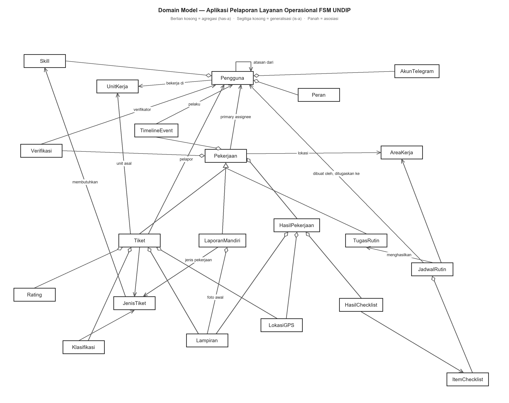

# Domain Model Awal

**Tahap ICONIX:** Requirements (Subbab 3.2.2, aktivitas 3). Belum melalui Milestone 1: Requirements Review.
**Sumber:** kata benda pada teks use case [`docs/requirements/use-case-inti.md`](../requirements/use-case-inti.md) (draf 2).
**Diagram:** [`domain-model.puml`](domain-model.puml) (sumber PlantUML), [`domain-model.png`](domain-model.png) (hasil render).

> **Catatan asal-usul:** draf ini disusun dengan bantuan asisten AI (Claude Code) berdasarkan teks use case yang ditulis peneliti, lalu ditinjau dan diputuskan peneliti pada 15 Nov 2026 (lihat bagian Keputusan Tinjauan). Bantuan ini dicatat sesuai Subbab 3.2.8.1.

Domain model ini mengikuti pedoman domain modeling Rosenberg & Stephens (2007, Bab 2):

| Pedoman | Rujukan |
|---|---|
| Hanya nama kelas, tanpa atribut dan operasi | Figure 2-2, hlm. 27 |
| Utamakan agregasi (*has-a*) dan generalisasi (*is-a*); asosiasi biasa boleh dipakai | Pedoman no. 9, hlm. 27–28 |
| Tanpa multiplisitas, karena terlalu dini pada domain model awal | Exercise 2-1 Solution, hlm. 41 |
| Tanpa kelas abstrak, karena itu detail desain | Exercise 2-3 Solution, hlm. 43 |
| Sistem luar dimodelkan sebagai aktor, bukan kelas | hlm. 35 |
| Tanpa kelas layar (GUI) dan kelas desain | Pedoman no. 1, hlm. 29 |

Atribut, operasi, dan multiplisitas ditambahkan pada tahap robustness analysis dan detailed design ketika domain model berkembang menjadi class diagram. Sistem luar (n8n, OpenRouter, Telegram) tidak dimasukkan karena bukan bagian domain aplikasi.

## Glosarium

### Organisasi dan Pengguna

| Kelas | Arti | Use case |
|---|---|---|
| Pengguna | Orang yang memakai aplikasi: dosen, mahasiswa, staf, petugas, atau atasan. Memiliki relasi atasan–bawahan dengan pengguna lain. | Semua |
| Peran | Peran pengguna di aplikasi: pelapor, petugas, atasan, serta penanda atasan yang ditunjuk sebagai pengklasifikasi tiket (K-13). | Semua, UC-54 |
| UnitKerja | Unit organisasi pengguna. Dipakai sebagai unit asal tiket. | UC-01 |
| Skill | Keahlian petugas, misalnya kebersihan, keamanan, listrik, atau jaringan. Menentukan antrean tiket dan pilihan jenis pekerjaan pada laporan mandiri. | UC-09, UC-16 |
| AkunTelegram | Akun Telegram yang ditautkan ke pengguna agar bot dapat mengenali pengguna (K-11). | UC-01, UC-09, UC-15, UC-16, UC-18 |

### Pekerjaan (bagian bersama)

| Kelas | Arti | Use case |
|---|---|---|
| Pekerjaan | Kelas umum untuk semua pekerjaan yang dikerjakan petugas dan diverifikasi. Memiliki status, primary assignee, hasil, verifikasi, dan timeline. | — |
| Tiket | Permintaan layanan ad-hoc dari pelapor. | UC-01, PS-01, UC-54, UC-09, UC-15, UC-05 |
| LaporanMandiri | Pekerjaan yang dilaporkan dan dikerjakan sendiri oleh petugas. Jenis pekerjaannya adalah jenis tiket yang membutuhkan skill petugas tersebut. | UC-16, UC-29 |
| TugasRutin | Tugas yang dibuat otomatis dari jadwal rutin untuk satu petugas pada satu waktu. Dapat bertanda Overdue. | PS-02, UC-18, PS-03, UC-30 |
| HasilPekerjaan | Satu kali penyelesaian atau pengajuan (*completion attempt*): catatan, foto, lokasi, dan centang checklist. Hasil lama tidak ditimpa saat Reopen. | UC-15, UC-16, UC-18 |
| Verifikasi | Keputusan terima atau tolak beserta alasan, verifikator, dan waktunya. Penolakan menghasilkan Reopen. | UC-05, UC-29, UC-30 |
| TimelineEvent | Catatan setiap perubahan status dan aksi penting beserta pelaku dan waktunya (audit). | Semua |
| Lampiran | Foto yang dilampirkan saat membuat Tiket, memulai Laporan Mandiri (foto awal, K-18), atau menyelesaikan pekerjaan. Satu foto JPG/PNG maksimal 5 MB per unggahan (BR-100). | UC-01, UC-15, UC-16, UC-18 |
| LokasiGPS | Titik lokasi yang direkam sekali pada saat aksi bukti, bukan pelacakan terus-menerus. | UC-01, UC-18 |

### Permintaan Layanan

| Kelas | Arti | Use case |
|---|---|---|
| JenisTiket | Kategori layanan yang sudah dikonfigurasi (data awal). Setiap jenis membutuhkan satu atau lebih skill. Dipakai untuk tiket dan sebagai jenis pekerjaan laporan mandiri. | PS-01, UC-54, UC-16 |
| Klasifikasi | Satu kali penentuan jenis tiket: sumber (AI atau manual), jenis tiket, confidence score, pelaku, dan hasilnya (berhasil atau gagal). Riwayatnya disimpan. | PS-01, UC-54 |
| Rating | Nilai 1–5 dan komentar opsional dari pelapor saat menerima hasil. Terkunci setelah Closed. | UC-05 |

### Tugas Rutin

| Kelas | Arti | Use case |
|---|---|---|
| JadwalRutin | Jadwal yang dibuat atasan: nama tugas, pola pengulangan, jam mulai, batas waktu, kebutuhan bukti, dan petugas yang ditugaskan. | UC-32 |
| AreaKerja | Area tempat tugas rutin dikerjakan, misalnya gedung atau lantai tertentu. Disiapkan sebagai data awal dan dipilih atasan saat membuat jadwal. | UC-32, UC-18 |
| ItemChecklist | Butir pekerjaan dalam jadwal rutin, bertanda wajib atau opsional. | UC-32, UC-18 |
| HasilChecklist | Status centang satu item checklist pada satu pengajuan tugas rutin. | UC-18, UC-30 |

## Keputusan Tinjauan Peneliti (15 Nov 2026)

| No | Hal | Keputusan | Dampak |
|---|---|---|---|
| 1 | Kelas umum untuk pekerjaan | `Tiket`, `LaporanMandiri`, dan `TugasRutin` adalah turunan `Pekerjaan`. Hasil, verifikasi, Reopen, dan timeline dirancang sekali. | — |
| 2 | Jenis pekerjaan laporan mandiri | Dipilih dari `JenisTiket` yang membutuhkan skill petugas, bukan langsung dari `Skill`. | Teks UC-16 langkah 2 dan 4, A1, AC-16-3, serta K-4 disesuaikan. |
| 3 | Area kerja | `AreaKerja` disiapkan sebagai data awal tersendiri. | Daftar data awal dan UC-32 langkah 2 disesuaikan. |
| 4 | Rating | `Rating` dipisahkan dari `Verifikasi` karena hanya berlaku untuk tiket. | — |
| 5 | Atasan yang ditunjuk (K-13) | Dimodelkan sebagai salah satu `Peran`. | — |
| 6 | Cara penggambaran | Mengikuti pedoman Rosenberg & Stephens (2007, Bab 2): tanpa multiplisitas, tanpa kelas abstrak, dan tanpa kotak paket. | `Pekerjaan` menjadi kelas biasa. |
