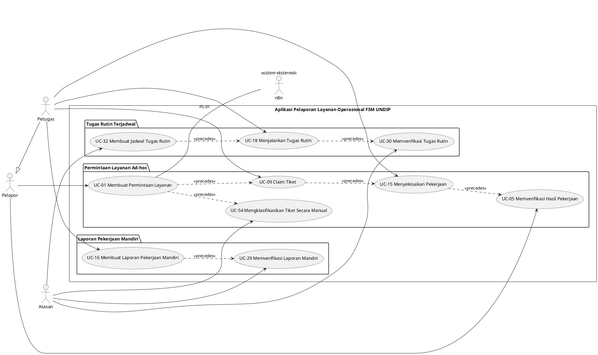

# Requirement dan Use Case Inti — Aplikasi Pelaporan Layanan Operasional FSM UNDIP

**Versi:** draf 3 (15 Nov 2026). Draf 1 dan draf 2 tersimpan di riwayat git file ini.
**Tahap ICONIX:** Requirements (Subbab 3.2.2). Belum melalui Milestone 1: Requirements Review.

**Sumber:**
- `Dokumen_Perencanaan_TA_FSM_UNDIP.md`: FR, NFR, BR, daftar 53 UC, narasi proses bisnis, dan AC FR-AI;
- `Keputusan_UseCase_Inti_4Nov2026.md`: 9 use case inti awal;
- naskah skripsi Subbab 1.5, Subbab 3.2, dan Subbab 3.2.1–3.2.9;
- keputusan peneliti atas K-1 sampai K-17 pada 15 Nov 2026 (Bagian 9);
- domain model [`docs/iconix/domain-model.md`](../iconix/domain-model.md);
- panduan metode [`docs/metode/panduan-eksperimen.md`](../metode/panduan-eksperimen.md).

> **Catatan asal-usul.** Draf 3 ditulis ulang oleh asisten AI (Claude Code) berdasarkan keputusan peneliti dan pedoman Rosenberg & Stephens (2007) serta Martinelli (2026). Perubahan terhadap draf sebelumnya dapat dilihat lewat riwayat git. Teks ini belum divalidasi Koordinator SI FSM atau dosen pembimbing.
>
> **Konvensi penulisan.**
> - Istilah berhuruf kapital (Tiket, Hasil Pekerjaan, Timeline Event, dan lainnya) adalah kelas pada domain model.
> - Nama halaman (Halaman Antrean Tiket, dan lainnya) adalah boundary.
> - Aktor ditulis Pelapor, Petugas, Atasan, dan n8n.

---

## 1. Batasan Sistem

- **Aplikasi:** PWA, dibangun dari awal. ICONIX hanya dipakai untuk aplikasi.
- **Proses bisnis:**
  - (A) permintaan layanan ad-hoc;
  - (B) laporan pekerjaan mandiri;
  - (C) tugas rutin terjadwal.
- **Cakupan:** 10 use case inti dan 3 proses sistem (Bagian 3).
- **Data awal (seed), bukan use case:**
  - Pengguna, Peran, Skill, Jenis Tiket, Unit Kerja, Area Kerja;
  - struktur atasan–bawahan;
  - Atasan yang ditunjuk sebagai pengklasifikasi Tiket (K-13).
- **Login:** sederhana, tidak dianalisis.
- **Tidak dibangun:**
  - pengelolaan data oleh admin, SLA, dashboard pimpinan, auto-assignment, dan auto-close;
  - form khusus per Jenis Tiket (K-9);
  - use case lain di luar cakupan.
- **n8n:** sistem eksternal. Alur kerjanya dikonfigurasi manual dan tidak dirancang dengan ICONIX. Di diagram ICONIX, n8n hanya muncul sebagai aktor sistem luar. n8n dipakai untuk:
  - klasifikasi Tiket melalui OpenRouter (PS-01);
  - bot Telegram sebagai jalur masuk kedua (Bagian 2.1);
  - notifikasi Telegram, serta pencatatan ke Google Spreadsheet dan Calendar.
- **Evaluasi:**
  - black-box testing pada basic course dan setiap alternate course;
  - ketiga proses sistem juga diuji;
  - akurasi klasifikasi AI tidak dievaluasi;
  - jalur Telegram diuji dari sisi aplikasi, melalui endpoint yang dipanggil n8n.

**Siklus status (tetap, tidak dikonfigurasi admin)**

Tiket:
```
Open → Assigned → In Progress → Menunggu Verifikasi → Closed
                       ▲                │
                       └── Reopen ◄─────┘ (ditolak Pelapor)
```

Laporan Mandiri:
```
In Progress → Menunggu Verifikasi → Closed
     ▲                │
     └── Reopen ◄─────┘ (ditolak Atasan, K-5)
```

Tugas Rutin:
```
Aktif → Menunggu Verifikasi → Closed
  ▲              │
  └── Reopen ◄───┘ (ditolak Atasan)
Overdue adalah tanda permanen, bukan status (BR-037).
```

Closed adalah status final (BR-017).

---

## 2. Aktor

Aktor selalu berada di luar sistem (Rosenberg & Stephens, 2007, Bab 3).

| Aktor | Keterangan | Use case |
|---|---|---|
| Pelapor | Semua pengguna aktif: dosen, mahasiswa, staf, termasuk Petugas (BR-001) | UC-01, UC-05 |
| Petugas | Staf layanan operasional yang memiliki Skill. Menjalankan use case lewat web atau bot Telegram. | UC-09, UC-15, UC-16, UC-18 |
| Atasan | Atasan langsung Petugas menurut struktur organisasi. Satu Atasan yang ditunjuk juga mengklasifikasikan Tiket (K-13). | UC-29, UC-30, UC-32, UC-54 |
| n8n | Sistem eksternal. (1) Menerima permintaan klasifikasi dan mengembalikan hasilnya (PS-01). (2) Meneruskan aksi dari bot Telegram ke endpoint aplikasi. | UC-01 (melalui PS-01), jalur Telegram |

### 2.1 Jalur Telegram

Pengguna dapat membuat laporan lewat web maupun Telegram. Petugas juga dapat mengerjakan Tiket dan mengisi checklist Tugas Rutin lewat Telegram. Bot Telegram diperlakukan sebagai **jalur masuk tambahan** (opsi b):

1. Bot dapat dipakai **semua pengguna aktif** (K-12). Menu yang tampil mengikuti Peran:
   - semua pengguna: Laporan, yaitu membuat permintaan layanan (UC-01);
   - Petugas: Laporan, ditambah Laporan Mandiri (UC-16), Tiket yang dapat diambil dan dikerjakan (UC-09, UC-15), serta checklist Tugas Rutin (UC-18).
2. n8n menerima aksi dari bot, lalu memanggil **endpoint aplikasi yang sama** dengan yang dipakai halaman web.
3. Aplikasi mengenali Pengguna dari Akun Telegram yang sudah ditautkan. Setelah itu aplikasi menerapkan validasi, otorisasi (NFR-SEC-002), dan pencatatan Timeline Event yang sama seperti jalur web.
4. **Penautan akun (K-11):** Pengguna membuka Halaman Profil di aplikasi web dan menekan tombol Tautkan Telegram. Sistem menampilkan kode sekali pakai yang berlaku sementara. Pengguna mengirim kode itu ke bot, lalu n8n meneruskan kode beserta ID Telegram ke endpoint penautan. Sistem menyimpan Akun Telegram milik Pengguna. Penautan adalah fungsi pendukung, bukan use case inti, dan diuji sebagai prasyarat skenario Jalur Telegram.
5. Foto dikirim sebagai lampiran. Lokasi dikirim dengan fitur kirim lokasi Telegram, yaitu lokasi pada saat itu saja, bukan *live location* (NFR-PRIV-001/002).
6. Alur percakapan bot dikonfigurasi manual di n8n dan tidak dirancang dengan ICONIX. Yang dirancang dengan ICONIX adalah endpoint aplikasi yang dipanggil bot. Endpoint ini menjadi boundary pada robustness diagram dan sequence diagram.
7. Setiap use case yang dapat dijalankan lewat Telegram mendapat satu alternate course **"Jalur Telegram"**. Skenario ini diuji dengan memanggil endpoint seperti n8n, termasuk penolakan untuk Akun Telegram yang belum ditautkan.
8. Secret n8n dan bot tidak diekspos ke client (NFR-SEC-006). Kegagalan n8n tidak memengaruhi data di aplikasi (NFR-REL-002).

---

## 3. Use Case Inti dan Proses Sistem

### 3.1 Use case inti

| ID | Nama | Aktor utama | Proses | Jalur |
|---|---|---|---|---|
| UC-01 | Membuat Permintaan Layanan | Pelapor | A | Web, Telegram |
| UC-54 | Mengklasifikasikan Tiket Secara Manual | Atasan | A | Web |
| UC-09 | Claim Tiket | Petugas | A | Web, Telegram |
| UC-15 | Menyelesaikan Pekerjaan | Petugas | A | Web, Telegram |
| UC-05 | Memverifikasi Hasil Pekerjaan (gabungan UC-05, UC-06, dan UC-07) | Pelapor | A | Web |
| UC-16 | Membuat Laporan Pekerjaan Mandiri | Petugas | B | Web, Telegram |
| UC-29 | Memverifikasi Laporan Mandiri | Atasan | B | Web |
| UC-32 | Membuat Jadwal Tugas Rutin | Atasan | C | Web |
| UC-18 | Menjalankan Tugas Rutin | Petugas | C | Web, Telegram |
| UC-30 | Memverifikasi Tugas Rutin | Atasan | C | Web |

ID UC-54 adalah ID baru, karena daftar 53 UC belum memuat use case klasifikasi manual.

### 3.2 Proses sistem (algoritma bernama)

Proses yang seluruhnya dijalankan sistem tanpa dialog dengan aktor **bukan use case**. Proses seperti ini ditulis sebagai satu langkah bernama di use case terkait, lalu dirinci di bagian tersendiri (Rosenberg & Stephens, 2007, Bab 3, "Use Case or Algorithm?"; Martinelli, 2026, Bab 3). Ketiga proses tetap dirancang dengan sequence diagram, diimplementasikan, dan diuji.

| ID | Nama | Pemicu | Dirujuk dari |
|---|---|---|---|
| PS-01 | Klasifikasikan Tiket (dulu UC-47) | Tiket baru tersimpan (UC-01) | UC-01 langkah 9, UC-54 |
| PS-02 | Buat Tugas Rutin Terjadwal | Waktu: setiap jadwal jatuh tempo, oleh penjadwal (*cron*) aplikasi (K-7) | UC-32 postcondition, UC-18 prasyarat |
| PS-03 | Tandai Tugas Overdue | Waktu: batas waktu Tugas Rutin terlewati | UC-18 A3, UC-30 |

### 3.3 Use case diagram (PlantUML)



> Catatan notasi:
> - Relasi antar-use case memakai `<<precedes>>`, artinya use case di pangkal panah selesai sebelum use case di ujung panah dimulai (Rosenberg & Stephens, 2007, Bab 3).
> - Generalisasi Petugas → Pelapor dipakai karena Petugas juga boleh membuat permintaan layanan.
> - Jalur Telegram tidak digambar sebagai aktor tersendiri. Jalur ini adalah boundary tambahan pada use case yang sama (Bagian 2.1).

---

## 4. Functional Requirement dalam Cakupan

ID dipertahankan dari dokumen perencanaan. FR lain di luar tabel ini tetap tercatat di dokumen perencanaan, tetapi tidak dibangun (lihat Bagian 8).

| ID | Kebutuhan | Dialokasikan ke |
|---|---|---|
| FR-AUTH-001 | Sistem mengautentikasi pengguna sebelum memberikan akses ke fitur internal. | Semua UC |
| FR-AUTH-008 | Sistem menolak akses pengguna berstatus nonaktif. | Semua UC |
| FR-ORG-002 | Sistem menyimpan relasi atasan–bawahan. | UC-29, UC-30, UC-32 |
| FR-ORG-003 | Sistem memakai struktur organisasi untuk verifikasi dan hak akses. | UC-29, UC-30, UC-32 |
| FR-ORG-007 | Atasan dapat melihat data bawahannya sesuai hierarki. | UC-29, UC-30, UC-32 |
| FR-TKT-001 | Semua pengguna aktif dapat membuat permintaan layanan. | UC-01 |
| FR-TKT-002 | Unit asal Tiket diambil dari konteks organisasi aktif Pelapor. | UC-01 |
| FR-TKT-003 | Sistem mengumpulkan deskripsi laporan. | UC-01 |
| FR-TKT-005 | Sistem mendukung foto, file, dan GPS. | UC-01 |
| FR-TKT-006 | Sistem mengirim Tiket ke antrean yang sesuai. | PS-01, UC-54 |
| FR-TKT-007 | Sistem menampilkan Tiket kepada SPV yang berwenang. | UC-54 |
| FR-TKT-008 | Sistem mendukung claim mandiri. | UC-09 |
| FR-TKT-011 | Pelapor tidak dapat membatalkan Tiket. | UC-01 |
| FR-AI-001 | Sistem mengirim data Tiket ke layanan AI untuk klasifikasi. | PS-01 |
| FR-AI-002 | AI mencocokkan deskripsi dengan Jenis Tiket yang sudah dikonfigurasi. Skill mengikuti Jenis Tiket. | PS-01 |
| FR-AI-003 | AI menghasilkan confidence score. | PS-01 |
| FR-AI-004 | Hasil klasifikasi diterapkan otomatis sebagai nilai awal tanpa threshold. Confidence score hanya informasi. | PS-01, UC-54 |
| FR-AI-005 | Sistem mempunyai fallback manual jika AI gagal. | PS-01, UC-54 |
| FR-AI-008 | Foto dapat dipakai AI sebagai konteks tambahan jika tersedia. | PS-01 |
| FR-ASG-001 | Antrean Petugas difilter berdasarkan Skill. | UC-09 |
| FR-ASG-003 | Claim bersifat first-come, first-served. | UC-09 |
| FR-ASG-004 | Sistem mencegah double claim. | UC-09 |
| FR-ASG-005 | Satu Tiket hanya mempunyai satu primary assignee. | UC-09 |
| FR-WRK-001 | Petugas dapat memulai pengerjaan. | UC-15, UC-16 |
| FR-WRK-002 | Sistem menyimpan waktu mulai. | UC-15, UC-16 |
| FR-WRK-009 | Primary assignee dapat menyelesaikan pekerjaan utama. | UC-15, UC-16 |
| FR-WRK-010 | Saat diselesaikan, progress otomatis menjadi 100%. | UC-15, UC-16 |
| FR-VER-001 | Setelah pekerjaan selesai, Tiket masuk Menunggu Verifikasi. | UC-15 |
| FR-VER-002 | Pelapor dapat menerima hasil. | UC-05 |
| FR-VER-003 | Pelapor dapat menolak hasil. | UC-05 |
| FR-VER-004 | Penolakan mewajibkan alasan. | UC-05 |
| FR-VER-005 | Penolakan menghasilkan reopen. | UC-05 |
| FR-VER-006 | Reopen kembali ke primary assignee yang sama. | UC-05 |
| FR-VER-008 | Hasil penyelesaian lama tetap disimpan. | UC-05, UC-15 |
| FR-VER-009 | Sistem menyimpan setiap completion attempt (Hasil Pekerjaan). | UC-15 |
| FR-VER-010 | Sistem menampilkan jumlah dan riwayat reopen. | UC-05 |
| FR-VER-011 | Rating 1–5 wajib saat Pelapor menerima hasil. | UC-05 |
| FR-VER-012 | Komentar rating bersifat opsional. | UC-05 |
| FR-VER-014 | Rating dan komentar terkunci setelah Closed. | UC-05 |
| FR-VER-015 | Closed adalah status final. | UC-05 |
| FR-SELF-001 | Petugas dapat membuat laporan pekerjaan mandiri. | UC-16 |
| FR-SELF-002 | Pembuat Laporan Mandiri otomatis menjadi primary assignee. | UC-16 |
| FR-SELF-003 | Waktu mulai dicatat melalui aksi Mulai Pengerjaan. | UC-16 |
| FR-SELF-007 | Laporan Mandiri diverifikasi Atasan. | UC-29 |
| FR-SELF-008 | Laporan Mandiri tidak memakai Rating. | UC-16, UC-29 |
| FR-SELF-009 | Laporan Mandiri tidak memakai komentar/chat. | UC-16 |
| FR-ROU-001 | Sistem mendukung template tugas rutin. | UC-32 |
| FR-ROU-002 | Template mendukung banyak checklist. | UC-32 |
| FR-ROU-003 | Sistem mendukung jadwal dan deadline. | UC-32, PS-02 |
| FR-ROU-004 | Sistem mendukung assignment per area/petugas. | UC-32, PS-02 |
| FR-ROU-005 | Satu Petugas dapat memiliki beberapa assignment rutin. | UC-32 |
| FR-ROU-006 | Setiap assignment area terpisah. | UC-32, PS-02 |
| FR-ROU-007 | Checklist wajib harus selesai sebelum tugas diajukan. | UC-18 |
| FR-ROU-008 | Tugas rutin mendukung foto akhir. | UC-18 |
| FR-ROU-009 | Tugas rutin mendukung GPS. | UC-18 |
| FR-ROU-010 | Tugas rutin diverifikasi Atasan. | UC-30 |
| FR-ROU-011 | Tugas rutin tidak memakai Rating. | UC-30 |
| FR-ROU-013 | Tugas yang melewati deadline ditandai Overdue. | PS-03 |
| FR-ROU-014 | Flag terlambat tetap ada setelah tugas selesai. | PS-03, UC-18, UC-30 |
| FR-AUD-001 | Sistem mencatat seluruh perubahan status. | Semua |
| FR-AUD-002 | Sistem mencatat assignment. | UC-09 |
| FR-AUD-004 | Sistem mencatat verifikasi dan reopen. | UC-05, UC-29, UC-30 |
| FR-AUD-006 | Sistem menyimpan identitas pelaku dan timestamp. | Semua |

---

## 5. Nonfunctional Requirement dalam Cakupan

| ID | Kebutuhan |
|---|---|
| NFR-SEC-001 | Otorisasi berdasarkan peran, konteks aktif, dan hierarki organisasi. |
| NFR-SEC-002 | Endpoint backend memverifikasi otorisasi, tidak hanya mengandalkan UI. Berlaku juga untuk endpoint yang dipanggil bot Telegram. |
| NFR-SEC-003 | Lampiran memiliki kontrol akses sesuai hak akses Tiket. |
| NFR-SEC-006 | Secret n8n/AI tidak diekspos ke client. |
| NFR-DATA-001 | Claim bersifat atomic untuk mencegah dua primary assignee, termasuk antara jalur web dan Telegram. |
| NFR-DATA-003 | Hasil Pekerjaan lama tidak boleh ditimpa. |
| NFR-REL-001 | Kegagalan AI tidak menggagalkan pembuatan Tiket. |
| NFR-REL-002 | Kegagalan n8n tidak menghapus Tiket atau transaksi inti. |
| NFR-REL-003 | Kegagalan automation dapat dideteksi dan dicatat. |
| NFR-USE-001 | Pelapor tidak perlu memahami istilah teknis. |
| NFR-USE-004 | Status Tiket mudah dipahami Pelapor. |
| NFR-PWA-001 | Responsif di desktop dan perangkat mobile. |
| NFR-PWA-003 | Pengambilan foto dan GPS dapat dipakai di perangkat mobile. |
| NFR-PRIV-001 | Tidak ada pelacakan lokasi berkelanjutan. |
| NFR-PRIV-002 | GPS disimpan hanya pada event yang butuh bukti lokasi. |
| NFR-PRIV-003 | Pengguna hanya melihat data sesuai peran dan cakupan organisasi. |

## 6. Business Rule dalam Cakupan

| ID | Aturan |
|---|---|
| BR-001 | Semua pengguna aktif boleh membuat permintaan layanan. |
| BR-002 | Pelapor tidak wajib menentukan klasifikasi teknis. |
| BR-003 | AI tidak boleh menghalangi pembuatan Tiket. |
| BR-006 | Claim memakai prinsip first-come, first-served. |
| BR-007 | Satu Tiket hanya mempunyai satu primary assignee pada satu waktu. |
| BR-009 | Hanya primary assignee yang dapat menyelesaikan Tiket. |
| BR-010 | Progress 100% tidak otomatis menyelesaikan Tiket. |
| BR-011 | Penyelesaian Tiket otomatis mengubah progress menjadi 100%. |
| BR-017 | Tiket Closed tidak dapat di-reopen. |
| BR-018 | Pelapor tidak dapat membatalkan Tiket. |
| BR-020 | Laporan Mandiri diverifikasi Atasan. |
| BR-021 | Tugas Rutin diverifikasi Atasan. |
| BR-022 | Tiket layanan yang dikerjakan orang lain diverifikasi Pelapor. |
| BR-023 | Jika pelapor dan pelaksana orang yang sama, verifikasi dilakukan Atasan. Aturan ini dipenuhi lewat K-6: pekerjaan yang dilaporkan dan dikerjakan sendiri selalu dibuat sebagai Laporan Mandiri (UC-16) dan diverifikasi Atasan (UC-29). Petugas tidak dapat meng-claim Tiket yang ia laporkan sendiri. |
| BR-025 | Rating hanya diberikan saat Tiket ditutup melalui persetujuan Pelapor. |
| BR-037 | Tugas Rutin yang overdue tetap dapat diselesaikan dengan flag terlambat permanen. |
| BR-038 | Seluruh checklist wajib harus selesai sebelum Tugas Rutin diajukan. |

---

## 7. Teks Use Case dan Acceptance Criteria

Format mengikuti panduan metode §2.3:
- **Teks use case** ditulis aktif, berpola event/response, dan menyebut halaman (boundary) serta kelas domain model (Rosenberg & Stephens, 2007, Bab 3).
- **Prasyarat** hanya berisi keadaan.
- **Postcondition** dan **business rule** ditulis terpisah dari langkah (Martinelli, 2026, Bab 4).
- **Acceptance criteria** memakai format Given–When–Then.
- **Jumlah skenario uji minimal** = 1 basic course + jumlah alternate course.

---

### UC-01 Membuat Permintaan Layanan

| | |
|---|---|
| Aktor | Pelapor (utama); n8n (sekunder, melalui PS-01) |
| Requirement | FR-AUTH-001, FR-TKT-001/002/003/005/011, FR-AUD-001/006, NFR-USE-001, NFR-REL-001, NFR-PWA-003 |
| Prasyarat | Pelapor sudah masuk dan berstatus aktif. |

**Basic course**
1. Pelapor memilih menu Buat Permintaan Layanan.
2. Sistem menampilkan Halaman Buat Permintaan Layanan berisi kolom deskripsi, unggahan foto, dan tombol Ambil Lokasi.
3. Pelapor menulis deskripsi masalah.
4. Pelapor melampirkan foto (opsional).
5. Pelapor menekan tombol Ambil Lokasi (opsional), lalu sistem merekam Lokasi GPS saat itu.
6. Pelapor menekan tombol Kirim.
7. Sistem memeriksa bahwa deskripsi terisi serta format dan ukuran foto memenuhi ketentuan.
8. Sistem menyimpan Tiket berstatus Open, mengisi Unit Kerja asal dari konteks organisasi Pelapor, menyimpan Lampiran dan Lokasi GPS, lalu mencatat Timeline Event pembuatan Tiket beserta pelaku dan waktunya.
9. Sistem menjalankan **PS-01 Klasifikasikan Tiket** di latar belakang tanpa menunggu hasilnya (K-10).
10. Sistem menampilkan Halaman Detail Tiket berisi nomor Tiket, status Open, dan keterangan "Sedang diklasifikasi".

**Alternate courses**
- **A1 (langkah 7) Deskripsi kosong:** Sistem menampilkan pesan "Deskripsi wajib diisi" di Halaman Buat Permintaan Layanan dan tidak menyimpan Tiket.
- **A2 (langkah 7) Format atau ukuran foto tidak sesuai:** Sistem menampilkan pesan format/ukuran foto tidak sesuai dan tidak menyimpan Tiket sampai Pelapor mengganti atau menghapus foto.
- **A3 (langkah 5) Izin lokasi ditolak:** Sistem menampilkan pesan bahwa lokasi tidak tersedia. Pelapor tetap dapat menekan tombol Kirim tanpa Lokasi GPS.
- **A4 (langkah 9) PS-01 gagal:** Sistem menandai Tiket "Belum terklasifikasi" dan menampilkannya di Halaman Klasifikasi Tiket milik Atasan yang ditunjuk (UC-54). Tiket tetap berstatus Open.
- **A5 Jalur Telegram (K-12):** Pelapor memilih menu Laporan di bot Telegram, lalu mengirim deskripsi, foto, dan lokasi (opsional). n8n memanggil endpoint pembuatan Tiket, dan sistem menjalankan langkah 7–9. Bot membalas nomor Tiket dan status Open. Jika Akun Telegram belum ditautkan (K-11), sistem menolak permintaan dan tidak menyimpan Tiket.

**Postcondition**
- Berhasil: Tiket tersimpan berstatus Open dengan Unit Kerja asal Pelapor, Timeline Event pembuatan tercatat, dan PS-01 sudah dijalankan.
- Gagal: Sistem tidak menyimpan Tiket.

**Business rule:** BR-001, BR-002, BR-003, BR-018.

**Acceptance criteria**
- **AC-01-1:** **Given** Pelapor aktif sudah masuk, **When** ia mengirim formulir dengan deskripsi terisi, **Then** sistem menyimpan Tiket berstatus Open dengan Unit Kerja asal sesuai konteks aktif, mencatat Timeline Event pembuatan, dan langsung menampilkan Halaman Detail Tiket tanpa menunggu hasil PS-01.
- **AC-01-2:** **Given** deskripsi kosong, **When** Pelapor menekan Kirim, **Then** sistem menampilkan pesan wajib isi dan tidak menyimpan Tiket baru.
- **AC-01-3:** **Given** foto berformat atau berukuran tidak sesuai, **When** Pelapor menekan Kirim, **Then** sistem menampilkan pesan dan tidak menyimpan Tiket baru.
- **AC-01-4:** **Given** izin lokasi ditolak, **When** Pelapor mengirim formulir, **Then** sistem tetap menyimpan Tiket tanpa Lokasi GPS.
- **AC-01-5:** **Given** n8n tidak merespons, **When** Pelapor mengirim formulir yang valid, **Then** sistem tetap menyimpan Tiket berstatus Open, menandainya "Belum terklasifikasi", dan menampilkannya di Halaman Klasifikasi Tiket (BR-003).
- **AC-01-6:** **Given** Tiket sudah tersimpan, **When** Pelapor membuka Halaman Detail Tiket, **Then** sistem tidak menampilkan aksi pembatalan, dan sistem menolak permintaan pembatalan lewat endpoint (BR-018).
- **AC-01-7:** **Given** Akun Telegram Pelapor sudah ditautkan, **When** n8n memanggil endpoint pembuatan Tiket dengan deskripsi terisi, **Then** sistem menyimpan Tiket berstatus Open atas nama pemilik akun tersebut. **Given** akun belum ditautkan, **Then** sistem menolak permintaan dan tidak menyimpan Tiket.

Skenario uji minimal: 6.

---

### PS-01 Klasifikasikan Tiket (proses sistem)

| | |
|---|---|
| Pemicu | UC-01 langkah 9, dijalankan di latar belakang (K-10) |
| Pihak luar | n8n, yang memanggil model di OpenRouter |
| Requirement | FR-AI-001/002/003/004/005/008, FR-TKT-006, NFR-REL-001/002/003, NFR-SEC-006 |

**Alur utama**
1. Sistem mengirim nomor Tiket, deskripsi, Lampiran foto (jika ada), dan daftar Jenis Tiket aktif ke webhook n8n.
2. n8n mengembalikan Jenis Tiket yang paling sesuai beserta confidence score.
3. Sistem memeriksa bahwa Jenis Tiket yang diterima termasuk Jenis Tiket aktif.
4. Sistem menyimpan Klasifikasi bersumber "AI" berisi Jenis Tiket, confidence score, dan waktu.
5. Sistem menetapkan Jenis Tiket tersebut pada Tiket sebagai nilai awal, sehingga Skill yang dibutuhkan mengikuti konfigurasi Jenis Tiket.
6. Sistem mencatat Timeline Event hasil klasifikasi, sehingga Tiket tampil di Halaman Antrean Tiket bagi Petugas yang memiliki Skill tersebut.

**Alur alternatif**
- **A1 (langkah 2) n8n atau OpenRouter tidak merespons dalam 30 detik (K-14), atau mengembalikan error:** Sistem menyimpan Klasifikasi berhasil "gagal" beserta penyebabnya, menandai Tiket "Belum terklasifikasi", dan menampilkan Tiket di Halaman Klasifikasi Tiket (UC-54). Status Tiket tetap Open.
- **A2 (langkah 3) Jenis Tiket tidak dikenal atau format respons tidak valid:** Sistem menjalankan A1.
- **A3 (langkah 1) Tiket tanpa foto:** Sistem mengirim deskripsi saja, lalu proses berlanjut ke langkah 2.

**Acceptance criteria**
- **AC-PS01-1:** **Given** Tiket baru dengan deskripsi terisi, **When** n8n mengembalikan Jenis Tiket yang valid dan confidence score, **Then** sistem:
  - menyimpan Jenis Tiket dan confidence score sebagai nilai awal;
  - menampilkan Tiket di Halaman Antrean Tiket bagi Petugas dengan Skill yang sesuai;
  - tidak menerapkan aturan apa pun yang memblokir penerapan berdasarkan angka confidence.
- **AC-PS01-2:** **Given** n8n tidak merespons atau error, **When** batas waktu 30 detik terlewati, **Then** sistem tetap menyimpan Tiket berstatus Open dengan tanda "Belum terklasifikasi", menyimpan Klasifikasi gagal, dan menampilkan Tiket di Halaman Klasifikasi Tiket.
- **AC-PS01-3:** **Given** n8n mengembalikan Jenis Tiket yang tidak termasuk Jenis Tiket aktif, **When** sistem memproses respons, **Then** hasilnya sama dengan AC-PS01-2.
- **AC-PS01-4:** **Given** Tiket tanpa foto, **When** PS-01 berjalan, **Then** sistem tetap mengirim permintaan ke n8n tanpa foto dan menerapkan hasilnya.
- **AC-PS01-5:** **Given** permintaan ke n8n, **When** isi permintaan dan respons diperiksa di sisi client, **Then** tidak ada secret atau kredensial n8n maupun OpenRouter yang terlihat (NFR-SEC-006).

Skenario uji minimal: 4. Pengujian dilakukan dari sisi aplikasi dengan n8n tiruan (mock), termasuk n8n yang sengaja dimatikan.

---

### UC-54 Mengklasifikasikan Tiket Secara Manual

| | |
|---|---|
| Aktor | Atasan yang ditunjuk sebagai pengklasifikasi Tiket melalui data awal (K-13) |
| Requirement | FR-AI-004/005, FR-TKT-006/007, FR-AUD-001/006, NFR-SEC-001/002 |
| Prasyarat | Atasan yang ditunjuk sudah masuk. |

**Basic course**
1. Atasan memilih menu Klasifikasi Tiket.
2. Sistem menampilkan Halaman Klasifikasi Tiket berisi Tiket berstatus Open yang belum memiliki primary assignee. Tiket "Belum terklasifikasi" tampil paling atas, diikuti Tiket hasil PS-01 beserta Jenis Tiket dan confidence score-nya.
3. Atasan memilih satu Tiket.
4. Sistem menampilkan deskripsi, Lampiran, dan Jenis Tiket saat ini (jika ada).
5. Atasan memilih Jenis Tiket dari daftar Jenis Tiket aktif, lalu menekan tombol Simpan Klasifikasi.
6. Sistem memeriksa bahwa Jenis Tiket sudah dipilih, Tiket masih berstatus Open, dan Tiket belum memiliki primary assignee.
7. Sistem menyimpan Klasifikasi bersumber "Manual" berisi Jenis Tiket baru, Jenis Tiket sebelumnya, pelaku, dan waktu.
8. Sistem menetapkan Jenis Tiket baru pada Tiket dan mencatat Timeline Event perubahan.
9. Sistem menampilkan Tiket di Halaman Antrean Tiket bagi Petugas dengan Skill sesuai Jenis Tiket baru, dan tidak lagi menampilkannya bagi Petugas dengan Skill lama.

**Alternate courses**
- **A1 (langkah 6) Jenis Tiket belum dipilih:** Sistem menampilkan pesan "Jenis Tiket wajib dipilih" dan tidak mengubah Klasifikasi.
- **A2 (langkah 6) Tiket sudah di-claim Petugas:** Sistem menampilkan pesan bahwa Tiket sudah diambil Petugas dan tidak mengubah Klasifikasi.
- **A3 (langkah 2) Tidak ada Tiket yang perlu diklasifikasi:** Sistem menampilkan pesan bahwa daftar kosong.
- **A4 (langkah 1) Pengguna bukan Atasan yang ditunjuk:** Sistem tidak menampilkan menu Klasifikasi Tiket dan menolak permintaan klasifikasi lewat endpoint, termasuk dari Atasan lain (K-13).

**Postcondition**
- Berhasil: Tiket memiliki Jenis Tiket baru, Klasifikasi "Manual" tersimpan, dan Tiket tampil di Halaman Antrean Tiket yang sesuai.
- Gagal: Klasifikasi dan antrean Tiket tidak berubah.

**Acceptance criteria**
- **AC-54-1:** **Given** Tiket "Belum terklasifikasi" berstatus Open, **When** Atasan memilih Jenis Tiket X dan menekan Simpan Klasifikasi, **Then** sistem:
  - menyimpan Jenis Tiket X;
  - menyimpan Klasifikasi "Manual";
  - mencatat Timeline Event;
  - menampilkan Tiket di Halaman Antrean Tiket bagi Petugas dengan Skill X.
- **AC-54-2:** **Given** Tiket hasil PS-01 berjenis X yang belum di-claim, **When** Atasan mengubahnya menjadi jenis Y, **Then** sistem memindahkan Tiket dari antrean Skill X ke antrean Skill Y, dan Klasifikasi sebelumnya (X) tetap tersimpan.
- **AC-54-3:** **Given** Jenis Tiket belum dipilih, **When** Atasan menekan Simpan Klasifikasi, **Then** sistem menampilkan pesan dan tidak mengubah Klasifikasi.
- **AC-54-4:** **Given** Tiket sudah di-claim Petugas, **When** Atasan mengirim perubahan Klasifikasi, **Then** sistem menolak permintaan dan tidak mengubah Klasifikasi.
- **AC-54-5:** **Given** pengguna yang bukan Atasan yang ditunjuk, termasuk Atasan lain, **When** ia membuka halaman atau mengirim permintaan klasifikasi ke endpoint, **Then** sistem tidak menampilkan menu dan menolak permintaan (NFR-SEC-002).

Skenario uji minimal: 5.

---

### UC-09 Claim Tiket

| | |
|---|---|
| Aktor | Petugas |
| Requirement | FR-TKT-008, FR-ASG-001/003/004/005, FR-AUD-002, NFR-DATA-001 |
| Prasyarat | Petugas sudah masuk dan memiliki minimal satu Skill. |

**Basic course**
1. Petugas memilih menu Antrean Tiket.
2. Sistem menampilkan Halaman Antrean Tiket berisi Tiket berstatus Open yang Jenis Tiket-nya membutuhkan Skill Petugas, kecuali Tiket yang dilaporkan Petugas itu sendiri (K-6).
3. Petugas memilih satu Tiket.
4. Sistem menampilkan Halaman Detail Tiket dengan tombol Ambil Tiket.
5. Petugas menekan tombol Ambil Tiket.
6. Sistem memeriksa bahwa Tiket masih berstatus Open, belum memiliki primary assignee, dan bukan Tiket yang dilaporkan Petugas tersebut.
7. Sistem menetapkan Petugas sebagai primary assignee, mengubah status Tiket menjadi Assigned, dan mencatat Timeline Event assignment.
8. Sistem menampilkan Halaman Detail Tiket dengan tombol Mulai Pengerjaan.

**Alternate courses**
- **A1 (langkah 2) Tidak ada Tiket yang sesuai:** Sistem menampilkan pesan bahwa antrean kosong.
- **A2 (langkah 6) Tiket sudah diambil Petugas lain:** Sistem menampilkan pesan "Tiket sudah diambil Petugas lain" dan memuat ulang Halaman Antrean Tiket.
- **A3 (langkah 6) Tiket dilaporkan oleh Petugas itu sendiri (K-6):** Sistem menolak permintaan claim lewat endpoint. Jika Petugas ingin mengerjakan sendiri pekerjaan yang sesuai Skill-nya, ia memakai UC-16.
- **A4 Jalur Telegram:** Petugas memilih menu Tiket di bot Telegram, dan bot menampilkan antrean dari endpoint yang sama (langkah 2). Petugas menekan tombol Ambil, lalu n8n memanggil endpoint claim. Sistem menjalankan langkah 6–7, dan bot membalas status Assigned atau pesan A2/A3.

**Postcondition**
- Berhasil: Petugas menjadi primary assignee, Tiket berstatus Assigned, dan Timeline Event assignment tercatat.
- Gagal: Primary assignee dan status Tiket tidak berubah.

**Business rule:** BR-006, BR-007, BR-023.

**Acceptance criteria**
- **AC-09-1:** **Given** Tiket Open dengan Skill X dan Petugas yang memiliki Skill X, **When** Petugas menekan Ambil Tiket, **Then** sistem menetapkan Petugas sebagai primary assignee, mengubah status menjadi Assigned, dan mencatat Timeline Event assignment.
- **AC-09-2:** **Given** Petugas tanpa Skill X, **When** ia membuka Halaman Antrean Tiket, **Then** sistem tidak menampilkan Tiket dengan Skill X.
- **AC-09-3:** **Given** dua Petugas menekan Ambil Tiket pada Tiket yang sama hampir bersamaan, termasuk satu dari web dan satu dari Telegram, **When** kedua permintaan diproses, **Then** hanya satu yang berhasil, dan sistem menampilkan pesan Tiket sudah diambil kepada Petugas lainnya (NFR-DATA-001).
- **AC-09-4:** **Given** tidak ada Tiket yang sesuai Skill, **When** Petugas membuka Halaman Antrean Tiket, **Then** sistem menampilkan pesan antrean kosong.
- **AC-09-5:** **Given** Tiket yang dilaporkan Petugas A, **When** Petugas A membuka antrean atau mengirim permintaan claim ke endpoint, **Then** sistem tidak menampilkan Tiket tersebut dan menolak permintaan.
- **AC-09-6:** **Given** Akun Telegram Petugas sudah ditautkan, **When** n8n memanggil endpoint claim untuk Tiket Open yang sesuai Skill-nya, **Then** hasilnya sama dengan AC-09-1.

Skenario uji minimal: 5, ditambah 1 uji claim bersamaan, sehingga 6.

---

### UC-15 Menyelesaikan Pekerjaan

| | |
|---|---|
| Aktor | Petugas (primary assignee) |
| Requirement | FR-WRK-001/002/009/010, FR-VER-001/008/009, FR-AUD-001, NFR-SEC-002, NFR-DATA-003 |
| Prasyarat | Tiket berstatus Assigned atau Reopen, dan Petugas adalah primary assignee-nya. |

**Basic course**
1. Petugas membuka Halaman Detail Tiket miliknya.
2. Sistem menampilkan detail Tiket dengan tombol Mulai Pengerjaan.
3. Petugas menekan tombol Mulai Pengerjaan (K-1).
4. Sistem mencatat waktu mulai, mengubah status Tiket menjadi In Progress, dan menampilkan tombol Selesai Dikerjakan.
5. Setelah pekerjaan selesai, Petugas menekan tombol Selesai Dikerjakan.
6. Sistem menampilkan Formulir Penyelesaian berisi kolom catatan dan unggahan satu foto hasil.
7. Petugas menulis catatan, melampirkan satu foto hasil, lalu menekan tombol Kirim.
8. Sistem memeriksa bahwa catatan dan foto hasil terisi (K-2).
9. Sistem menyimpan Hasil Pekerjaan baru berisi catatan, Lampiran, dan waktu selesai.
10. Sistem mengubah progress menjadi 100%, mengubah status Tiket menjadi Menunggu Verifikasi, dan mencatat Timeline Event.

**Alternate courses**
- **A1 (langkah 8) Catatan atau foto hasil kosong:** Sistem menampilkan pesan bukti belum lengkap dan tidak mengubah status Tiket.
- **A2 (langkah 1) Pengguna bukan primary assignee:** Sistem tidak menampilkan tombol Mulai Pengerjaan dan Selesai Dikerjakan, dan menolak permintaan langsung ke endpoint.
- **A3 (prasyarat) Tiket berstatus Reopen:** Petugas menjalankan langkah 2–10 lagi. Sistem menyimpan Hasil Pekerjaan baru tanpa menimpa Hasil Pekerjaan lama.
- **A4 Jalur Telegram:** Petugas memilih Tiket miliknya di bot Telegram, menekan Mulai, lalu menekan Selesai sambil mengirim catatan dan satu foto. n8n memanggil endpoint yang sama, dan sistem menjalankan langkah 4 dan 8–10. Sistem menolak permintaan jika bukti belum lengkap (A1) atau pengirim bukan primary assignee (A2).

**Postcondition**
- Berhasil: Tiket berstatus Menunggu Verifikasi, progress 100%, dan Hasil Pekerjaan baru tersimpan.
- Gagal: Status Tiket dan Hasil Pekerjaan yang ada tidak berubah.

**Business rule:** BR-009, BR-010, BR-011.

**Acceptance criteria**
- **AC-15-1:** **Given** Tiket Assigned milik Petugas, **When** Petugas menekan Mulai Pengerjaan, **Then** sistem mencatat waktu mulai dan mengubah status menjadi In Progress.
- **AC-15-2:** **Given** Tiket In Progress, **When** Petugas mengirim Formulir Penyelesaian dengan catatan dan foto, **Then** sistem:
  - mengubah progress menjadi 100%;
  - mengubah status menjadi Menunggu Verifikasi;
  - menyimpan Hasil Pekerjaan dengan waktu selesai.
- **AC-15-3:** **Given** catatan atau foto kosong, **When** Petugas menekan Kirim, **Then** sistem menampilkan pesan dan status tetap In Progress.
- **AC-15-4:** **Given** pengguna bukan primary assignee, **When** ia mengirim permintaan penyelesaian ke endpoint, **Then** sistem menolak permintaan (NFR-SEC-002).
- **AC-15-5:** **Given** Tiket Reopen yang sudah memiliki satu Hasil Pekerjaan, **When** Petugas menyelesaikannya lagi, **Then** sistem menyimpan dua Hasil Pekerjaan dan Hasil Pekerjaan lama tidak berubah.
- **AC-15-6:** **Given** Tiket In Progress milik Petugas dengan Akun Telegram tertaut, **When** n8n memanggil endpoint penyelesaian dengan catatan dan foto, **Then** hasilnya sama dengan AC-15-2.

Skenario uji minimal: 5.

---

### UC-05 Memverifikasi Hasil Pekerjaan (gabungan UC-05, UC-06, dan UC-07)

| | |
|---|---|
| Aktor | Pelapor |
| Requirement | FR-VER-002/003/004/005/006/008/010/011/012/014/015, FR-AUD-004 |
| Prasyarat | Tiket berstatus Menunggu Verifikasi, dan pengguna adalah Pelapor Tiket tersebut. |

> Pelapor dan pelaksana Tiket selalu orang yang berbeda, karena Petugas tidak dapat meng-claim Tiket yang ia laporkan sendiri (UC-09 A3, K-6). Oleh karena itu, verifikasi Tiket selalu dilakukan Pelapor (BR-022).

**Basic course (menerima hasil)**
1. Pelapor membuka Halaman Detail Tiket.
2. Sistem menampilkan Hasil Pekerjaan terbaru (catatan, Lampiran, waktu selesai), jumlah reopen, serta tombol Terima dan Tolak.
3. Pelapor menekan tombol Terima.
4. Sistem menampilkan Formulir Penilaian berisi pilihan Rating 1–5 dan kolom komentar.
5. Pelapor memilih Rating, dapat menulis komentar, lalu menekan tombol Kirim.
6. Sistem memeriksa bahwa Rating sudah dipilih.
7. Sistem menyimpan Rating dan Verifikasi "diterima" dengan Pelapor sebagai pelaku.
8. Sistem mengubah status Tiket menjadi Closed dan mencatat Timeline Event.

**Alternate courses**
- **A1 (langkah 3) Pelapor menolak hasil (UC-07):**
  1. Pelapor menekan tombol Tolak.
  2. Sistem menampilkan kolom alasan.
  3. Pelapor menulis alasan dan menekan Kirim.
  4. Sistem memeriksa bahwa alasan terisi.
  5. Sistem menyimpan Verifikasi "ditolak" beserta alasannya, mempertahankan Hasil Pekerjaan lama, dan menambah jumlah reopen.
  6. Sistem mengubah status Tiket menjadi Reopen dengan primary assignee yang sama dan mencatat Timeline Event.
- **A2 (langkah 6) Rating belum dipilih:** Sistem menampilkan pesan "Rating wajib diisi" dan tidak mengubah status Tiket.
- **A3 (A1 langkah 4) Alasan penolakan kosong:** Sistem menampilkan pesan "Alasan wajib diisi" dan tidak mengubah status Tiket.
- **A4 (langkah 2) Tiket sudah Closed:** Sistem tidak menampilkan tombol Terima dan Tolak, dan menampilkan Rating serta komentar tanpa bisa diubah.
- **A5 (langkah 1) Pengguna bukan Pelapor Tiket:** Sistem tidak menampilkan tombol verifikasi dan menolak permintaan ke endpoint.

**Postcondition**
- Berhasil (diterima): Tiket Closed, dan Rating serta Verifikasi tersimpan dan terkunci.
- Berhasil (ditolak): Tiket Reopen dengan primary assignee yang sama, alasan tersimpan, dan Hasil Pekerjaan lama tetap ada.
- Gagal: Status Tiket tidak berubah.

**Business rule:** BR-017, BR-022, BR-025.

**Acceptance criteria**
- **AC-05-1:** **Given** Tiket Menunggu Verifikasi, **When** Pelapor menekan Terima dengan Rating 4, **Then** sistem mengubah status menjadi Closed, menyimpan Rating 4, dan mencatat Pelapor sebagai penutup Tiket.
- **AC-05-2:** **Given** Tiket Menunggu Verifikasi, **When** Pelapor menekan Tolak dengan alasan, **Then** sistem:
  - mengubah status menjadi Reopen;
  - mempertahankan primary assignee;
  - menambah jumlah reopen sebesar 1;
  - tetap menyimpan Hasil Pekerjaan lama.
- **AC-05-3:** **Given** Rating belum dipilih, **When** Pelapor menekan Kirim, **Then** sistem menampilkan pesan dan tidak mengubah status.
- **AC-05-4:** **Given** alasan kosong, **When** Pelapor menekan Kirim pada penolakan, **Then** sistem menampilkan pesan dan tidak mengubah status.
- **AC-05-5:** **Given** Tiket Closed, **When** pengguna mencoba mengubah Rating atau me-reopen, **Then** sistem menolak permintaan (BR-017, FR-VER-014).
- **AC-05-6:** **Given** pengguna bukan Pelapor, **When** ia mengirim permintaan verifikasi, **Then** sistem menolak permintaan.

Skenario uji minimal: 6.

---

### UC-16 Membuat Laporan Pekerjaan Mandiri

| | |
|---|---|
| Aktor | Petugas |
| Requirement | FR-SELF-001/002/003/008/009, FR-WRK-001/002/009/010, FR-AUD-001/006 |
| Prasyarat | Petugas sudah masuk dan memiliki Atasan pada struktur organisasi (data awal). |

**Basic course**
1. Petugas memilih menu Buat Laporan Mandiri.
2. Sistem menampilkan Halaman Buat Laporan Mandiri berisi pilihan jenis pekerjaan, kolom deskripsi, dan unggahan foto. Pilihan jenis pekerjaan hanya memuat Jenis Tiket yang membutuhkan Skill Petugas (K-4).
3. Petugas memilih jenis pekerjaan, menulis deskripsi, lalu menekan tombol Mulai Pengerjaan (K-1).
4. Sistem memeriksa bahwa jenis pekerjaan dan deskripsi terisi, dan jenis pekerjaan membutuhkan salah satu Skill Petugas.
5. Sistem menyimpan Laporan Mandiri, menetapkan Petugas sebagai primary assignee, mencatat waktu mulai, mengubah status menjadi In Progress, dan mencatat Timeline Event.
6. Sistem menampilkan Halaman Detail Laporan Mandiri dengan tombol Selesai Dikerjakan.
7. Setelah pekerjaan selesai, Petugas menekan tombol Selesai Dikerjakan.
8. Sistem menampilkan Formulir Penyelesaian.
9. Petugas menulis catatan, melampirkan satu foto hasil, lalu menekan Kirim.
10. Sistem memeriksa bahwa catatan dan foto hasil terisi (sama dengan K-2).
11. Sistem menyimpan Hasil Pekerjaan, mengubah progress menjadi 100%, mengubah status menjadi Menunggu Verifikasi, dan menampilkan Laporan Mandiri di Halaman Verifikasi Laporan Mandiri milik Atasan langsung.

**Alternate courses**
- **A1 (langkah 4) Kolom wajib kosong atau jenis pekerjaan tidak membutuhkan Skill Petugas:** Sistem menampilkan pesan dan tidak menyimpan Laporan Mandiri.
- **A2 (langkah 10) Catatan atau foto hasil kosong:** Sistem menampilkan pesan, dan status tetap In Progress.
- **A3 (prasyarat) Laporan dikembalikan Atasan (Reopen dari UC-29, K-5):** Petugas membuka Halaman Detail Laporan Mandiri berstatus Reopen, dan sistem menampilkan alasan penolakan. Petugas menjalankan langkah 7–11 lagi, dan sistem tetap menyimpan Hasil Pekerjaan sebelumnya.
- **A4 Jalur Telegram:** Petugas memilih menu Laporan Mandiri di bot Telegram, dan bot menampilkan jenis pekerjaan sesuai Skill Petugas. Petugas mengirim deskripsi untuk memulai, lalu catatan dan foto untuk menyelesaikan. n8n memanggil endpoint yang sama, dan sistem menjalankan langkah 4–5 dan 10–11.

**Postcondition**
- Berhasil: Laporan Mandiri berstatus Menunggu Verifikasi dan tampil di Halaman Verifikasi Laporan Mandiri milik Atasan langsung.
- Gagal: Sistem tidak menyimpan Laporan Mandiri, atau statusnya tidak berubah.

**Business rule:**
- BR-020;
- BR-023 (K-6: UC-16 adalah satu-satunya jalur bagi Petugas yang melaporkan sekaligus mengerjakan pekerjaannya sendiri);
- Laporan Mandiri tidak memiliki Rating maupun komentar (FR-SELF-008/009).

Catatan: laporan retrospektif (UC-17) tidak dibangun.

**Acceptance criteria**
- **AC-16-1:** **Given** Petugas aktif, **When** ia mengisi jenis pekerjaan dan deskripsi lalu menekan Mulai Pengerjaan, **Then** sistem menyimpan Laporan Mandiri berstatus In Progress, menetapkan Petugas sebagai primary assignee, dan mencatat waktu mulai.
- **AC-16-2:** **Given** Laporan Mandiri In Progress, **When** Petugas mengirim catatan dan foto hasil, **Then** sistem mengubah status menjadi Menunggu Verifikasi dan menampilkan laporan di Halaman Verifikasi Laporan Mandiri milik Atasan langsungnya.
- **AC-16-3:** **Given** kolom wajib kosong, atau jenis pekerjaan yang dikirim ke endpoint tidak membutuhkan Skill Petugas, **When** Petugas menekan Mulai Pengerjaan, **Then** sistem menampilkan pesan dan tidak menyimpan Laporan Mandiri.
- **AC-16-4:** **Given** catatan atau foto hasil kosong, **When** Petugas menekan Kirim, **Then** sistem menampilkan pesan dan tidak mengubah status.
- **AC-16-5:** **Given** Laporan Mandiri, **When** detailnya dibuka, **Then** sistem tidak menampilkan kolom Rating maupun komentar (FR-SELF-008/009).
- **AC-16-6:** **Given** Laporan Mandiri berstatus Reopen dengan alasan dari Atasan, **When** Petugas menyelesaikannya lagi, **Then** sistem mengubah status menjadi Menunggu Verifikasi dan tetap menyimpan Hasil Pekerjaan sebelumnya.
- **AC-16-7:** **Given** Akun Telegram Petugas sudah ditautkan, **When** n8n memanggil endpoint pembuatan dan penyelesaian Laporan Mandiri, **Then** hasilnya sama dengan AC-16-1 dan AC-16-2.

Skenario uji minimal: 5.

---

### UC-29 Memverifikasi Laporan Mandiri

| | |
|---|---|
| Aktor | Atasan |
| Requirement | FR-SELF-007, FR-ORG-002/003/007, FR-AUD-004/006, NFR-PRIV-003 |
| Prasyarat | Atasan sudah masuk dan memiliki bawahan pada struktur organisasi. |

**Basic course**
1. Atasan memilih menu Verifikasi Laporan Mandiri.
2. Sistem menampilkan Halaman Verifikasi Laporan Mandiri berisi Laporan Mandiri berstatus Menunggu Verifikasi milik bawahan Atasan tersebut.
3. Atasan memilih satu Laporan Mandiri.
4. Sistem menampilkan deskripsi, Hasil Pekerjaan (catatan dan Lampiran), serta waktu mulai dan selesai.
5. Atasan menekan tombol Setujui.
6. Sistem menyimpan Verifikasi "disetujui" dengan Atasan sebagai verifikator.
7. Sistem mengubah status Laporan Mandiri menjadi Closed dan mencatat Timeline Event.

**Alternate courses**
- **A1 (langkah 5) Atasan menolak (K-5):**
  1. Atasan menekan tombol Tolak dan menulis alasan.
  2. Sistem memeriksa bahwa alasan terisi.
  3. Sistem menyimpan Verifikasi "ditolak" beserta alasannya dan mempertahankan Hasil Pekerjaan lama.
  4. Sistem mengubah status menjadi Reopen untuk Petugas yang sama dan mencatat Timeline Event.
- **A2 (A1 langkah 2) Alasan kosong:** Sistem menampilkan pesan dan tidak mengubah status.
- **A3 (langkah 2) Tidak ada laporan yang menunggu:** Sistem menampilkan pesan bahwa daftar kosong.
- **A4 (langkah 2) Laporan milik Petugas yang bukan bawahan:** Sistem tidak menampilkan laporan tersebut dan menolak permintaan verifikasi lewat endpoint.

**Postcondition**
- Berhasil (disetujui): Laporan Mandiri Closed, dan Verifikasi tersimpan.
- Berhasil (ditolak): Laporan Mandiri Reopen, alasan tersimpan, dan Hasil Pekerjaan lama tetap ada.
- Gagal: Status tidak berubah.

**Business rule:** BR-020.

**Acceptance criteria**
- **AC-29-1:** **Given** laporan bawahan berstatus Menunggu Verifikasi, **When** Atasan menekan Setujui, **Then** sistem mengubah status menjadi Closed dan mencatat verifikator beserta waktunya.
- **AC-29-2:** **Given** laporan bawahan berstatus Menunggu Verifikasi, **When** Atasan menekan Tolak dengan alasan, **Then** sistem mengubah status menjadi Reopen, menyimpan alasan, dan tetap menyimpan Hasil Pekerjaan lama.
- **AC-29-3:** **Given** alasan kosong, **When** Atasan menekan Tolak, **Then** sistem menampilkan pesan dan tidak mengubah status.
- **AC-29-4:** **Given** laporan milik Petugas yang bukan bawahan, **When** Atasan membuka daftar atau mengirim permintaan verifikasi, **Then** sistem tidak menampilkan laporan dan menolak permintaan.

Skenario uji minimal: 5.

---

### UC-32 Membuat Jadwal Tugas Rutin

| | |
|---|---|
| Aktor | Atasan |
| Requirement | FR-ROU-001/002/003/004/005/006/008/009, FR-ORG-007, FR-AUD-006 |
| Prasyarat | Atasan sudah masuk dan memiliki bawahan Petugas. |

**Basic course**
1. Atasan memilih menu Buat Jadwal Tugas Rutin.
2. Sistem menampilkan Halaman Buat Jadwal Tugas Rutin berisi:
   - kolom nama tugas;
   - pilihan Area Kerja dari data awal;
   - daftar Item Checklist, masing-masing ditandai wajib atau opsional;
   - pola pengulangan (setiap hari atau hari tertentu), jam mulai, dan batas waktu;
   - kebutuhan bukti (foto akhir dan GPS);
   - pilihan Petugas bawahan.
3. Atasan mengisi formulir, menambahkan Item Checklist, memilih Petugas, lalu menekan tombol Simpan.
4. Sistem memeriksa bahwa:
   - nama, Area Kerja, dan pola jadwal terisi;
   - checklist berisi minimal satu Item Checklist;
   - batas waktu berada setelah jam mulai;
   - Petugas yang dipilih adalah bawahan Atasan tersebut.
5. Sistem menyimpan Jadwal Rutin beserta penugasan terpisah untuk setiap Petugas.
6. Sistem menampilkan Halaman Daftar Jadwal Tugas Rutin milik Atasan.

**Alternate courses**
- **A1 (langkah 4) Kolom wajib kosong, checklist kosong, atau Petugas bukan bawahan:** Sistem menandai kolom yang salah dan tidak menyimpan Jadwal Rutin.
- **A2 (langkah 4) Batas waktu tidak setelah jam mulai:** Sistem menampilkan pesan dan tidak menyimpan Jadwal Rutin.
- **A3 (langkah 5) Petugas sudah memiliki Jadwal Rutin lain:** Sistem tetap menyimpan Jadwal Rutin baru sebagai penugasan terpisah (FR-ROU-005/006).

**Postcondition**
- Berhasil: Jadwal Rutin tersimpan dan tampil di daftar. Pada setiap jadwal yang jatuh tempo, **PS-02** membuat Tugas Rutin bagi setiap Petugas yang ditugaskan.
- Gagal: Sistem tidak menyimpan Jadwal Rutin.

**Acceptance criteria**
- **AC-32-1:** **Given** data jadwal lengkap dan valid, **When** Atasan menekan Simpan, **Then** sistem menyimpan Jadwal Rutin dan penugasan per Petugas, lalu menampilkannya di Halaman Daftar Jadwal Tugas Rutin.
- **AC-32-2:** **Given** checklist kosong atau kolom wajib kosong, **When** Atasan menekan Simpan, **Then** sistem menampilkan pesan dan tidak menyimpan Jadwal Rutin.
- **AC-32-3:** **Given** batas waktu lebih awal dari jam mulai, **When** Atasan menekan Simpan, **Then** sistem menampilkan pesan dan tidak menyimpan Jadwal Rutin.
- **AC-32-4:** **Given** Petugas yang sudah memiliki Jadwal Rutin di Area Kerja lain, **When** jadwal baru disimpan untuknya, **Then** sistem menyimpan kedua penugasan secara terpisah.

Skenario uji minimal: 4.

---

### PS-02 Buat Tugas Rutin Terjadwal (proses sistem)

| | |
|---|---|
| Pemicu | Penjadwal (*cron*) aplikasi pada jam mulai setiap Jadwal Rutin (K-7) |
| Requirement | FR-ROU-003/004/006 |

**Alur utama**
1. Penjadwal memeriksa Jadwal Rutin yang jam mulainya jatuh pada saat ini.
2. Untuk setiap Jadwal Rutin tersebut, sistem membuat satu Tugas Rutin berstatus Aktif bagi setiap Petugas yang ditugaskan. Tugas Rutin itu berisi Area Kerja, Item Checklist, batas waktu, dan kebutuhan bukti dari Jadwal Rutin.
3. Sistem mencatat Timeline Event pembuatan Tugas Rutin.

**Alur alternatif**
- **A1 (langkah 1) Hari ini tidak termasuk pola pengulangan Jadwal Rutin:** Sistem tidak membuat Tugas Rutin untuk jadwal tersebut.

**Acceptance criteria**
- **AC-PS02-1:** **Given** Jadwal Rutin harian pukul 07.00 untuk dua Petugas, **When** waktu menunjukkan pukul 07.00, **Then** sistem membuat dua Tugas Rutin berstatus Aktif, satu untuk setiap Petugas.
- **AC-PS02-2:** **Given** Jadwal Rutin khusus hari Senin, **When** penjadwal berjalan pada hari Selasa, **Then** sistem tidak membuat Tugas Rutin untuk jadwal tersebut.

Skenario uji minimal: 2. Waktu disimulasikan pada lingkungan uji.

---

### UC-18 Menjalankan Tugas Rutin

| | |
|---|---|
| Aktor | Petugas |
| Requirement | FR-ROU-007/008/009/014, NFR-PWA-003, NFR-PRIV-001/002 |
| Prasyarat | Petugas memiliki Tugas Rutin berstatus Aktif atau Reopen yang dibuat PS-02. |

**Basic course**
1. Petugas memilih menu Tugas Rutin Hari Ini.
2. Sistem menampilkan Halaman Tugas Rutin Hari Ini berisi Tugas Rutin milik Petugas beserta Area Kerja, batas waktu, status, dan tanda Overdue jika ada.
3. Petugas memilih satu Tugas Rutin.
4. Sistem menampilkan Halaman Pelaksanaan Tugas Rutin berisi Item Checklist, unggahan foto akhir, dan tombol Ambil Lokasi.
5. Petugas mencentang Item Checklist yang sudah dikerjakan.
6. Petugas mengambil foto akhir.
7. Petugas menekan tombol Ambil Lokasi, dan sistem merekam Lokasi GPS saat itu saja.
8. Petugas menekan tombol Ajukan.
9. Sistem memeriksa bahwa seluruh Item Checklist wajib sudah dicentang dan bukti yang diwajibkan Jadwal Rutin sudah lengkap.
10. Sistem menyimpan Hasil Pekerjaan berisi Hasil Checklist, Lampiran, dan Lokasi GPS.
11. Sistem mengubah status Tugas Rutin menjadi Menunggu Verifikasi dan mencatat waktu pengajuan.

**Alternate courses**
- **A1 (langkah 9) Ada Item Checklist wajib yang belum dicentang:** Sistem menampilkan Item Checklist yang belum selesai dan tidak mengajukan Tugas Rutin.
- **A2 (langkah 7) GPS diwajibkan Jadwal Rutin, tetapi izin lokasi ditolak atau GPS tidak tersedia:** Sistem menampilkan pesan dan tidak mengajukan Tugas Rutin.
- **A3 (langkah 2) Tugas Rutin bertanda Overdue (dari PS-03):** Sistem tetap mengizinkan Petugas menjalankan langkah 3–11, dan tanda Overdue tetap tersimpan setelah pengajuan.
- **A4 (langkah 2) Tidak ada Tugas Rutin hari ini:** Sistem menampilkan pesan bahwa tidak ada tugas.
- **A5 (prasyarat) Tugas Rutin dikembalikan Atasan (Reopen dari UC-30):** Sistem menampilkan alasan penolakan di Halaman Pelaksanaan Tugas Rutin. Petugas menjalankan langkah 5–11 lagi, dan sistem tetap menyimpan Hasil Pekerjaan sebelumnya.
- **A6 Jalur Telegram:** Petugas memilih menu checklist Tugas Rutin di bot Telegram, dan bot menampilkan Item Checklist sebagai tombol. Petugas mencentang item, mengirim foto, dan mengirim lokasi saat itu (bukan *live location*). n8n memanggil endpoint yang sama, dan sistem menjalankan langkah 9–11 dengan aturan A1 dan A2.

**Postcondition**
- Berhasil: Tugas Rutin berstatus Menunggu Verifikasi, Hasil Pekerjaan tersimpan, dan tanda Overdue (jika ada) tetap ada.
- Gagal: Status Tugas Rutin tidak berubah.

**Business rule:** BR-037, BR-038.

**Acceptance criteria**
- **AC-18-1:** **Given** Tugas Rutin dengan seluruh Item Checklist wajib tercentang serta foto dan GPS terisi, **When** Petugas menekan Ajukan, **Then** sistem mengubah status menjadi Menunggu Verifikasi dan mencatat waktu pengajuan.
- **AC-18-2:** **Given** ada Item Checklist wajib yang belum dicentang, **When** Petugas menekan Ajukan, **Then** sistem menampilkan item tersebut dan tidak mengubah status (BR-038).
- **AC-18-3:** **Given** GPS diwajibkan dan izin lokasi ditolak, **When** Petugas menekan Ajukan, **Then** sistem menampilkan pesan dan tidak mengajukan Tugas Rutin.
- **AC-18-4:** **Given** Tugas Rutin bertanda Overdue, **When** Petugas mengajukannya dengan bukti lengkap, **Then** sistem menerima pengajuan dan tanda Overdue tetap tersimpan (BR-037).
- **AC-18-5:** **Given** Petugas tidak sedang mengajukan Tugas Rutin, **When** aplikasi digunakan, **Then** sistem tidak merekam lokasi di latar belakang (NFR-PRIV-001).
- **AC-18-6:** **Given** Tugas Rutin berstatus Reopen, **When** Petugas mengajukannya lagi dengan bukti lengkap, **Then** sistem mengubah status menjadi Menunggu Verifikasi dan tetap menyimpan Hasil Pekerjaan sebelumnya.
- **AC-18-7:** **Given** Akun Telegram Petugas sudah ditautkan, **When** n8n memanggil endpoint pengajuan dengan checklist wajib lengkap, foto, dan lokasi, **Then** hasilnya sama dengan AC-18-1.

Skenario uji minimal: 7.

---

### PS-03 Tandai Tugas Overdue (proses sistem)

| | |
|---|---|
| Pemicu | Penjadwal aplikasi saat batas waktu Tugas Rutin terlewati |
| Requirement | FR-ROU-013/014 |

**Alur utama**
1. Penjadwal memeriksa Tugas Rutin berstatus Aktif atau Reopen yang batas waktunya sudah terlewati.
2. Sistem memberi tanda Overdue pada Tugas Rutin tersebut dan mencatat Timeline Event. Tanda ini tidak pernah dihapus (BR-037).

**Alur alternatif**
- **A1 (langkah 1) Tugas Rutin sudah diajukan sebelum batas waktu:** Sistem tidak memberi tanda Overdue.

**Acceptance criteria**
- **AC-PS03-1:** **Given** Tugas Rutin Aktif dengan batas waktu 10.00 yang belum diajukan, **When** waktu melewati 10.00, **Then** sistem memberi tanda Overdue pada Tugas Rutin tersebut, walaupun Petugas belum pernah membukanya.
- **AC-PS03-2:** **Given** Tugas Rutin yang sudah diajukan pukul 09.30, **When** waktu melewati batas 10.00, **Then** sistem tidak memberi tanda Overdue.

Skenario uji minimal: 2. Waktu disimulasikan pada lingkungan uji.

---

### UC-30 Memverifikasi Tugas Rutin

| | |
|---|---|
| Aktor | Atasan |
| Requirement | FR-ROU-010/011/014, FR-ORG-002/003/007, FR-AUD-004/006, NFR-PRIV-003 |
| Prasyarat | Atasan sudah masuk dan memiliki bawahan pada struktur organisasi. |

**Basic course**
1. Atasan memilih menu Verifikasi Tugas Rutin.
2. Sistem menampilkan Halaman Verifikasi Tugas Rutin berisi Tugas Rutin berstatus Menunggu Verifikasi milik bawahan, beserta tanda Overdue jika ada.
3. Atasan memilih satu Tugas Rutin.
4. Sistem menampilkan Hasil Pekerjaan terbaru: Hasil Checklist, Lampiran foto akhir, Lokasi GPS, batas waktu, dan waktu pengajuan.
5. Atasan menekan tombol Setujui.
6. Sistem menyimpan Verifikasi "disetujui" dengan Atasan sebagai verifikator.
7. Sistem mengubah status Tugas Rutin menjadi Closed, mempertahankan tanda Overdue jika ada, dan mencatat Timeline Event.

**Alternate courses**
- **A1 (langkah 5) Atasan menolak:**
  1. Atasan menekan tombol Tolak dan menulis alasan.
  2. Sistem memeriksa bahwa alasan terisi.
  3. Sistem menyimpan Verifikasi "ditolak" beserta alasannya dan mempertahankan Hasil Pekerjaan lama.
  4. Sistem mengubah status menjadi Reopen untuk Petugas yang sama dan mencatat Timeline Event.
- **A2 (A1 langkah 2) Alasan kosong:** Sistem menampilkan pesan dan tidak mengubah status.
- **A3 (langkah 2) Tidak ada Tugas Rutin yang menunggu:** Sistem menampilkan pesan bahwa daftar kosong.
- **A4 (langkah 2) Tugas Rutin milik Petugas yang bukan bawahan:** Sistem tidak menampilkannya dan menolak permintaan verifikasi lewat endpoint.

**Postcondition**
- Berhasil (disetujui): Tugas Rutin Closed, dan tanda Overdue tetap tersimpan.
- Berhasil (ditolak): Tugas Rutin Reopen, alasan tersimpan, dan Hasil Pekerjaan lama tetap ada.
- Gagal: Status tidak berubah.

**Business rule:** BR-021, BR-037. Tugas Rutin tidak memiliki Rating (FR-ROU-011).

**Acceptance criteria**
- **AC-30-1:** **Given** Tugas Rutin bawahan berstatus Menunggu Verifikasi, **When** Atasan menekan Setujui, **Then** sistem mengubah status menjadi Closed, mencatat verifikator beserta waktunya, dan mempertahankan tanda Overdue jika ada.
- **AC-30-2:** **Given** Tugas Rutin bawahan berstatus Menunggu Verifikasi, **When** Atasan menekan Tolak dengan alasan, **Then** sistem mengubah status menjadi Reopen, menyimpan alasan, dan tetap menyimpan Hasil Pekerjaan lama.
- **AC-30-3:** **Given** alasan kosong, **When** Atasan menekan Tolak, **Then** sistem menampilkan pesan dan tidak mengubah status.
- **AC-30-4:** **Given** Tugas Rutin milik Petugas yang bukan bawahan, **When** Atasan membuka daftar atau mengirim permintaan verifikasi, **Then** sistem tidak menampilkannya dan menolak permintaan.

Skenario uji minimal: 5.

---

### Ringkasan jumlah skenario uji minimal

| ID | Basic/alur utama | Alternate | Minimal skenario uji |
|---|---|---|---|
| UC-01 | 1 | 5 (termasuk Telegram) | 6 |
| PS-01 | 1 | 3 | 4 |
| UC-54 | 1 | 4 | 5 |
| UC-09 | 1 | 4 (termasuk Telegram) + 1 uji claim bersamaan | 6 |
| UC-15 | 1 | 4 (termasuk Telegram) | 5 |
| UC-05 | 1 | 5 | 6 |
| UC-16 | 1 | 4 (termasuk Telegram) | 5 |
| UC-29 | 1 | 4 | 5 |
| UC-32 | 1 | 3 | 4 |
| PS-02 | 1 | 1 | 2 |
| UC-18 | 1 | 6 (termasuk Telegram) | 7 |
| PS-03 | 1 | 1 | 2 |
| UC-30 | 1 | 4 | 5 |
| **Total** | | | **62** |

---

## 8. Di Luar Cakupan

**Data awal (tanpa halaman pengelolaan):**
- Pengguna, Peran, dan status aktif;
- struktur organisasi dan relasi atasan–bawahan;
- Skill Petugas;
- Jenis Tiket beserta Skill-nya;
- Unit Kerja;
- Area Kerja untuk Tugas Rutin;
- Atasan yang ditunjuk sebagai pengklasifikasi Tiket.

**Use case yang tidak dibangun** (tetap dicatat dan menjadi bahan saran BAB V):
- UC-02–UC-04: status, timeline, dan komentar;
- UC-08: bagian dari UC-09;
- UC-10–UC-14: mulai, progress, pause, dan supporting staff. Aksi Mulai Pengerjaan dimasukkan ke UC-15 dan UC-16 (K-1);
- UC-17 retrospektif;
- UC-19 tiket temuan;
- UC-20–UC-28;
- UC-31, UC-33–UC-46;
- UC-48 rekomendasi skill;
- UC-49 auto-assignment, UC-50–UC-53.

UC-47 tidak lagi menjadi use case, tetapi proses sistem PS-01 (K-15).

**Fitur yang tidak dibangun:** form khusus per Jenis Tiket (FR-TKT-004), sesuai K-9.

**Kandidat tambahan jika waktu cukup:** UC-26 Assign, UC-49 Auto Assignment, dan UC-19 Tiket Temuan.

**Sisi n8n** (dikonfigurasi manual, tidak dirancang dengan ICONIX):
- alur klasifikasi melalui OpenRouter;
- alur percakapan bot Telegram;
- notifikasi Telegram;
- pencatatan ke Google Spreadsheet dan Calendar.

Aplikasi hanya diuji pada titik pertukaran datanya. Penjadwalan Tugas Rutin dan penandaan Overdue tidak dilakukan oleh n8n (K-7).

---

## 9. Keputusan Peneliti (15 Nov 2026)

| Kode | Masalah | Keputusan | Dampak di dokumen |
|---|---|---|---|
| K-1 | UC-10 Memulai Pengerjaan bukan use case inti, padahal UC-15 butuh status In Progress. | Aksi Mulai Pengerjaan dijadikan langkah di UC-15 dan UC-16. | UC-15, UC-16 |
| K-2 | Bukti penyelesaian Tiket belum diatur. | Catatan dan 1 foto hasil wajib. Aturan yang sama dipakai di UC-16. | UC-15, UC-16 |
| K-3 | Siapa yang menangani Tiket "Belum terklasifikasi"? | Use case UC-54: Atasan yang ditunjuk mengklasifikasikan Tiket yang gagal diklasifikasi AI, dan dapat mengoreksi hasil AI selama Tiket belum di-claim. | UC-54, PS-01 A1, UC-01 A4 |
| K-4 | Apakah Laporan Mandiri juga diklasifikasi AI? | Tidak. Petugas memilih jenis pekerjaan dari Jenis Tiket yang membutuhkan Skill-nya. | UC-16 |
| K-5 | Atasan menolak Laporan Mandiri. | Tolak dengan alasan wajib, lalu Reopen ke Petugas yang sama. Hasil Pekerjaan lama tetap tersimpan. | UC-29 A1, UC-16 A3 |
| K-6 | BR-023: pelapor = pelaksana. | Petugas yang melaporkan masalah di luar Skill-nya memakai UC-01. Pekerjaan sesuai Skill sendiri dibuat sebagai Laporan Mandiri (UC-16) dan diverifikasi Atasan. Petugas tidak dapat meng-claim Tiket yang ia laporkan sendiri. | UC-09, UC-05, BR-023 |
| K-7 | Siapa yang membuat Tugas Rutin otomatis? | Penjadwal (*cron*) di aplikasi. | PS-02, PS-03 |
| K-8 | UC-30 Verifikasi Tugas Rutin bukan inti. | UC-30 dijadikan use case inti. | UC-30, UC-18 A5 |
| K-9 | Form khusus per Jenis Tiket. | Tidak dibangun. | Bagian 1, 8 |
| K-10 | Cara aplikasi menunggu klasifikasi. | Tiket langsung tersimpan, dan klasifikasi berjalan di latar belakang. | UC-01 langkah 9, PS-01 |
| Telegram | Peran bot Telegram. | Jalur kedua yang memanggil endpoint aplikasi yang sama, diuji dari sisi aplikasi (opsi b). | Bagian 2.1, alternate Jalur Telegram |
| K-11 | Penautan Akun Telegram. | Kode sekali pakai dari Halaman Profil, dikirim ke bot. Fungsi pendukung, bukan use case inti. | Bagian 2.1 butir 4 |
| K-12 | Siapa yang memakai bot, dan menu Laporan membuat apa. | Semua pengguna aktif. Menu Laporan membuat permintaan layanan (UC-01). Menu Petugas hanya tampil untuk Petugas. | Bagian 2.1, UC-01 A5 |
| K-13 | Siapa yang melihat Halaman Klasifikasi Tiket. | Satu Atasan yang ditunjuk melalui data awal. | UC-54 |
| K-14 | Batas waktu klasifikasi. | 30 detik. | PS-01 A1 |
| K-15 | UC-47 memakai "Sistem" sebagai aktor utama. | Klasifikasi menjadi proses sistem bernama **PS-01**, dipanggil dari UC-01. Dasarnya: aktor harus berada di luar sistem, dan proses yang seluruhnya dikerjakan sistem adalah algoritma yang ditulis sebagai satu langkah bernama (Rosenberg & Stephens, 2007, Bab 3; Martinelli, 2026, Bab 3). | Bagian 2–3, UC-01, PS-01 |
| K-16 | Pembuatan Tugas Rutin otomatis dan penandaan Overdue berada di dalam UC-32 dan UC-18, padahal bukan dialog dengan aktor. | Dipisahkan menjadi **PS-02** dan **PS-03** dengan dasar yang sama, ditambah prinsip satu tujuan per use case (Martinelli, 2026, Bab 3). | UC-32, UC-18, PS-02, PS-03 |
| K-17 | Istilah di teks use case belum sama dengan domain model, dan masih ada kalimat pasif. | Semua istilah memakai nama kelas domain model, dan kalimat ditulis aktif (Rosenberg & Stephens, 2007, Bab 3 pedoman 2 dan 8; Bab 4 langkah 2 dan 5). | Bagian 7 |

Tidak ada keputusan yang masih terbuka.

---

## 10. Dampak ke Naskah Skripsi

| Subbab | Perlu diubah menjadi |
|---|---|
| 1.5 dan 3.2 | **Sepuluh use case inti dan tiga proses sistem.** Klasifikasi Tiket berbantuan AI, pembuatan Tugas Rutin terjadwal, dan penandaan Overdue dijelaskan sebagai proses sistem yang dirujuk dari use case, bukan sebagai use case (Rosenberg & Stephens, 2007, Bab 3). |
| 1.1, 3.2.1 | Penjadwalan dijalankan aplikasi. n8n untuk klasifikasi, notifikasi, dan bot Telegram. |
| 2.2.1, 2.2.10 | Hasil klasifikasi diperiksa dan dapat diubah Atasan yang ditunjuk (UC-54). |
| 2.2.10, 3.2.8 | Bot Telegram memanggil endpoint aplikasi yang sama dan diuji dari sisi aplikasi. |
| 3.2.4 | Deployment diagram memuat jalur Telegram → n8n → endpoint aplikasi. |
| 3.2.9 | Proses sistem juga diuji black-box dengan waktu yang disimulasikan dan n8n tiruan. |

---

## 11. Langkah Berikutnya (sesuai ICONIX)

1. Buat GUI storyboard untuk setiap halaman yang disebut di teks use case:
   - Buat Permintaan Layanan, Detail Tiket;
   - Klasifikasi Tiket, Antrean Tiket, Formulir Penyelesaian, Formulir Penilaian;
   - Buat Laporan Mandiri, Detail Laporan Mandiri, Verifikasi Laporan Mandiri;
   - Buat Jadwal Tugas Rutin, Daftar Jadwal Tugas Rutin;
   - Tugas Rutin Hari Ini, Pelaksanaan Tugas Rutin, Verifikasi Tugas Rutin;
   - Profil.
2. Lakukan Milestone 1, Requirements Review, bersama Koordinator SI FSM memakai delapan langkah review (panduan metode §2.5).
3. Lanjutkan robustness analysis per use case, dimulai dari use case percontohan UC-01 beserta PS-01.
