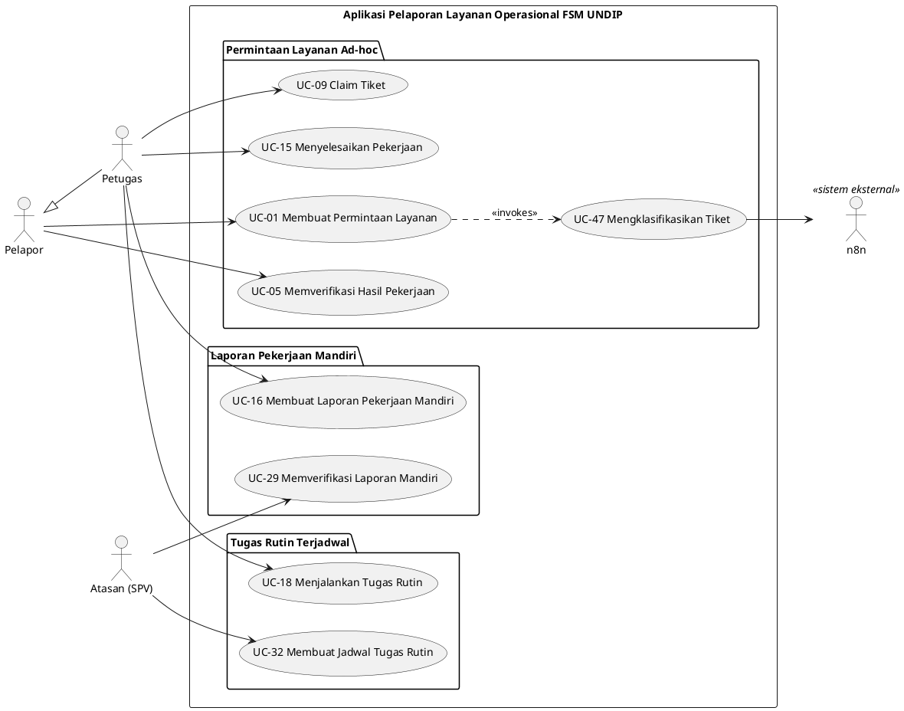

# Requirement dan Use Case Inti — Aplikasi Pelaporan Layanan Operasional FSM UNDIP

**Versi:** draf 1 (15 Nov 2026)
**Tahap ICONIX:** Requirements (Subbab 3.2.2). Belum melalui Milestone 1: Requirements Review.

**Sumber:**
- `Dokumen_Perencanaan_TA_FSM_UNDIP.md`: FR, NFR, BR, daftar 53 UC, narasi proses bisnis, AC FR-AI;
- `Keputusan_UseCase_Inti_4Nov2026.md`: 9 use case inti;
- naskah Word: Subbab 1.5, Subbab 3.2, Subbab 3.2.1–3.2.9.

> **Cara membaca status**
> - **[Sumber]**: diambil dari dokumen requirement atau keputusan yang sudah ada.
> - **[Draf]**: teks use case dan AC yang baru disusun di dokumen ini dari FR/BR dan narasi proses bisnis. Belum divalidasi Koordinator SI FSM atau dosen pembimbing.
> - **[Keputusan?]**: hal yang belum ada di sumber dan perlu Anda putuskan (daftar lengkap di Bagian 9).

---

## 1. Batasan Sistem [Sumber]

- **Aplikasi:** PWA, dibangun dari awal. ICONIX hanya dipakai untuk aplikasi.
- **Proses bisnis:**
  - (A) permintaan layanan ad-hoc;
  - (B) laporan pekerjaan mandiri;
  - (C) tugas rutin terjadwal.
- **Cakupan:** 9 use case inti saja.
- **Data awal (seed), bukan use case:** akun pengguna, peran, skill, jenis tiket, unit kerja, dan struktur atasan–bawahan.
- **Login:** sederhana, tidak dianalisis.
- **Tidak dibangun:** pengelolaan data oleh admin, SLA, dashboard pimpinan, auto-assignment, auto-close, dan use case lain di luar 9 use case inti.
- **n8n:** sistem eksternal. Alur kerjanya dikonfigurasi manual, tidak dirancang dengan ICONIX. Di diagram ICONIX, n8n hanya muncul sebagai aktor sistem luar.
- **Evaluasi:** black-box testing pada skenario utama dan setiap skenario alternatif. Akurasi klasifikasi AI tidak dievaluasi.

**Siklus status tiket (tetap, tidak dikonfigurasi admin) [Sumber]**

```
Open → Assigned → In Progress → Menunggu Verifikasi → Closed
                                        │
                                        └─(ditolak)→ Reopen → In Progress → …
```

Closed adalah status final (BR-017).

---

## 2. Aktor

| Aktor | Keterangan | Use case inti |
|---|---|---|
| Pelapor | Semua pengguna aktif: dosen, mahasiswa, staf, termasuk petugas (BR-001) | UC-01, UC-05 |
| Petugas | Staf layanan operasional yang memiliki skill (kebersihan, keamanan, teknisi, dll.) | UC-09, UC-15, UC-16, UC-18 |
| Atasan (SPV) | Atasan langsung petugas menurut struktur organisasi | UC-29, UC-32 |
| Sistem | Proses otomatis di dalam aplikasi | UC-47 |
| n8n | Sistem eksternal yang memanggil model di OpenRouter untuk klasifikasi | UC-47 (aktor sekunder) |

---

## 3. Daftar Use Case Inti [Sumber]

| ID | Nama | Aktor utama | Proses |
|---|---|---|---|
| UC-01 | Membuat Permintaan Layanan | Pelapor | A |
| UC-47 | Mengklasifikasikan Tiket | Sistem (+ n8n) | A |
| UC-09 | Claim Tiket | Petugas | A |
| UC-15 | Menyelesaikan Pekerjaan | Petugas | A |
| UC-05 | Memverifikasi Hasil Pekerjaan (gabungan UC-05, UC-06, dan UC-07) | Pelapor | A |
| UC-16 | Membuat Laporan Pekerjaan Mandiri | Petugas | B |
| UC-29 | Memverifikasi Laporan Mandiri | Atasan | B |
| UC-32 | Membuat Jadwal Tugas Rutin | Atasan | C |
| UC-18 | Menjalankan Tugas Rutin | Petugas | C |

**Use case diagram (PlantUML) [Draf]**



> Catatan notasi: ICONIX menyarankan memakai `<<invokes>>`/`<<precedes>>` dan tidak berdebat soal include/extend (Rosenberg & Stephens, 2007). Generalisasi Petugas → Pelapor dipakai karena petugas juga boleh membuat permintaan layanan.

---

## 4. Functional Requirement dalam Cakupan [Sumber]

ID dipertahankan dari dokumen perencanaan agar tetap konsisten. FR lain di luar tabel ini tetap tercatat di dokumen perencanaan, tetapi tidak dibangun (lihat Bagian 8).

| ID | Kebutuhan | UC |
|---|---|---|
| FR-AUTH-001 | Sistem mengautentikasi pengguna sebelum memberikan akses ke fitur internal. | Semua |
| FR-AUTH-008 | Sistem menolak akses pengguna berstatus nonaktif. | Semua |
| FR-ORG-002 | Sistem menyimpan relasi atasan–bawahan. | UC-29, UC-32 |
| FR-ORG-003 | Sistem memakai struktur organisasi untuk verifikasi dan hak akses. | UC-29, UC-32 |
| FR-ORG-007 | Atasan dapat melihat data bawahannya sesuai hierarki. | UC-29, UC-32 |
| FR-TKT-001 | Semua pengguna aktif dapat membuat permintaan layanan. | UC-01 |
| FR-TKT-002 | Unit asal tiket diambil dari konteks organisasi aktif pelapor. | UC-01 |
| FR-TKT-003 | Sistem mengumpulkan deskripsi laporan. | UC-01 |
| FR-TKT-005 | Sistem mendukung foto, file, dan GPS. | UC-01 |
| FR-TKT-006 | Sistem mengirim tiket ke antrean yang sesuai. | UC-47 |
| FR-TKT-008 | Sistem mendukung claim mandiri. | UC-09 |
| FR-TKT-011 | Pelapor tidak dapat membatalkan tiket. | UC-01 |
| FR-AI-001 | Sistem mengirim data tiket ke layanan AI untuk klasifikasi. | UC-47 |
| FR-AI-002 | AI mencocokkan deskripsi dengan jenis tiket yang sudah dikonfigurasi. Skill mengikuti jenis tiket. | UC-47 |
| FR-AI-003 | AI menghasilkan confidence score. | UC-47 |
| FR-AI-004 | Hasil klasifikasi diterapkan otomatis sebagai nilai awal tanpa threshold. Confidence score hanya informasi. | UC-47 |
| FR-AI-005 | Sistem mempunyai fallback manual jika AI gagal. | UC-47 |
| FR-AI-008 | Foto dapat dipakai AI sebagai konteks tambahan jika tersedia. | UC-47 |
| FR-ASG-001 | Antrean petugas difilter berdasarkan skill. | UC-09 |
| FR-ASG-003 | Claim bersifat first-come, first-served. | UC-09 |
| FR-ASG-004 | Sistem mencegah double claim. | UC-09 |
| FR-ASG-005 | Satu tiket hanya mempunyai satu primary assignee. | UC-09 |
| FR-WRK-001 | Petugas dapat memulai pengerjaan. | UC-15, UC-16 |
| FR-WRK-002 | Sistem menyimpan waktu mulai. | UC-15, UC-16 |
| FR-WRK-009 | Primary assignee dapat menyelesaikan pekerjaan utama. | UC-15, UC-16 |
| FR-WRK-010 | Saat diselesaikan, progress otomatis menjadi 100%. | UC-15, UC-16 |
| FR-VER-001 | Setelah pekerjaan selesai, tiket masuk Menunggu Verifikasi. | UC-15 |
| FR-VER-002 | Pelapor dapat menerima hasil. | UC-05 |
| FR-VER-003 | Pelapor dapat menolak hasil. | UC-05 |
| FR-VER-004 | Penolakan mewajibkan alasan. | UC-05 |
| FR-VER-005 | Penolakan menghasilkan reopen. | UC-05 |
| FR-VER-006 | Reopen kembali ke primary assignee yang sama. | UC-05 |
| FR-VER-008 | Hasil penyelesaian lama tetap disimpan. | UC-05, UC-15 |
| FR-VER-009 | Sistem menyimpan setiap completion attempt. | UC-15 |
| FR-VER-010 | Sistem menampilkan jumlah dan riwayat reopen. | UC-05 |
| FR-VER-011 | Rating 1–5 wajib saat pelapor menerima hasil. | UC-05 |
| FR-VER-012 | Komentar rating bersifat opsional. | UC-05 |
| FR-VER-014 | Rating dan komentar terkunci setelah Closed. | UC-05 |
| FR-VER-015 | Closed adalah status final. | UC-05 |
| FR-SELF-001 | Petugas dapat membuat laporan pekerjaan mandiri. | UC-16 |
| FR-SELF-002 | Pembuat laporan mandiri otomatis menjadi primary assignee. | UC-16 |
| FR-SELF-003 | Waktu mulai dicatat melalui aksi Mulai Pengerjaan. | UC-16 |
| FR-SELF-007 | Laporan mandiri diverifikasi atasan. | UC-29 |
| FR-SELF-008 | Laporan mandiri tidak memakai rating. | UC-16, UC-29 |
| FR-SELF-009 | Laporan mandiri tidak memakai komentar/chat. | UC-16 |
| FR-ROU-001 | Sistem mendukung template tugas rutin. | UC-32 |
| FR-ROU-002 | Template mendukung banyak checklist. | UC-32 |
| FR-ROU-003 | Sistem mendukung jadwal dan deadline. | UC-32 |
| FR-ROU-004 | Sistem mendukung assignment per area/petugas. | UC-32 |
| FR-ROU-005 | Satu petugas dapat memiliki beberapa assignment rutin. | UC-32 |
| FR-ROU-006 | Setiap assignment area terpisah. | UC-32 |
| FR-ROU-007 | Checklist wajib harus selesai sebelum tugas diajukan. | UC-18 |
| FR-ROU-008 | Tugas rutin mendukung foto akhir. | UC-18 |
| FR-ROU-009 | Tugas rutin mendukung GPS. | UC-18 |
| FR-ROU-013 | Tugas yang melewati deadline ditandai Overdue. | UC-18 |
| FR-ROU-014 | Flag terlambat tetap ada setelah tugas selesai. | UC-18 |
| FR-AUD-001 | Sistem mencatat seluruh perubahan status. | Semua |
| FR-AUD-002 | Sistem mencatat assignment. | UC-09 |
| FR-AUD-004 | Sistem mencatat verifikasi dan reopen. | UC-05, UC-29 |
| FR-AUD-006 | Sistem menyimpan identitas pelaku dan timestamp. | Semua |

---

## 5. Nonfunctional Requirement dalam Cakupan [Sumber]

| ID | Kebutuhan |
|---|---|
| NFR-SEC-001 | Otorisasi berdasarkan peran, konteks aktif, dan hierarki organisasi. |
| NFR-SEC-002 | Endpoint backend memverifikasi otorisasi, tidak hanya mengandalkan UI. |
| NFR-SEC-003 | Lampiran memiliki kontrol akses sesuai hak akses tiket. |
| NFR-SEC-006 | Secret n8n/AI tidak diekspos ke client. |
| NFR-DATA-001 | Claim bersifat atomic untuk mencegah dua primary assignee. |
| NFR-DATA-003 | Completion attempt lama tidak boleh ditimpa. |
| NFR-REL-001 | Kegagalan AI tidak menggagalkan pembuatan tiket. |
| NFR-REL-002 | Kegagalan n8n tidak menghapus tiket atau transaksi inti. |
| NFR-REL-003 | Kegagalan automation dapat dideteksi dan dicatat. |
| NFR-USE-001 | Pelapor tidak perlu memahami istilah teknis. |
| NFR-USE-004 | Status tiket mudah dipahami pelapor. |
| NFR-PWA-001 | Responsif di desktop dan perangkat mobile. |
| NFR-PWA-003 | Pengambilan foto dan GPS dapat dipakai di perangkat mobile. |
| NFR-PRIV-001 | Tidak ada pelacakan lokasi berkelanjutan. |
| NFR-PRIV-002 | GPS disimpan hanya pada event yang butuh bukti lokasi. |
| NFR-PRIV-003 | Pengguna hanya melihat data sesuai peran dan cakupan organisasi. |

## 6. Business Rule dalam Cakupan [Sumber]

| ID | Aturan |
|---|---|
| BR-001 | Semua pengguna aktif boleh membuat permintaan layanan. |
| BR-002 | Pelapor tidak wajib menentukan klasifikasi teknis. |
| BR-003 | AI tidak boleh menghalangi pembuatan tiket. |
| BR-006 | Claim memakai prinsip first-come, first-served. |
| BR-007 | Satu tiket hanya mempunyai satu primary assignee pada satu waktu. |
| BR-009 | Hanya primary assignee yang dapat menyelesaikan tiket. |
| BR-010 | Progress 100% tidak otomatis menyelesaikan tiket. |
| BR-011 | Penyelesaian tiket otomatis mengubah progress menjadi 100%. |
| BR-017 | Tiket Closed tidak dapat di-reopen. |
| BR-018 | Pelapor tidak dapat membatalkan tiket. |
| BR-020 | Laporan mandiri diverifikasi atasan. |
| BR-022 | Tiket layanan yang dikerjakan orang lain diverifikasi pelapor. |
| BR-023 | Jika pelapor dan pelaksana orang yang sama, verifikasi dilakukan atasan. **[Keputusan? K-6]** |
| BR-025 | Rating hanya diberikan saat tiket ditutup melalui persetujuan pelapor. |
| BR-037 | Tugas rutin yang overdue tetap dapat diselesaikan dengan flag terlambat permanen. |
| BR-038 | Seluruh checklist wajib harus selesai sebelum tugas rutin diajukan. |

---

## 7. Teks Use Case dan Acceptance Criteria [Draf]

Teks use case ditulis dengan kalimat aktif, menyebut nama halaman/tombol (boundary), dan memuat skenario utama (*basic course*) serta skenario alternatif (*alternate course*), sesuai pedoman ICONIX. Acceptance criteria memakai format Given–When–Then. Jumlah skenario uji minimal = 1 skenario utama + jumlah skenario alternatif.

---

### UC-01 Membuat Permintaan Layanan

| | |
|---|---|
| Aktor | Pelapor |
| Requirement | FR-AUTH-001, FR-TKT-001/002/003/005/011, FR-AUD-001/006, BR-001/002/003/018, NFR-USE-001, NFR-REL-001, NFR-PWA-003 |
| Prasyarat | Pelapor sudah masuk dan akunnya aktif. |
| Hasil akhir | Tiket tersimpan dengan status Open dan UC-47 sudah dijalankan. |

**Basic course**
1. Pelapor membuka halaman Buat Permintaan Layanan.
2. Sistem menampilkan formulir berisi kolom deskripsi, unggahan foto (opsional), dan tombol Ambil Lokasi (opsional).
3. Pelapor menulis deskripsi masalah, melampirkan foto jika ada, lalu menekan tombol Kirim.
4. Sistem memeriksa bahwa deskripsi tidak kosong serta format dan ukuran foto sesuai ketentuan.
5. Sistem membuat tiket baru dengan status Open, mengisi unit asal dari konteks organisasi pelapor, lalu mencatat pembuatan tiket beserta pelaku dan waktunya pada timeline.
6. Sistem menjalankan UC-47 Mengklasifikasikan Tiket.
7. Sistem menampilkan halaman Detail Tiket yang memuat nomor tiket, status, dan jenis tiket hasil klasifikasi.

**Alternate courses**
- **A1 (langkah 4) Deskripsi kosong:** Sistem menampilkan pesan "Deskripsi wajib diisi" dan tidak menyimpan tiket.
- **A2 (langkah 4) Foto tidak valid:** Sistem menampilkan pesan format/ukuran foto tidak sesuai dan tidak menyimpan tiket sampai foto diganti atau dihapus.
- **A3 (langkah 2) Izin lokasi ditolak:** Sistem menampilkan bahwa lokasi tidak tersedia, dan pelapor tetap dapat mengirim tanpa GPS.
- **A4 (langkah 6) Klasifikasi gagal:** Tiket tetap tersimpan dengan status Open dan Detail Tiket menampilkan "Belum terklasifikasi" (UC-47 A1).

**Acceptance criteria**
- **AC-01-1:** **Given** pelapor aktif sudah masuk, **When** ia mengirim formulir dengan deskripsi terisi, **Then** tiket tersimpan berstatus Open dengan unit asal sesuai konteks aktif, pembuatan tiket tercatat di timeline, dan UC-47 dijalankan.
- **AC-01-2:** **Given** deskripsi kosong, **When** pelapor menekan Kirim, **Then** sistem menampilkan pesan wajib isi dan tidak ada tiket baru.
- **AC-01-3:** **Given** foto berformat atau berukuran tidak sesuai, **When** pelapor menekan Kirim, **Then** sistem menampilkan pesan dan tidak ada tiket baru.
- **AC-01-4:** **Given** izin lokasi ditolak, **When** pelapor mengirim formulir, **Then** tiket tetap tersimpan tanpa GPS.
- **AC-01-5:** **Given** n8n tidak merespons, **When** pelapor mengirim formulir yang valid, **Then** tiket tetap tersimpan berstatus Open (BR-003).
- **AC-01-6:** **Given** tiket sudah dibuat, **When** pelapor membuka Detail Tiket, **Then** tidak ada aksi membatalkan tiket, dan permintaan pembatalan lewat endpoint ditolak (BR-018).

Skenario uji minimal: 5.

---

### UC-47 Mengklasifikasikan Tiket

| | |
|---|---|
| Aktor | Sistem (utama), n8n (sekunder, sistem eksternal) |
| Requirement | FR-AI-001/002/003/004/005/008, FR-TKT-006, BR-002/003, NFR-REL-001/002/003, NFR-SEC-006 |
| Pemicu | UC-01 langkah 6 |
| Hasil akhir | Tiket memiliki jenis tiket, skill, dan confidence score, lalu masuk antrean. Jika gagal, tiket ditandai belum terklasifikasi. |

**Basic course**
1. Sistem mengirim nomor tiket, deskripsi, foto (jika ada), dan daftar jenis tiket aktif ke webhook n8n.
2. n8n memanggil model di OpenRouter, lalu mengembalikan jenis tiket yang paling sesuai beserta confidence score.
3. Sistem memeriksa bahwa jenis tiket yang diterima ada dalam daftar jenis tiket aktif.
4. Sistem menerapkan jenis tiket tersebut sebagai nilai awal, mengisi skill yang dibutuhkan dari konfigurasi jenis tiket, dan menyimpan confidence score.
5. Sistem memasukkan tiket ke antrean petugas yang memiliki skill tersebut dan mencatat hasil klasifikasi pada timeline.

**Alternate courses**
- **A1 (langkah 2) n8n atau OpenRouter tidak merespons dalam batas waktu, atau mengembalikan error:**
  - sistem mencatat kegagalan pada log;
  - tiket ditandai "Belum terklasifikasi" dan tetap berstatus Open;
  - tiket masuk antrean fallback **[Keputusan? K-3]**.
- **A2 (langkah 3) Jenis tiket tidak dikenal atau format respons tidak valid:** Sistem memperlakukannya sama seperti A1.
- **A3 (langkah 1) Tiket tanpa foto:** Sistem mengirim deskripsi saja, dan klasifikasi tetap berjalan.

**Acceptance criteria**
- **AC-47-1:** **Given** tiket baru dengan deskripsi terisi, **When** n8n mengembalikan jenis tiket yang valid dan confidence score, **Then**:
  - jenis tiket dan skill dari konfigurasinya tersimpan sebagai nilai awal;
  - confidence score tersimpan;
  - tiket muncul di antrean petugas dengan skill tersebut;
  - tidak ada aturan yang memblokir penerapan berdasarkan angka confidence.
- **AC-47-2:** **Given** n8n tidak merespons atau error, **When** batas waktu terlewati, **Then** tiket tetap tersimpan berstatus Open dengan tanda "Belum terklasifikasi", dan kegagalan tercatat di log.
- **AC-47-3:** **Given** n8n mengembalikan jenis tiket yang tidak ada di daftar, **When** respons diproses, **Then** sistem memperlakukannya sebagai kegagalan klasifikasi (sama seperti AC-47-2).
- **AC-47-4:** **Given** tiket tanpa foto, **When** klasifikasi dijalankan, **Then** permintaan ke n8n tetap dikirim tanpa foto dan hasilnya diterapkan.
- **AC-47-5:** **Given** permintaan ke n8n, **When** isi permintaan dan respons diperiksa di sisi client, **Then** tidak ada secret/kredensial n8n atau OpenRouter yang terlihat (NFR-SEC-006).

Skenario uji minimal: 4. Pengujian dilakukan dari sisi aplikasi, termasuk dengan n8n yang sengaja dimatikan.

---

### UC-09 Claim Tiket

| | |
|---|---|
| Aktor | Petugas |
| Requirement | FR-TKT-008, FR-ASG-001/003/004/005, FR-AUD-002, NFR-DATA-001, BR-006/007 |
| Prasyarat | Petugas sudah masuk dan memiliki minimal satu skill. |
| Hasil akhir | Petugas menjadi primary assignee dan status tiket menjadi Assigned. |

**Basic course**
1. Petugas membuka halaman Antrean Tiket.
2. Sistem menampilkan tiket berstatus Open yang skill-nya sesuai dengan skill petugas.
3. Petugas memilih tiket, membaca detailnya, lalu menekan tombol Ambil Tiket.
4. Sistem memeriksa bahwa tiket masih berstatus Open dan belum memiliki primary assignee.
5. Sistem menetapkan petugas sebagai primary assignee, mengubah status menjadi Assigned, dan mencatat assignment pada timeline.
6. Sistem menampilkan halaman Detail Tiket dengan tombol Mulai Pengerjaan.

**Alternate courses**
- **A1 (langkah 2) Tidak ada tiket yang sesuai:** Sistem menampilkan pesan bahwa antrean kosong.
- **A2 (langkah 4) Tiket sudah diambil petugas lain:** Sistem menampilkan pesan "Tiket sudah diambil petugas lain" dan memuat ulang antrean.

**Acceptance criteria**
- **AC-09-1:** **Given** tiket Open dengan skill X dan petugas yang memiliki skill X, **When** petugas menekan Ambil Tiket, **Then** petugas menjadi primary assignee, status menjadi Assigned, dan assignment tercatat di timeline.
- **AC-09-2:** **Given** petugas tanpa skill X, **When** ia membuka Antrean Tiket, **Then** tiket dengan skill X tidak tampil.
- **AC-09-3:** **Given** dua petugas menekan Ambil Tiket pada tiket yang sama hampir bersamaan, **When** kedua permintaan diproses, **Then** hanya satu yang berhasil, dan petugas lainnya menerima pesan bahwa tiket sudah diambil (NFR-DATA-001).
- **AC-09-4:** **Given** tidak ada tiket yang sesuai skill, **When** petugas membuka Antrean Tiket, **Then** sistem menampilkan pesan antrean kosong.

Skenario uji minimal: 3. Ditambah 1 skenario uji klaim bersamaan.

---

### UC-15 Menyelesaikan Pekerjaan

| | |
|---|---|
| Aktor | Petugas (primary assignee) |
| Requirement | FR-WRK-001/002/009/010, FR-VER-001/008/009, FR-AUD-001, BR-009/010/011, NFR-SEC-002, NFR-DATA-003 |
| Prasyarat | Tiket berstatus Assigned atau Reopen, dan petugas adalah primary assignee-nya. |
| Hasil akhir | Tiket berstatus Menunggu Verifikasi dan completion attempt tersimpan. |

**Basic course**
1. Petugas membuka halaman Detail Tiket miliknya.
2. Petugas menekan tombol Mulai Pengerjaan.
3. Sistem mencatat waktu mulai dan mengubah status menjadi In Progress **[Keputusan? K-1]**.
4. Setelah pekerjaan selesai, petugas menekan tombol Selesai Dikerjakan, menulis catatan penyelesaian, dan melampirkan foto hasil.
5. Sistem memeriksa bahwa catatan dan foto hasil sudah diisi **[Keputusan? K-2]**.
6. Sistem menyimpan completion attempt, mengubah progress menjadi 100%, mengubah status menjadi Menunggu Verifikasi, dan mencatat waktu selesai pada timeline.

**Alternate courses**
- **A1 (langkah 5) Bukti penyelesaian belum lengkap:** Sistem menampilkan pesan, dan status tidak berubah.
- **A2 (langkah 1) Pengguna bukan primary assignee:** Sistem tidak menampilkan tombol Mulai/Selesai, dan permintaan langsung ke endpoint ditolak.
- **A3 (prasyarat) Tiket berstatus Reopen:** Langkah 2–6 dijalankan lagi. Completion attempt baru disimpan tanpa menimpa yang lama.

**Acceptance criteria**
- **AC-15-1:** **Given** tiket Assigned milik petugas, **When** petugas menekan Mulai Pengerjaan, **Then** waktu mulai tercatat dan status menjadi In Progress.
- **AC-15-2:** **Given** tiket In Progress, **When** petugas menekan Selesai dengan catatan dan foto, **Then**:
  - progress menjadi 100%;
  - status menjadi Menunggu Verifikasi;
  - completion attempt tersimpan dengan waktu selesai.
- **AC-15-3:** **Given** catatan atau foto kosong, **When** petugas menekan Selesai, **Then** sistem menampilkan pesan dan status tetap In Progress.
- **AC-15-4:** **Given** pengguna bukan primary assignee, **When** ia mengirim permintaan Selesai ke endpoint, **Then** permintaan ditolak (NFR-SEC-002).
- **AC-15-5:** **Given** tiket Reopen yang sudah memiliki satu completion attempt, **When** petugas menyelesaikannya lagi, **Then** tersimpan dua completion attempt dan yang lama tidak berubah.

Skenario uji minimal: 4.

---

### UC-05 Memverifikasi Hasil Pekerjaan (gabungan UC-05, UC-06, dan UC-07)

| | |
|---|---|
| Aktor | Pelapor |
| Requirement | FR-VER-002/003/004/005/006/008/010/011/012/014/015, FR-AUD-004, BR-017/022/025 |
| Prasyarat | Tiket berstatus Menunggu Verifikasi, dan pengguna adalah pelapor tiket tersebut. |
| Hasil akhir | Tiket Closed dengan rating, atau Reopen dengan alasan penolakan. |

**Basic course (menerima hasil)**
1. Pelapor membuka halaman Detail Tiket yang berstatus Menunggu Verifikasi.
2. Sistem menampilkan hasil pekerjaan (catatan, foto, dan waktu selesai) beserta tombol Terima dan Tolak.
3. Pelapor menekan Terima, memilih rating 1–5, dan dapat menulis komentar.
4. Sistem memeriksa bahwa rating sudah dipilih.
5. Sistem menyimpan rating dan komentar, mengubah status menjadi Closed, mencatat pelapor sebagai penutup tiket, dan mengunci rating.

**Alternate courses**
- **A1 (langkah 3) Pelapor menolak hasil (UC-07):**
  1. Pelapor menekan Tolak dan menulis alasan.
  2. Sistem memeriksa bahwa alasan tidak kosong.
  3. Sistem menyimpan alasan, mempertahankan completion attempt lama, dan menambah jumlah reopen.
  4. Sistem mengubah status menjadi Reopen dengan primary assignee yang sama dan mencatatnya pada timeline.
- **A2 (langkah 4) Rating belum dipilih:** Sistem menampilkan pesan "Rating wajib diisi" dan status tidak berubah.
- **A3 (A1) Alasan penolakan kosong:** Sistem menampilkan pesan "Alasan wajib diisi" dan status tidak berubah.
- **A4 (langkah 1) Tiket sudah Closed:** Sistem tidak menampilkan tombol Terima/Tolak, serta rating dan komentar tidak dapat diubah.
- **A5 (langkah 1) Pengguna bukan pelapor tiket:** Sistem tidak menampilkan tombol verifikasi, dan permintaan ke endpoint ditolak.

**Acceptance criteria**
- **AC-05-1:** **Given** tiket Menunggu Verifikasi, **When** pelapor menekan Terima dengan rating 4, **Then** status menjadi Closed, rating 4 tersimpan, dan penutup tiket tercatat.
- **AC-05-2:** **Given** tiket Menunggu Verifikasi, **When** pelapor menekan Tolak dengan alasan, **Then**:
  - status menjadi Reopen;
  - primary assignee tetap sama;
  - jumlah reopen bertambah 1;
  - completion attempt lama tetap ada.
- **AC-05-3:** **Given** rating belum dipilih, **When** pelapor menekan Terima, **Then** sistem menampilkan pesan dan status tidak berubah.
- **AC-05-4:** **Given** alasan kosong, **When** pelapor menekan Tolak, **Then** sistem menampilkan pesan dan status tidak berubah.
- **AC-05-5:** **Given** tiket Closed, **When** pengguna mencoba mengubah rating atau me-reopen, **Then** permintaan ditolak (BR-017, FR-VER-014).
- **AC-05-6:** **Given** pengguna bukan pelapor, **When** ia mengirim permintaan verifikasi, **Then** permintaan ditolak.

Skenario uji minimal: 6.

---

### UC-16 Membuat Laporan Pekerjaan Mandiri

| | |
|---|---|
| Aktor | Petugas |
| Requirement | FR-SELF-001/002/003/008/009, FR-WRK-001/002/009/010, FR-AUD-001/006, BR-020 |
| Prasyarat | Petugas sudah masuk dan memiliki atasan pada struktur organisasi (data awal). |
| Hasil akhir | Laporan mandiri berstatus Menunggu Verifikasi oleh atasan langsung. |

**Basic course**
1. Petugas membuka halaman Buat Laporan Mandiri.
2. Sistem menampilkan formulir berisi pilihan jenis pekerjaan sesuai skill petugas, kolom deskripsi, dan unggahan foto **[Keputusan? K-4]**.
3. Petugas memilih jenis pekerjaan, menulis deskripsi, lalu menekan tombol Mulai Pengerjaan.
4. Sistem memeriksa bahwa jenis pekerjaan dan deskripsi sudah diisi.
5. Sistem membuat laporan mandiri, menetapkan petugas sebagai primary assignee, mencatat waktu mulai, dan mengubah status menjadi In Progress.
6. Setelah pekerjaan selesai, petugas membuka laporan tersebut, menekan Selesai Dikerjakan, menulis catatan, dan melampirkan foto hasil.
7. Sistem memeriksa bahwa foto hasil sudah dilampirkan.
8. Sistem menyimpan hasil, mengubah progress menjadi 100%, mengubah status menjadi Menunggu Verifikasi, dan menampilkan laporan pada daftar verifikasi atasan langsung.

**Alternate courses**
- **A1 (langkah 4) Kolom wajib kosong:** Sistem menampilkan pesan, dan laporan tidak dibuat.
- **A2 (langkah 7) Foto hasil belum dilampirkan:** Sistem menampilkan pesan, dan status tetap In Progress.
- **A3 Laporan mandiri tidak memiliki rating maupun kolom komentar.** Sistem tidak menampilkan keduanya.

Catatan: laporan retrospektif (UC-17) tidak dibangun.

**Acceptance criteria**
- **AC-16-1:** **Given** petugas aktif, **When** ia mengisi jenis pekerjaan dan deskripsi lalu menekan Mulai Pengerjaan, **Then** laporan tersimpan berstatus In Progress, petugas menjadi primary assignee, dan waktu mulai tercatat.
- **AC-16-2:** **Given** laporan In Progress, **When** petugas menekan Selesai dengan foto hasil, **Then** status menjadi Menunggu Verifikasi dan laporan tampil di daftar verifikasi atasan langsungnya.
- **AC-16-3:** **Given** kolom wajib kosong, **When** petugas menekan Mulai Pengerjaan, **Then** sistem menampilkan pesan dan laporan tidak dibuat.
- **AC-16-4:** **Given** foto hasil kosong, **When** petugas menekan Selesai, **Then** sistem menampilkan pesan dan status tidak berubah.
- **AC-16-5:** **Given** laporan mandiri, **When** detailnya dibuka, **Then** tidak ada kolom rating maupun komentar (FR-SELF-008/009).

Skenario uji minimal: 3.

---

### UC-29 Memverifikasi Laporan Mandiri

| | |
|---|---|
| Aktor | Atasan (SPV) |
| Requirement | FR-SELF-007, FR-ORG-002/003/007, FR-AUD-004/006, BR-020, NFR-PRIV-003 |
| Prasyarat | Atasan sudah masuk dan memiliki bawahan pada struktur organisasi. |
| Hasil akhir | Laporan mandiri Closed, atau dikembalikan ke petugas. |

**Basic course**
1. Atasan membuka halaman Verifikasi Laporan Mandiri.
2. Sistem menampilkan laporan berstatus Menunggu Verifikasi milik bawahan atasan tersebut.
3. Atasan memilih laporan, lalu sistem menampilkan deskripsi, foto, serta waktu mulai dan selesai.
4. Atasan menekan tombol Setujui.
5. Sistem mengubah status laporan menjadi Closed dan mencatat atasan sebagai verifikator beserta waktunya.

**Alternate courses**
- **A1 (langkah 4) Atasan menolak:** Atasan menekan Tolak dan menulis alasan. Sistem menyimpan alasan, mengubah status menjadi Reopen, dan mengembalikan laporan ke petugas **[Keputusan? K-5]**.
- **A2 (A1) Alasan kosong:** Sistem menampilkan pesan, dan status tidak berubah.
- **A3 (langkah 2) Tidak ada laporan menunggu:** Sistem menampilkan pesan bahwa daftar kosong.
- **A4 (langkah 2) Laporan milik petugas yang bukan bawahan:** Laporan tidak tampil, dan permintaan verifikasi lewat endpoint ditolak.

**Acceptance criteria**
- **AC-29-1:** **Given** laporan bawahan berstatus Menunggu Verifikasi, **When** atasan menekan Setujui, **Then** status menjadi Closed dan verifikator serta waktunya tercatat.
- **AC-29-2:** **Given** laporan bawahan berstatus Menunggu Verifikasi, **When** atasan menekan Tolak dengan alasan, **Then** status menjadi Reopen dan alasan tersimpan.
- **AC-29-3:** **Given** alasan kosong, **When** atasan menekan Tolak, **Then** sistem menampilkan pesan dan status tidak berubah.
- **AC-29-4:** **Given** laporan milik petugas yang bukan bawahan, **When** atasan membuka daftar atau mengirim permintaan verifikasi, **Then** laporan tidak tampil dan permintaan ditolak.

Skenario uji minimal: 5.

---

### UC-32 Membuat Jadwal Tugas Rutin

| | |
|---|---|
| Aktor | Atasan (SPV) |
| Requirement | FR-ROU-001/002/003/004/005/006/008/009, FR-ORG-007, FR-AUD-006 |
| Prasyarat | Atasan sudah masuk dan memiliki bawahan petugas. |
| Hasil akhir | Jadwal tersimpan, dan tugas rutin dibuat otomatis sesuai jadwal. |

**Basic course**
1. Atasan membuka halaman Buat Jadwal Tugas Rutin.
2. Sistem menampilkan formulir berisi:
   - nama tugas dan area kerja;
   - daftar item checklist, masing-masing ditandai wajib atau opsional;
   - pola pengulangan (setiap hari atau hari tertentu), jam mulai, dan batas waktu;
   - kebutuhan bukti (foto akhir dan GPS);
   - petugas bawahan yang ditugaskan.
3. Atasan mengisi formulir, menambahkan item checklist, memilih petugas, lalu menekan tombol Simpan.
4. Sistem memeriksa bahwa:
   - nama, area, dan jadwal terisi;
   - checklist berisi minimal satu item;
   - batas waktu berada setelah jam mulai;
   - petugas yang dipilih adalah bawahan atasan tersebut.
5. Sistem menyimpan jadwal beserta assignment area untuk setiap petugas.
6. Pada setiap jadwal yang jatuh tempo, sistem membuat tugas rutin untuk petugas yang ditugaskan **[Keputusan? K-7]**.
7. Sistem menampilkan daftar jadwal tugas rutin milik atasan.

**Alternate courses**
- **A1 (langkah 4) Data tidak lengkap atau tidak valid:** Sistem menandai kolom yang salah dan tidak menyimpan jadwal.
- **A2 (langkah 4) Batas waktu tidak setelah jam mulai:** Sistem menampilkan pesan, dan jadwal tidak disimpan.
- **A3 (langkah 5) Petugas sudah memiliki jadwal lain:** Jadwal tetap disimpan sebagai assignment terpisah (FR-ROU-005/006).

**Acceptance criteria**
- **AC-32-1:** **Given** data jadwal lengkap dan valid, **When** atasan menekan Simpan, **Then** jadwal dan assignment per petugas tersimpan dan tampil di daftar jadwal.
- **AC-32-2:** **Given** jadwal harian pukul 07.00, **When** waktu jadwal tiba, **Then** tugas rutin untuk hari itu dibuat bagi setiap petugas yang ditugaskan.
- **AC-32-3:** **Given** checklist kosong atau kolom wajib kosong, **When** atasan menekan Simpan, **Then** sistem menampilkan pesan dan jadwal tidak tersimpan.
- **AC-32-4:** **Given** batas waktu lebih awal dari jam mulai, **When** atasan menekan Simpan, **Then** sistem menampilkan pesan dan jadwal tidak tersimpan.
- **AC-32-5:** **Given** petugas yang sudah memiliki jadwal di area lain, **When** jadwal baru disimpan untuknya, **Then** kedua assignment tersimpan terpisah.

Skenario uji minimal: 4.

---

### UC-18 Menjalankan Tugas Rutin

| | |
|---|---|
| Aktor | Petugas |
| Requirement | FR-ROU-007/008/009/013/014, BR-037/038, NFR-PWA-003, NFR-PRIV-001/002 |
| Prasyarat | Petugas memiliki tugas rutin yang dibuat dari UC-32. |
| Hasil akhir | Tugas rutin berstatus Menunggu Verifikasi **[Keputusan? K-8]**. |

**Basic course**
1. Petugas membuka halaman Tugas Rutin Hari Ini.
2. Sistem menampilkan tugas rutin milik petugas beserta area, batas waktu, dan status.
3. Petugas memilih tugas, lalu sistem menampilkan item checklist.
4. Petugas mencentang item checklist yang sudah dikerjakan.
5. Petugas mengambil foto akhir dan menekan tombol Ambil Lokasi. Sistem merekam GPS pada saat itu saja.
6. Petugas menekan tombol Ajukan.
7. Sistem memeriksa bahwa seluruh item wajib sudah dicentang dan bukti foto serta GPS sudah lengkap.
8. Sistem menyimpan pengajuan, mengubah status menjadi Menunggu Verifikasi, dan mencatat waktu pengajuan.

**Alternate courses**
- **A1 (langkah 7) Ada item wajib yang belum dicentang:** Sistem menampilkan item yang belum selesai, dan tugas tidak diajukan.
- **A2 (langkah 5) Izin lokasi ditolak atau GPS tidak tersedia:** Sistem menampilkan pesan, dan tugas tidak dapat diajukan.
- **A3 (langkah 2) Batas waktu sudah terlewati:**
  - sistem menandai tugas sebagai Overdue;
  - petugas tetap dapat menjalankan dan mengajukan tugas;
  - tanda Overdue tetap tersimpan setelah tugas diajukan.
- **A4 (langkah 2) Tidak ada tugas hari ini:** Sistem menampilkan pesan bahwa tidak ada tugas.

**Acceptance criteria**
- **AC-18-1:** **Given** tugas rutin dengan seluruh item wajib tercentang serta foto dan GPS terisi, **When** petugas menekan Ajukan, **Then** status menjadi Menunggu Verifikasi dan waktu pengajuan tercatat.
- **AC-18-2:** **Given** ada item wajib belum dicentang, **When** petugas menekan Ajukan, **Then** sistem menampilkan item tersebut dan status tidak berubah (BR-038).
- **AC-18-3:** **Given** izin lokasi ditolak, **When** petugas menekan Ajukan, **Then** sistem menampilkan pesan dan tugas tidak diajukan.
- **AC-18-4:** **Given** batas waktu sudah terlewati, **When** petugas membuka dan mengajukan tugas, **Then** tugas bertanda Overdue, tetap dapat diajukan, dan tandanya tetap ada (BR-037).
- **AC-18-5:** **Given** petugas tidak sedang mengajukan tugas, **When** aplikasi digunakan, **Then** tidak ada perekaman lokasi di latar belakang (NFR-PRIV-001).

Skenario uji minimal: 5.

---

### Ringkasan jumlah skenario uji minimal

| UC | Skenario utama | Skenario alternatif | Minimal skenario uji |
|---|---|---|---|
| UC-01 | 1 | 4 | 5 |
| UC-47 | 1 | 3 | 4 |
| UC-09 | 1 | 2 (+1 uji klaim bersamaan) | 4 |
| UC-15 | 1 | 3 | 4 |
| UC-05 | 1 | 5 | 6 |
| UC-16 | 1 | 2 | 3 |
| UC-29 | 1 | 4 | 5 |
| UC-32 | 1 | 3 | 4 |
| UC-18 | 1 | 4 | 5 |
| **Total** | | | **40** |

---

## 8. Di Luar Cakupan [Sumber]

**Data awal (tanpa halaman pengelolaan):**
- pengguna, peran, dan status aktif;
- struktur organisasi dan relasi atasan–bawahan;
- skill petugas;
- jenis tiket beserta skill-nya;
- unit dan bidang.

**Use case yang tidak dibangun** (tetap dicatat dan menjadi bahan saran BAB V):
- UC-02–UC-04: status, timeline, dan komentar;
- UC-08: bagian dari UC-09;
- UC-10–UC-14: mulai, progress, pause, dan supporting staff. Aksi Mulai Pengerjaan dimasukkan ke UC-15/16, lihat K-1;
- UC-17 retrospektif;
- UC-19 tiket temuan;
- UC-20–UC-28;
- UC-30 verifikasi tugas rutin (lihat K-8);
- UC-31, UC-33–UC-46;
- UC-49 auto-assignment, UC-50–UC-53.

**Kandidat tambahan jika waktu cukup** (dari Keputusan 4 Nov):
- UC-26 Assign;
- UC-49 Auto Assignment;
- UC-30 Verifikasi Tugas Rutin;
- UC-19 Tiket Temuan.

**Sisi n8n** (dikonfigurasi manual, tidak dirancang dengan ICONIX): notifikasi Telegram, pencatatan ke Google Spreadsheet dan Calendar. Aplikasi hanya diuji pada titik pertukaran datanya.

---

## 9. Keputusan yang Perlu Anda Konfirmasi [Keputusan?]

| Kode | Masalah | Usulan | Alasan |
|---|---|---|---|
| K-1 | UC-10 Memulai Pengerjaan bukan use case inti, padahal UC-15 butuh status In Progress. | Aksi Mulai Pengerjaan dijadikan langkah di UC-15 dan UC-16. | Tanpa itu, waktu mulai (FR-WRK-002) tidak tercatat. |
| K-2 | Bukti penyelesaian tiket ad-hoc belum diatur di sumber. | Catatan dan 1 foto hasil wajib. | Pelapor butuh bukti untuk memverifikasi. |
| K-3 | Tiket "Belum terklasifikasi" ditangani siapa? UC-25/26 (SPV) tidak dibangun. | Tiket tampil di antrean semua petugas dengan label "Belum terklasifikasi". | Fallback manual (FR-AI-005) tetap berjalan tanpa menambah use case SPV. |
| K-4 | Apakah laporan mandiri juga diklasifikasi AI? | Tidak. Petugas memilih jenis pekerjaan sesuai skill-nya. | Keputusan 4 Nov menempatkan AI hanya pada proses ad-hoc. |
| K-5 | Atasan menolak laporan mandiri: tidak tertulis di sumber. | Tolak dengan alasan, lalu Reopen ke petugas (analog FR-VER-003–005). | Tanpa jalur tolak, verifikasi hanya formalitas. |
| K-6 | BR-023: jika pelapor = pelaksana, verifikator adalah atasan. | Batasi: petugas tidak dapat meng-claim tiket yang ia laporkan sendiri. | Lebih sederhana daripada menambah alur verifikasi atasan di UC-05. |
| K-7 | Pembuatan tugas rutin otomatis dijalankan oleh siapa? Naskah 3.2.1 menyebut penjadwalan sebagai aktivitas yang diotomatisasi n8n. | Opsi a: penjadwal (*cron*) di aplikasi. Opsi b: Schedule Trigger n8n memanggil endpoint aplikasi. | Opsi a lebih mudah diuji black-box. Opsi b sesuai narasi to-be. Pilih satu agar konsisten dengan BAB III. |
| K-8 | UC-30 Verifikasi Tugas Rutin bukan inti, sehingga tugas rutin berhenti di Menunggu Verifikasi. | Tambahkan UC-30 sebagai use case inti ke-10, atau terima batasan ini dan tulis di Ruang Lingkup. | FR-ROU-010 mewajibkan verifikasi atasan. |
| K-9 | FR-TKT-004: kolom khusus per jenis tiket muncul setelah klasifikasi. | Tidak dibangun. Pelapor cukup mengisi deskripsi, foto, dan GPS. | Mengurangi kompleksitas, sedangkan BR-002 tetap terpenuhi. |
| K-10 | Batas waktu respons n8n (timeout) belum ditetapkan. | Tetapkan satu nilai, misalnya 15–30 detik, lalu catat di spesifikasi. | AC-47-2 butuh nilai yang dapat diuji. |

---

## 10. Langkah Berikutnya (sesuai ICONIX)

1. Konfirmasi K-1 sampai K-10.
2. Validasi teks use case dan AC bersama Koordinator SI FSM: Milestone 1, Requirements Review.
3. Susun domain model awal dari kata benda pada teks use case. Kandidatnya:
   - Pengguna, Peran, Unit, Skill, JenisTiket;
   - Tiket, CompletionAttempt, Verifikasi, TimelineEvent;
   - LaporanMandiri, JadwalRutin, ItemChecklist, TugasRutin;
   - Lampiran, LogKlasifikasi.
4. Buat prototipe antarmuka (GUI storyboard) untuk setiap halaman yang disebut di teks use case.
