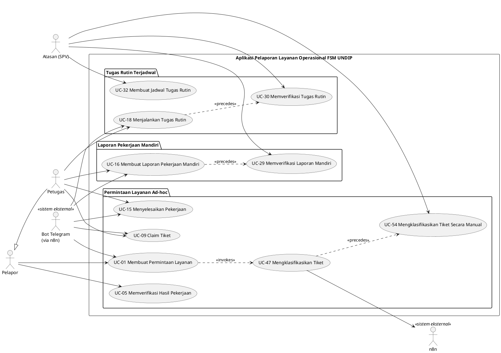

# Requirement dan Use Case Inti — Aplikasi Pelaporan Layanan Operasional FSM UNDIP

**Versi:** draf 2 (15 Nov 2026). Draf 1 tersimpan di riwayat git file ini.
**Tahap ICONIX:** Requirements (Subbab 3.2.2). Belum melalui Milestone 1: Requirements Review.

**Sumber:**
- `Dokumen_Perencanaan_TA_FSM_UNDIP.md`: FR, NFR, BR, daftar 53 UC, narasi proses bisnis, dan AC FR-AI;
- `Keputusan_UseCase_Inti_4Nov2026.md`: 9 use case inti awal;
- naskah Word: Subbab 1.5, Subbab 3.2, dan Subbab 3.2.1–3.2.9;
- keputusan peneliti atas K-1 sampai K-14 pada 15 Nov 2026 (Bagian 9).

> **Cara membaca status**
> - **[Sumber]**: diambil dari dokumen requirement atau keputusan yang sudah ada.
> - **[Draf]**: teks use case dan AC yang disusun di dokumen ini dari FR/BR dan narasi proses bisnis. Belum divalidasi Koordinator SI FSM atau dosen pembimbing.
> - **[Draf 2]**: teks yang ditambahkan atau diubah pada draf 2. Teks ini **ditulis oleh Claude Code (asisten AI)** berdasarkan keputusan peneliti pada 15 Nov 2026, lalu harus ditinjau peneliti. Penanda ini memenuhi ketentuan Subbab 3.2.8.1 bahwa bantuan asisten LLM dicatat.
> - **[Keputusan?]**: hal yang belum ada di sumber dan perlu diputuskan (daftar lengkap di Bagian 9).

---

## 1. Batasan Sistem [Sumber, diperbarui Draf 2]

- **Aplikasi:** PWA, dibangun dari awal. ICONIX hanya dipakai untuk aplikasi.
- **Proses bisnis:**
  - (A) permintaan layanan ad-hoc;
  - (B) laporan pekerjaan mandiri;
  - (C) tugas rutin terjadwal.
- **Cakupan:** 11 use case inti **[Draf 2]**, yaitu 9 use case inti awal ditambah UC-54 (K-3) dan UC-30 (K-8).
- **Data awal (seed), bukan use case:** akun pengguna, peran, skill, jenis tiket, unit kerja, dan struktur atasan–bawahan.
- **Login:** sederhana, tidak dianalisis.
- **Tidak dibangun:** pengelolaan data oleh admin, SLA, dashboard pimpinan, auto-assignment, auto-close, form khusus per jenis tiket (K-9), dan use case lain di luar 11 use case inti.
- **Penjadwal tugas rutin [Draf 2]:** berjalan di dalam aplikasi sebagai penjadwal (*cron*), bukan di n8n (K-7).
- **n8n:** sistem eksternal. Alur kerjanya dikonfigurasi manual, tidak dirancang dengan ICONIX. Di diagram ICONIX, n8n hanya muncul sebagai aktor sistem luar. n8n dipakai untuk:
  - klasifikasi tiket melalui OpenRouter (UC-47);
  - bot Telegram sebagai jalur masuk kedua bagi semua pengguna untuk UC-01, dan bagi petugas untuk use case petugas (lihat Bagian 2.1) **[Draf 2]**;
  - notifikasi Telegram, serta pencatatan ke Google Spreadsheet dan Calendar.
- **Evaluasi:** black-box testing pada skenario utama dan setiap skenario alternatif. Akurasi klasifikasi AI tidak dievaluasi. Jalur Telegram diuji dari sisi aplikasi, yaitu melalui endpoint yang dipanggil n8n **[Draf 2]**.

**Siklus status [Sumber, ditambah Draf 2]**

Status bersifat tetap dan tidak dikonfigurasi admin.

Tiket ad-hoc:
```
Open → Assigned → In Progress → Menunggu Verifikasi → Closed
                       ▲                │
                       └── Reopen ◄─────┘ (ditolak pelapor)
```

Laporan mandiri **[Draf 2]**:
```
In Progress → Menunggu Verifikasi → Closed
     ▲                │
     └── Reopen ◄─────┘ (ditolak atasan, K-5)
```

Tugas rutin **[Draf 2]**:
```
Aktif → Menunggu Verifikasi → Closed
  ▲              │
  └── Reopen ◄───┘ (ditolak atasan, UC-30)
Overdue = tanda permanen, bukan status (BR-037).
```

Closed adalah status final (BR-017).

---

## 2. Aktor

| Aktor | Keterangan | Use case inti |
|---|---|---|
| Pelapor | Semua pengguna aktif: dosen, mahasiswa, staf, termasuk petugas (BR-001) | UC-01, UC-05 |
| Petugas | Staf layanan operasional yang memiliki skill (kebersihan, keamanan, teknisi, dll.). Menjalankan use case lewat web atau bot Telegram. | UC-09, UC-15, UC-16, UC-18 |
| Atasan (SPV) | Atasan langsung petugas menurut struktur organisasi. Satu atasan yang ditunjuk melalui data awal juga mengklasifikasikan tiket secara manual **[Draf 2, K-13]**. | UC-29, UC-30, UC-32, UC-54 |
| Sistem | Proses otomatis di dalam aplikasi, termasuk penjadwal tugas rutin | UC-47, UC-32 langkah 6 |
| n8n | Sistem eksternal yang memanggil model di OpenRouter untuk klasifikasi | UC-47 (aktor sekunder) |
| Bot Telegram (via n8n) **[Draf 2]** | Sistem eksternal. Jalur masuk kedua yang memanggil endpoint aplikasi yang sama dengan halaman web. Bot dipakai semua pengguna untuk UC-01, dan oleh petugas untuk use case petugas (K-12). | UC-01, UC-09, UC-15, UC-16, UC-18 |

### 2.1 Jalur Telegram [Draf 2]

Keputusan: pengguna dapat membuat laporan lewat web maupun Telegram, dan petugas juga dapat mengerjakan tiket serta mengisi checklist tugas rutin lewat Telegram. Bot Telegram diperlakukan sebagai **jalur masuk tambahan** (opsi b):

1. Bot dapat dipakai **semua pengguna aktif** (K-12). Menu yang tampil mengikuti peran pengguna:
   - semua pengguna: Laporan, yaitu membuat permintaan layanan (UC-01);
   - petugas: Laporan, ditambah laporan pekerjaan mandiri (UC-16), tiket yang dapat diambil dan dikerjakan (UC-09, UC-15), serta checklist tugas rutin (UC-18).
2. n8n menerima aksi dari bot, lalu memanggil **endpoint aplikasi yang sama** dengan yang dipakai halaman web.
3. Aplikasi mengenali pengguna dari akun Telegram yang sudah ditautkan ke akun aplikasi. Setelah itu aplikasi menerapkan validasi, otorisasi (NFR-SEC-002), dan pencatatan timeline yang sama seperti jalur web.
4. **Penautan akun (K-11):** pengguna membuka halaman Profil di aplikasi web, menekan Tautkan Telegram, lalu memperoleh kode sekali pakai yang berlaku sementara. Pengguna mengirim kode itu ke bot. n8n meneruskan kode beserta ID Telegram ke endpoint penautan, lalu aplikasi menyimpan pasangan akun tersebut. Penautan adalah fungsi pendukung, bukan use case inti. Fungsi ini diuji dari sisi aplikasi sebagai prasyarat skenario Jalur Telegram.
5. Foto dikirim sebagai lampiran. Lokasi dikirim dengan fitur kirim lokasi Telegram, yaitu lokasi pada saat itu saja, bukan *live location* (NFR-PRIV-001/002).
6. Alur percakapan bot dikonfigurasi manual di n8n dan tidak dirancang dengan ICONIX. Yang dirancang dengan ICONIX adalah endpoint aplikasi yang dipanggil bot. Endpoint ini muncul sebagai boundary pada robustness diagram dan sequence diagram.
7. Setiap use case yang dapat dijalankan lewat Telegram mendapat satu skenario alternatif **"Jalur Telegram"**. Skenario ini diuji dengan memanggil endpoint seperti n8n, termasuk penolakan untuk akun Telegram yang belum ditautkan.
8. Secret n8n dan bot tidak diekspos ke client (NFR-SEC-006). Kegagalan n8n tidak memengaruhi data di aplikasi (NFR-REL-002).

---

## 3. Daftar Use Case Inti [Sumber, diperbarui Draf 2]

| ID | Nama | Aktor utama | Proses | Jalur |
|---|---|---|---|---|
| UC-01 | Membuat Permintaan Layanan | Pelapor | A | Web, Telegram |
| UC-47 | Mengklasifikasikan Tiket | Sistem (+ n8n) | A | Latar belakang |
| UC-54 **[Draf 2]** | Mengklasifikasikan Tiket Secara Manual | Atasan | A | Web |
| UC-09 | Claim Tiket | Petugas | A | Web, Telegram |
| UC-15 | Menyelesaikan Pekerjaan | Petugas | A | Web, Telegram |
| UC-05 | Memverifikasi Hasil Pekerjaan (gabungan UC-05, UC-06, dan UC-07) | Pelapor | A | Web |
| UC-16 | Membuat Laporan Pekerjaan Mandiri | Petugas | B | Web, Telegram |
| UC-29 | Memverifikasi Laporan Mandiri | Atasan | B | Web |
| UC-32 | Membuat Jadwal Tugas Rutin | Atasan | C | Web |
| UC-18 | Menjalankan Tugas Rutin | Petugas | C | Web, Telegram |
| UC-30 **[Draf 2]** | Memverifikasi Tugas Rutin | Atasan | C | Web |

> Catatan ID **[Draf 2]**: daftar 53 UC tidak memuat use case klasifikasi manual. ID **UC-54** diberikan sebagai ID baru agar tidak mengubah arti ID yang sudah ada.

**Use case diagram (PlantUML) [Draf, diperbarui Draf 2]**



> Catatan notasi: ICONIX menyarankan memakai `<<invokes>>`/`<<precedes>>` dan tidak berdebat soal include/extend (Rosenberg & Stephens, 2007). Generalisasi Petugas → Pelapor dipakai karena petugas juga boleh membuat permintaan layanan. Asosiasi dari Bot Telegram menandai jalur masuk kedua. Aktor utamanya tetap Petugas (Bagian 2.1).

---

## 4. Functional Requirement dalam Cakupan [Sumber, ditambah Draf 2]

ID dipertahankan dari dokumen perencanaan agar tetap konsisten. FR lain di luar tabel ini tetap tercatat di dokumen perencanaan, tetapi tidak dibangun (lihat Bagian 8).

| ID | Kebutuhan | UC |
|---|---|---|
| FR-AUTH-001 | Sistem mengautentikasi pengguna sebelum memberikan akses ke fitur internal. | Semua |
| FR-AUTH-008 | Sistem menolak akses pengguna berstatus nonaktif. | Semua |
| FR-ORG-002 | Sistem menyimpan relasi atasan–bawahan. | UC-29, UC-30, UC-32 |
| FR-ORG-003 | Sistem memakai struktur organisasi untuk verifikasi dan hak akses. | UC-29, UC-30, UC-32 |
| FR-ORG-007 | Atasan dapat melihat data bawahannya sesuai hierarki. | UC-29, UC-30, UC-32 |
| FR-TKT-001 | Semua pengguna aktif dapat membuat permintaan layanan. | UC-01 |
| FR-TKT-002 | Unit asal tiket diambil dari konteks organisasi aktif pelapor. | UC-01 |
| FR-TKT-003 | Sistem mengumpulkan deskripsi laporan. | UC-01 |
| FR-TKT-005 | Sistem mendukung foto, file, dan GPS. | UC-01 |
| FR-TKT-006 | Sistem mengirim tiket ke antrean yang sesuai. | UC-47, UC-54 |
| FR-TKT-007 **[Draf 2]** | Sistem menampilkan tiket kepada SPV yang berwenang. | UC-54 |
| FR-TKT-008 | Sistem mendukung claim mandiri. | UC-09 |
| FR-TKT-011 | Pelapor tidak dapat membatalkan tiket. | UC-01 |
| FR-AI-001 | Sistem mengirim data tiket ke layanan AI untuk klasifikasi. | UC-47 |
| FR-AI-002 | AI mencocokkan deskripsi dengan jenis tiket yang sudah dikonfigurasi. Skill mengikuti jenis tiket. | UC-47 |
| FR-AI-003 | AI menghasilkan confidence score. | UC-47 |
| FR-AI-004 | Hasil klasifikasi diterapkan otomatis sebagai nilai awal tanpa threshold. Confidence score hanya informasi. | UC-47, UC-54 |
| FR-AI-005 | Sistem mempunyai fallback manual jika AI gagal. | UC-47, UC-54 |
| FR-AI-008 | Foto dapat dipakai AI sebagai konteks tambahan jika tersedia. | UC-47 |
| FR-ASG-001 | Antrean petugas difilter berdasarkan skill. | UC-09 |
| FR-ASG-003 | Claim bersifat first-come, first-served. | UC-09 |
| FR-ASG-004 | Sistem mencegah double claim. | UC-09 |
| FR-ASG-005 | Satu tiket hanya mempunyai satu primary assignee. | UC-09 |
| FR-WRK-001 | Petugas dapat memulai pengerjaan. | UC-15, UC-16 |
| FR-WRK-002 | Sistem menyimpan waktu mulai. | UC-15, UC-16 |
| FR-WRK-009 | Primary assignee dapat menyelesaikan pekerjaan utama. | UC-15, UC-16 |
| FR-WRK-010 | Saat diselesaikan, progress otomatis menjadi 100%. | UC-15, UC-16 |
| FR-VER-001 | Setelah pekerjaan selesai, tiket masuk Menunggu Verifikasi. | UC-15 |
| FR-VER-002 | Pelapor dapat menerima hasil. | UC-05 |
| FR-VER-003 | Pelapor dapat menolak hasil. | UC-05 |
| FR-VER-004 | Penolakan mewajibkan alasan. | UC-05 |
| FR-VER-005 | Penolakan menghasilkan reopen. | UC-05 |
| FR-VER-006 | Reopen kembali ke primary assignee yang sama. | UC-05 |
| FR-VER-008 | Hasil penyelesaian lama tetap disimpan. | UC-05, UC-15 |
| FR-VER-009 | Sistem menyimpan setiap completion attempt. | UC-15 |
| FR-VER-010 | Sistem menampilkan jumlah dan riwayat reopen. | UC-05 |
| FR-VER-011 | Rating 1–5 wajib saat pelapor menerima hasil. | UC-05 |
| FR-VER-012 | Komentar rating bersifat opsional. | UC-05 |
| FR-VER-014 | Rating dan komentar terkunci setelah Closed. | UC-05 |
| FR-VER-015 | Closed adalah status final. | UC-05 |
| FR-SELF-001 | Petugas dapat membuat laporan pekerjaan mandiri. | UC-16 |
| FR-SELF-002 | Pembuat laporan mandiri otomatis menjadi primary assignee. | UC-16 |
| FR-SELF-003 | Waktu mulai dicatat melalui aksi Mulai Pengerjaan. | UC-16 |
| FR-SELF-007 | Laporan mandiri diverifikasi atasan. | UC-29 |
| FR-SELF-008 | Laporan mandiri tidak memakai rating. | UC-16, UC-29 |
| FR-SELF-009 | Laporan mandiri tidak memakai komentar/chat. | UC-16 |
| FR-ROU-001 | Sistem mendukung template tugas rutin. | UC-32 |
| FR-ROU-002 | Template mendukung banyak checklist. | UC-32 |
| FR-ROU-003 | Sistem mendukung jadwal dan deadline. | UC-32 |
| FR-ROU-004 | Sistem mendukung assignment per area/petugas. | UC-32 |
| FR-ROU-005 | Satu petugas dapat memiliki beberapa assignment rutin. | UC-32 |
| FR-ROU-006 | Setiap assignment area terpisah. | UC-32 |
| FR-ROU-007 | Checklist wajib harus selesai sebelum tugas diajukan. | UC-18 |
| FR-ROU-008 | Tugas rutin mendukung foto akhir. | UC-18 |
| FR-ROU-009 | Tugas rutin mendukung GPS. | UC-18 |
| FR-ROU-010 **[Draf 2]** | Tugas rutin diverifikasi atasan. | UC-30 |
| FR-ROU-011 **[Draf 2]** | Tugas rutin tidak memakai rating. | UC-30 |
| FR-ROU-013 | Tugas yang melewati deadline ditandai Overdue. | UC-18 |
| FR-ROU-014 | Flag terlambat tetap ada setelah tugas selesai. | UC-18, UC-30 |
| FR-AUD-001 | Sistem mencatat seluruh perubahan status. | Semua |
| FR-AUD-002 | Sistem mencatat assignment. | UC-09 |
| FR-AUD-004 | Sistem mencatat verifikasi dan reopen. | UC-05, UC-29, UC-30 |
| FR-AUD-006 | Sistem menyimpan identitas pelaku dan timestamp. | Semua |

---

## 5. Nonfunctional Requirement dalam Cakupan [Sumber]

| ID | Kebutuhan |
|---|---|
| NFR-SEC-001 | Otorisasi berdasarkan peran, konteks aktif, dan hierarki organisasi. |
| NFR-SEC-002 | Endpoint backend memverifikasi otorisasi, tidak hanya mengandalkan UI. Berlaku juga untuk endpoint yang dipanggil bot Telegram **[Draf 2]**. |
| NFR-SEC-003 | Lampiran memiliki kontrol akses sesuai hak akses tiket. |
| NFR-SEC-006 | Secret n8n/AI tidak diekspos ke client. |
| NFR-DATA-001 | Claim bersifat atomic untuk mencegah dua primary assignee, termasuk antara jalur web dan Telegram **[Draf 2]**. |
| NFR-DATA-003 | Completion attempt lama tidak boleh ditimpa. |
| NFR-REL-001 | Kegagalan AI tidak menggagalkan pembuatan tiket. |
| NFR-REL-002 | Kegagalan n8n tidak menghapus tiket atau transaksi inti. |
| NFR-REL-003 | Kegagalan automation dapat dideteksi dan dicatat. |
| NFR-USE-001 | Pelapor tidak perlu memahami istilah teknis. |
| NFR-USE-004 | Status tiket mudah dipahami pelapor. |
| NFR-PWA-001 | Responsif di desktop dan perangkat mobile. |
| NFR-PWA-003 | Pengambilan foto dan GPS dapat dipakai di perangkat mobile. |
| NFR-PRIV-001 | Tidak ada pelacakan lokasi berkelanjutan. |
| NFR-PRIV-002 | GPS disimpan hanya pada event yang butuh bukti lokasi. |
| NFR-PRIV-003 | Pengguna hanya melihat data sesuai peran dan cakupan organisasi. |

## 6. Business Rule dalam Cakupan [Sumber, diperbarui Draf 2]

| ID | Aturan |
|---|---|
| BR-001 | Semua pengguna aktif boleh membuat permintaan layanan. |
| BR-002 | Pelapor tidak wajib menentukan klasifikasi teknis. |
| BR-003 | AI tidak boleh menghalangi pembuatan tiket. |
| BR-006 | Claim memakai prinsip first-come, first-served. |
| BR-007 | Satu tiket hanya mempunyai satu primary assignee pada satu waktu. |
| BR-009 | Hanya primary assignee yang dapat menyelesaikan tiket. |
| BR-010 | Progress 100% tidak otomatis menyelesaikan tiket. |
| BR-011 | Penyelesaian tiket otomatis mengubah progress menjadi 100%. |
| BR-017 | Tiket Closed tidak dapat di-reopen. |
| BR-018 | Pelapor tidak dapat membatalkan tiket. |
| BR-020 | Laporan mandiri diverifikasi atasan. |
| BR-021 **[Draf 2]** | Tugas rutin diverifikasi atasan. |
| BR-022 | Tiket layanan yang dikerjakan orang lain diverifikasi pelapor. |
| BR-023 | Jika pelapor dan pelaksana orang yang sama, verifikasi dilakukan atasan. **[Draf 2]** Dipenuhi melalui K-6: pekerjaan yang dilaporkan dan dikerjakan sendiri selalu dibuat sebagai laporan mandiri (UC-16), lalu diverifikasi atasan (UC-29). Petugas tidak dapat meng-claim tiket UC-01 yang ia laporkan sendiri. |
| BR-025 | Rating hanya diberikan saat tiket ditutup melalui persetujuan pelapor. |
| BR-037 | Tugas rutin yang overdue tetap dapat diselesaikan dengan flag terlambat permanen. |
| BR-038 | Seluruh checklist wajib harus selesai sebelum tugas rutin diajukan. |

---

## 7. Teks Use Case dan Acceptance Criteria [Draf]

Teks use case ditulis dengan kalimat aktif, menyebut nama halaman/tombol (boundary), dan memuat skenario utama (*basic course*) serta skenario alternatif (*alternate course*), sesuai pedoman ICONIX. Acceptance criteria memakai format Given–When–Then. Jumlah skenario uji minimal = 1 skenario utama + jumlah skenario alternatif.

---

### UC-01 Membuat Permintaan Layanan

| | |
|---|---|
| Aktor | Pelapor |
| Requirement | FR-AUTH-001, FR-TKT-001/002/003/005/011, FR-AUD-001/006, BR-001/002/003/018, NFR-USE-001, NFR-REL-001, NFR-PWA-003 |
| Prasyarat | Pelapor sudah masuk dan akunnya aktif. |
| Hasil akhir | Tiket tersimpan dengan status Open dan UC-47 sudah dipicu di latar belakang **[Draf 2, K-10]**. |

**Basic course**
1. Pelapor membuka halaman Buat Permintaan Layanan.
2. Sistem menampilkan formulir berisi kolom deskripsi, unggahan foto (opsional), dan tombol Ambil Lokasi (opsional).
3. Pelapor menulis deskripsi masalah, melampirkan foto jika ada, dapat menekan tombol Ambil Lokasi, lalu menekan tombol Kirim **[Draf 2]**.
4. Sistem memeriksa bahwa deskripsi tidak kosong serta format dan ukuran foto sesuai ketentuan.
5. Sistem membuat tiket baru dengan status Open, mengisi unit asal dari konteks organisasi pelapor, lalu mencatat pembuatan tiket beserta pelaku dan waktunya pada timeline.
6. Sistem memicu UC-47 Mengklasifikasikan Tiket di latar belakang tanpa menunggu hasilnya **[Draf 2, K-10]**.
7. Sistem menampilkan halaman Detail Tiket yang memuat nomor tiket, status Open, dan keterangan "Sedang diklasifikasi" **[Draf 2]**.

**Alternate courses**
- **A1 (langkah 4) Deskripsi kosong:** Sistem menampilkan pesan "Deskripsi wajib diisi" dan tidak menyimpan tiket.
- **A2 (langkah 4) Foto tidak valid:** Sistem menampilkan pesan format/ukuran foto tidak sesuai dan tidak menyimpan tiket sampai foto diganti atau dihapus.
- **A3 (langkah 3) Izin lokasi ditolak:** Sistem menampilkan bahwa lokasi tidak tersedia, dan pelapor tetap dapat mengirim tanpa GPS.
- **A4 (langkah 6) Klasifikasi gagal:** Tiket tetap tersimpan dengan status Open. Detail Tiket menampilkan "Belum terklasifikasi", dan tiket tampil di daftar Klasifikasi Tiket milik atasan (UC-47 A1, UC-54) **[Draf 2]**.
- **A5 Jalur Telegram [Draf 2, K-12]:** Pelapor memilih menu Laporan di bot Telegram, lalu mengirim deskripsi, foto, dan lokasi (opsional). n8n memanggil endpoint pembuatan tiket. Sistem menjalankan langkah 4–6 seperti di web, lalu bot membalas nomor tiket dan status Open. Jika akun Telegram belum ditautkan (K-11), endpoint menolak permintaan dan tiket tidak dibuat.

**Acceptance criteria**
- **AC-01-1:** **Given** pelapor aktif sudah masuk, **When** ia mengirim formulir dengan deskripsi terisi, **Then** tiket tersimpan berstatus Open dengan unit asal sesuai konteks aktif, pembuatan tiket tercatat di timeline, dan Detail Tiket langsung tampil tanpa menunggu hasil UC-47 **[Draf 2]**.
- **AC-01-2:** **Given** deskripsi kosong, **When** pelapor menekan Kirim, **Then** sistem menampilkan pesan wajib isi dan tidak ada tiket baru.
- **AC-01-3:** **Given** foto berformat atau berukuran tidak sesuai, **When** pelapor menekan Kirim, **Then** sistem menampilkan pesan dan tidak ada tiket baru.
- **AC-01-4:** **Given** izin lokasi ditolak, **When** pelapor mengirim formulir, **Then** tiket tetap tersimpan tanpa GPS.
- **AC-01-5:** **Given** n8n tidak merespons, **When** pelapor mengirim formulir yang valid, **Then** tiket tetap tersimpan berstatus Open, bertanda "Belum terklasifikasi", dan tampil di daftar Klasifikasi Tiket (BR-003) **[Draf 2]**.
- **AC-01-6:** **Given** tiket sudah dibuat, **When** pelapor membuka Detail Tiket, **Then** tidak ada aksi membatalkan tiket, dan permintaan pembatalan lewat endpoint ditolak (BR-018).
- **AC-01-7 [Draf 2]:** **Given** akun Telegram pelapor sudah ditautkan, **When** n8n memanggil endpoint pembuatan tiket dengan deskripsi terisi, **Then** tiket tersimpan berstatus Open dengan pelapor = pemilik akun tertaut tersebut. **Given** akun belum ditautkan, **Then** permintaan ditolak dan tidak ada tiket baru.

Skenario uji minimal: 6 **[Draf 2]**.

---

### UC-47 Mengklasifikasikan Tiket

| | |
|---|---|
| Aktor | Sistem (utama), n8n (sekunder, sistem eksternal) |
| Requirement | FR-AI-001/002/003/004/005/008, FR-TKT-006, BR-002/003, NFR-REL-001/002/003, NFR-SEC-006 |
| Pemicu | UC-01 langkah 6, dijalankan di latar belakang (asinkron) **[Draf 2, K-10]** |
| Hasil akhir | Tiket memiliki jenis tiket, skill, dan confidence score, lalu masuk antrean. Jika gagal, tiket ditandai belum terklasifikasi dan menunggu UC-54. |

**Basic course**
1. Sistem mengirim nomor tiket, deskripsi, foto (jika ada), dan daftar jenis tiket aktif ke webhook n8n.
2. n8n memanggil model di OpenRouter, lalu mengembalikan jenis tiket yang paling sesuai beserta confidence score.
3. Sistem memeriksa bahwa jenis tiket yang diterima ada dalam daftar jenis tiket aktif.
4. Sistem menerapkan jenis tiket tersebut sebagai nilai awal, mengisi skill yang dibutuhkan dari konfigurasi jenis tiket, menyimpan confidence score, dan menandai sumber klasifikasi "AI" **[Draf 2]**.
5. Sistem memasukkan tiket ke antrean petugas yang memiliki skill tersebut dan mencatat hasil klasifikasi pada timeline.

**Alternate courses**
- **A1 (langkah 2) n8n atau OpenRouter tidak merespons dalam 30 detik (K-14), atau mengembalikan error:**
  - sistem mencatat kegagalan pada log;
  - tiket ditandai "Belum terklasifikasi" dan tetap berstatus Open;
  - tiket tidak masuk antrean petugas, tetapi tampil di daftar Klasifikasi Tiket untuk diklasifikasikan atasan melalui UC-54 **[Draf 2, K-3]**.
- **A2 (langkah 3) Jenis tiket tidak dikenal atau format respons tidak valid:** Sistem memperlakukannya sama seperti A1.
- **A3 (langkah 1) Tiket tanpa foto:** Sistem mengirim deskripsi saja, dan klasifikasi tetap berjalan.

**Acceptance criteria**
- **AC-47-1:** **Given** tiket baru dengan deskripsi terisi, **When** n8n mengembalikan jenis tiket yang valid dan confidence score, **Then**:
  - jenis tiket dan skill dari konfigurasinya tersimpan sebagai nilai awal;
  - confidence score tersimpan;
  - tiket muncul di antrean petugas dengan skill tersebut;
  - tidak ada aturan yang memblokir penerapan berdasarkan angka confidence.
- **AC-47-2:** **Given** n8n tidak merespons atau error, **When** batas waktu 30 detik terlewati (K-14), **Then** tiket tetap tersimpan berstatus Open dengan tanda "Belum terklasifikasi", kegagalan tercatat di log, dan tiket tampil di daftar Klasifikasi Tiket **[Draf 2]**.
- **AC-47-3:** **Given** n8n mengembalikan jenis tiket yang tidak ada di daftar, **When** respons diproses, **Then** sistem memperlakukannya sebagai kegagalan klasifikasi (sama seperti AC-47-2).
- **AC-47-4:** **Given** tiket tanpa foto, **When** klasifikasi dijalankan, **Then** permintaan ke n8n tetap dikirim tanpa foto dan hasilnya diterapkan.
- **AC-47-5:** **Given** permintaan ke n8n, **When** isi permintaan dan respons diperiksa di sisi client, **Then** tidak ada secret/kredensial n8n atau OpenRouter yang terlihat (NFR-SEC-006).

Skenario uji minimal: 4. Pengujian dilakukan dari sisi aplikasi, termasuk dengan n8n yang sengaja dimatikan.

---

### UC-54 Mengklasifikasikan Tiket Secara Manual [Draf 2]

| | |
|---|---|
| Aktor | Atasan (SPV) yang ditunjuk sebagai pengklasifikasi tiket melalui data awal (K-13) |
| Requirement | FR-AI-004/005, FR-TKT-006/007, FR-AUD-001/006, BR-002, NFR-SEC-001/002 |
| Prasyarat | Atasan yang ditunjuk sudah masuk. Ada tiket berstatus Open yang belum memiliki primary assignee. |
| Hasil akhir | Tiket memiliki jenis tiket dan skill hasil keputusan atasan, lalu masuk antrean petugas dengan skill tersebut. |
| Asal | K-3: fallback ketika klasifikasi AI gagal, sekaligus koreksi atas hasil AI yang salah (Skripsi Subbab 2.2.1). |

**Basic course**
1. Atasan membuka halaman Klasifikasi Tiket.
2. Sistem menampilkan tiket berstatus Open yang belum memiliki primary assignee. Tiket "Belum terklasifikasi" ditampilkan paling atas, diikuti tiket hasil klasifikasi AI beserta jenis tiket dan confidence score-nya.
3. Atasan memilih tiket. Sistem menampilkan deskripsi, foto, dan jenis tiket saat ini (jika ada).
4. Atasan memilih jenis tiket dari daftar jenis tiket aktif, lalu menekan tombol Simpan Klasifikasi.
5. Sistem memeriksa bahwa jenis tiket sudah dipilih, tiket masih berstatus Open, dan tiket belum memiliki primary assignee.
6. Sistem menyimpan jenis tiket dan skill dari konfigurasinya, menandai sumber klasifikasi "Manual", menyimpan jenis tiket sebelumnya, dan mencatat perubahan beserta pelaku dan waktunya pada timeline.
7. Sistem memindahkan tiket ke antrean petugas yang memiliki skill tersebut.

**Alternate courses**
- **A1 (langkah 5) Jenis tiket belum dipilih:** Sistem menampilkan pesan "Jenis tiket wajib dipilih", dan klasifikasi tidak berubah.
- **A2 (langkah 5) Tiket sudah di-claim petugas sebelum disimpan:** Sistem menampilkan pesan bahwa tiket sudah diambil petugas, dan klasifikasi tidak berubah.
- **A3 (langkah 2) Tidak ada tiket yang perlu diklasifikasi:** Sistem menampilkan pesan bahwa daftar kosong.
- **A4 (langkah 1) Pengguna bukan atasan yang ditunjuk:** Menu Klasifikasi Tiket tidak tampil, dan permintaan klasifikasi lewat endpoint ditolak. Ini berlaku juga untuk atasan lain (K-13).

**Acceptance criteria**
- **AC-54-1:** **Given** tiket "Belum terklasifikasi" berstatus Open, **When** atasan memilih jenis tiket X dan menekan Simpan Klasifikasi, **Then**:
  - jenis tiket X dan skill-nya tersimpan;
  - sumber klasifikasi tercatat "Manual";
  - perubahan tercatat di timeline;
  - tiket muncul di antrean petugas dengan skill X.
- **AC-54-2:** **Given** tiket hasil AI berjenis X yang belum di-claim, **When** atasan mengubahnya menjadi jenis Y, **Then** tiket pindah dari antrean skill X ke antrean skill Y, dan jenis X tetap tercatat sebagai klasifikasi sebelumnya.
- **AC-54-3:** **Given** jenis tiket belum dipilih, **When** atasan menekan Simpan Klasifikasi, **Then** sistem menampilkan pesan dan klasifikasi tidak berubah.
- **AC-54-4:** **Given** tiket sudah di-claim petugas, **When** atasan mengirim perubahan klasifikasi, **Then** permintaan ditolak dan klasifikasi tidak berubah.
- **AC-54-5:** **Given** pengguna yang bukan atasan yang ditunjuk, termasuk atasan lain, **When** ia membuka halaman atau mengirim permintaan klasifikasi ke endpoint, **Then** menu tidak tampil dan permintaan ditolak (NFR-SEC-002).

Skenario uji minimal: 5.

---

### UC-09 Claim Tiket

| | |
|---|---|
| Aktor | Petugas |
| Requirement | FR-TKT-008, FR-ASG-001/003/004/005, FR-AUD-002, NFR-DATA-001, BR-006/007/023 |
| Prasyarat | Petugas sudah masuk dan memiliki minimal satu skill. |
| Hasil akhir | Petugas menjadi primary assignee dan status tiket menjadi Assigned. |

**Basic course**
1. Petugas membuka halaman Antrean Tiket.
2. Sistem menampilkan tiket berstatus Open yang skill-nya sesuai dengan skill petugas, **kecuali tiket yang dilaporkan petugas itu sendiri [Draf 2, K-6]**.
3. Petugas memilih tiket, membaca detailnya, lalu menekan tombol Ambil Tiket.
4. Sistem memeriksa bahwa tiket masih berstatus Open, belum memiliki primary assignee, dan bukan tiket yang dilaporkan petugas tersebut.
5. Sistem menetapkan petugas sebagai primary assignee, mengubah status menjadi Assigned, dan mencatat assignment pada timeline.
6. Sistem menampilkan halaman Detail Tiket dengan tombol Mulai Pengerjaan.

**Alternate courses**
- **A1 (langkah 2) Tidak ada tiket yang sesuai:** Sistem menampilkan pesan bahwa antrean kosong.
- **A2 (langkah 4) Tiket sudah diambil petugas lain:** Sistem menampilkan pesan "Tiket sudah diambil petugas lain" dan memuat ulang antrean.
- **A3 (langkah 4) Tiket dilaporkan oleh petugas itu sendiri [Draf 2, K-6]:** Tiket tidak tampil di antrean, dan permintaan claim lewat endpoint ditolak. Jika petugas ingin mengerjakan sendiri pekerjaan yang sesuai skill-nya, ia memakai UC-16.
- **A4 Jalur Telegram [Draf 2]:** Petugas membuka menu tiket di bot Telegram. Bot menampilkan antrean dari endpoint yang sama (langkah 2). Petugas menekan tombol Ambil, lalu n8n memanggil endpoint claim. Sistem menjalankan langkah 4–5, dan bot membalas status Assigned atau pesan A2/A3.

**Acceptance criteria**
- **AC-09-1:** **Given** tiket Open dengan skill X dan petugas yang memiliki skill X, **When** petugas menekan Ambil Tiket, **Then** petugas menjadi primary assignee, status menjadi Assigned, dan assignment tercatat di timeline.
- **AC-09-2:** **Given** petugas tanpa skill X, **When** ia membuka Antrean Tiket, **Then** tiket dengan skill X tidak tampil.
- **AC-09-3:** **Given** dua petugas menekan Ambil Tiket pada tiket yang sama hampir bersamaan, termasuk satu dari web dan satu dari Telegram, **When** kedua permintaan diproses, **Then** hanya satu yang berhasil, dan petugas lainnya menerima pesan bahwa tiket sudah diambil (NFR-DATA-001) **[Draf 2]**.
- **AC-09-4:** **Given** tidak ada tiket yang sesuai skill, **When** petugas membuka Antrean Tiket, **Then** sistem menampilkan pesan antrean kosong.
- **AC-09-5 [Draf 2]:** **Given** tiket yang dilaporkan petugas A, **When** petugas A membuka antrean atau mengirim permintaan claim ke endpoint, **Then** tiket tidak tampil dan permintaan ditolak.
- **AC-09-6 [Draf 2]:** **Given** akun Telegram petugas sudah ditautkan, **When** n8n memanggil endpoint claim untuk tiket Open yang sesuai skill-nya, **Then** hasilnya sama dengan AC-09-1.

Skenario uji minimal: 5 + 1 uji klaim bersamaan = 6 **[Draf 2]**.

---

### UC-15 Menyelesaikan Pekerjaan

| | |
|---|---|
| Aktor | Petugas (primary assignee) |
| Requirement | FR-WRK-001/002/009/010, FR-VER-001/008/009, FR-AUD-001, BR-009/010/011, NFR-SEC-002, NFR-DATA-003 |
| Prasyarat | Tiket berstatus Assigned atau Reopen, dan petugas adalah primary assignee-nya. |
| Hasil akhir | Tiket berstatus Menunggu Verifikasi dan completion attempt tersimpan. |

**Basic course**
1. Petugas membuka halaman Detail Tiket miliknya.
2. Petugas menekan tombol Mulai Pengerjaan.
3. Sistem mencatat waktu mulai dan mengubah status menjadi In Progress **[K-1: diputuskan, langkah ini bagian dari UC-15]**.
4. Setelah pekerjaan selesai, petugas menekan tombol Selesai Dikerjakan, menulis catatan penyelesaian, dan melampirkan satu foto hasil.
5. Sistem memeriksa bahwa catatan dan foto hasil sudah diisi **[K-2: diputuskan, catatan dan 1 foto wajib]**.
6. Sistem menyimpan completion attempt, mengubah progress menjadi 100%, mengubah status menjadi Menunggu Verifikasi, dan mencatat waktu selesai pada timeline.

**Alternate courses**
- **A1 (langkah 5) Bukti penyelesaian belum lengkap:** Sistem menampilkan pesan, dan status tidak berubah.
- **A2 (langkah 1) Pengguna bukan primary assignee:** Sistem tidak menampilkan tombol Mulai/Selesai, dan permintaan langsung ke endpoint ditolak.
- **A3 (prasyarat) Tiket berstatus Reopen:** Langkah 2–6 dijalankan lagi. Completion attempt baru disimpan tanpa menimpa yang lama.
- **A4 Jalur Telegram [Draf 2]:** Petugas memilih tiket miliknya di bot Telegram, menekan Mulai, lalu Selesai sambil mengirim catatan dan satu foto. n8n memanggil endpoint yang sama. Sistem menjalankan langkah 3, 5, dan 6, serta menolak permintaan jika bukti belum lengkap (A1) atau pengirim bukan primary assignee (A2).

**Acceptance criteria**
- **AC-15-1:** **Given** tiket Assigned milik petugas, **When** petugas menekan Mulai Pengerjaan, **Then** waktu mulai tercatat dan status menjadi In Progress.
- **AC-15-2:** **Given** tiket In Progress, **When** petugas menekan Selesai dengan catatan dan foto, **Then**:
  - progress menjadi 100%;
  - status menjadi Menunggu Verifikasi;
  - completion attempt tersimpan dengan waktu selesai.
- **AC-15-3:** **Given** catatan atau foto kosong, **When** petugas menekan Selesai, **Then** sistem menampilkan pesan dan status tetap In Progress.
- **AC-15-4:** **Given** pengguna bukan primary assignee, **When** ia mengirim permintaan Selesai ke endpoint, **Then** permintaan ditolak (NFR-SEC-002).
- **AC-15-5:** **Given** tiket Reopen yang sudah memiliki satu completion attempt, **When** petugas menyelesaikannya lagi, **Then** tersimpan dua completion attempt dan yang lama tidak berubah.
- **AC-15-6 [Draf 2]:** **Given** tiket In Progress milik petugas dengan akun Telegram tertaut, **When** n8n memanggil endpoint Selesai dengan catatan dan foto, **Then** hasilnya sama dengan AC-15-2.

Skenario uji minimal: 5 **[Draf 2]**.

---

### UC-05 Memverifikasi Hasil Pekerjaan (gabungan UC-05, UC-06, dan UC-07)

| | |
|---|---|
| Aktor | Pelapor |
| Requirement | FR-VER-002/003/004/005/006/008/010/011/012/014/015, FR-AUD-004, BR-017/022/025 |
| Prasyarat | Tiket berstatus Menunggu Verifikasi, dan pengguna adalah pelapor tiket tersebut. |
| Hasil akhir | Tiket Closed dengan rating, atau Reopen dengan alasan penolakan. |

> **[Draf 2, K-6]** Pelapor dan pelaksana tiket UC-01 selalu orang yang berbeda karena petugas tidak dapat meng-claim tiket yang ia laporkan sendiri (UC-09 A3). Oleh karena itu, verifikasi tiket UC-01 selalu dilakukan pelapor (BR-022), dan UC-05 tidak memerlukan alur verifikasi oleh atasan.

**Basic course (menerima hasil)**
1. Pelapor membuka halaman Detail Tiket yang berstatus Menunggu Verifikasi.
2. Sistem menampilkan hasil pekerjaan (catatan, foto, dan waktu selesai) beserta tombol Terima dan Tolak.
3. Pelapor menekan Terima, memilih rating 1–5, dan dapat menulis komentar.
4. Sistem memeriksa bahwa rating sudah dipilih.
5. Sistem menyimpan rating dan komentar, mengubah status menjadi Closed, mencatat pelapor sebagai penutup tiket, dan mengunci rating.

**Alternate courses**
- **A1 (langkah 3) Pelapor menolak hasil (UC-07):**
  1. Pelapor menekan Tolak dan menulis alasan.
  2. Sistem memeriksa bahwa alasan tidak kosong.
  3. Sistem menyimpan alasan, mempertahankan completion attempt lama, dan menambah jumlah reopen.
  4. Sistem mengubah status menjadi Reopen dengan primary assignee yang sama dan mencatatnya pada timeline.
- **A2 (langkah 4) Rating belum dipilih:** Sistem menampilkan pesan "Rating wajib diisi" dan status tidak berubah.
- **A3 (A1) Alasan penolakan kosong:** Sistem menampilkan pesan "Alasan wajib diisi" dan status tidak berubah.
- **A4 (langkah 1) Tiket sudah Closed:** Sistem tidak menampilkan tombol Terima/Tolak, serta rating dan komentar tidak dapat diubah.
- **A5 (langkah 1) Pengguna bukan pelapor tiket:** Sistem tidak menampilkan tombol verifikasi, dan permintaan ke endpoint ditolak.

**Acceptance criteria**
- **AC-05-1:** **Given** tiket Menunggu Verifikasi, **When** pelapor menekan Terima dengan rating 4, **Then** status menjadi Closed, rating 4 tersimpan, dan penutup tiket tercatat.
- **AC-05-2:** **Given** tiket Menunggu Verifikasi, **When** pelapor menekan Tolak dengan alasan, **Then**:
  - status menjadi Reopen;
  - primary assignee tetap sama;
  - jumlah reopen bertambah 1;
  - completion attempt lama tetap ada.
- **AC-05-3:** **Given** rating belum dipilih, **When** pelapor menekan Terima, **Then** sistem menampilkan pesan dan status tidak berubah.
- **AC-05-4:** **Given** alasan kosong, **When** pelapor menekan Tolak, **Then** sistem menampilkan pesan dan status tidak berubah.
- **AC-05-5:** **Given** tiket Closed, **When** pengguna mencoba mengubah rating atau me-reopen, **Then** permintaan ditolak (BR-017, FR-VER-014).
- **AC-05-6:** **Given** pengguna bukan pelapor, **When** ia mengirim permintaan verifikasi, **Then** permintaan ditolak.

Skenario uji minimal: 6.

---

### UC-16 Membuat Laporan Pekerjaan Mandiri

| | |
|---|---|
| Aktor | Petugas |
| Requirement | FR-SELF-001/002/003/008/009, FR-WRK-001/002/009/010, FR-AUD-001/006, BR-020/023 |
| Prasyarat | Petugas sudah masuk dan memiliki atasan pada struktur organisasi (data awal). |
| Hasil akhir | Laporan mandiri berstatus Menunggu Verifikasi oleh atasan langsung. |

**Aturan [Draf 2]:**
- **K-4:** laporan mandiri tidak diklasifikasi AI. Laporan mandiri hanya untuk pekerjaan yang sesuai skill petugas sendiri, sehingga petugas memilih jenis pekerjaan dari skill-nya, dan laporan otomatis dikerjakan oleh petugas tersebut.
- **K-6:** UC-16 adalah satu-satunya jalur bagi petugas yang melaporkan sekaligus mengerjakan pekerjaannya sendiri. Verifikasinya oleh atasan (BR-023).
- Laporan mandiri tidak memiliki rating maupun kolom komentar (FR-SELF-008/009). Aturan ini sebelumnya ditulis sebagai A3 di draf 1.

**Basic course**
1. Petugas membuka halaman Buat Laporan Mandiri.
2. Sistem menampilkan formulir berisi pilihan jenis pekerjaan yang hanya memuat skill petugas, kolom deskripsi, dan unggahan foto **[K-4: diputuskan]**.
3. Petugas memilih jenis pekerjaan, menulis deskripsi, lalu menekan tombol Mulai Pengerjaan **[K-1: diputuskan]**.
4. Sistem memeriksa bahwa jenis pekerjaan dan deskripsi sudah diisi, dan jenis pekerjaan termasuk skill petugas.
5. Sistem membuat laporan mandiri, menetapkan petugas sebagai primary assignee, mencatat waktu mulai, dan mengubah status menjadi In Progress.
6. Setelah pekerjaan selesai, petugas membuka laporan tersebut, menekan Selesai Dikerjakan, menulis catatan, dan melampirkan satu foto hasil.
7. Sistem memeriksa bahwa catatan dan foto hasil sudah diisi **[Draf 2, disamakan dengan K-2]**.
8. Sistem menyimpan hasil, mengubah progress menjadi 100%, mengubah status menjadi Menunggu Verifikasi, dan menampilkan laporan pada daftar verifikasi atasan langsung.

**Alternate courses**
- **A1 (langkah 4) Kolom wajib kosong atau jenis pekerjaan di luar skill:** Sistem menampilkan pesan, dan laporan tidak dibuat.
- **A2 (langkah 7) Catatan atau foto hasil belum dilampirkan:** Sistem menampilkan pesan, dan status tetap In Progress.
- **A3 (prasyarat) Laporan dikembalikan atasan (Reopen dari UC-29) [Draf 2, K-5]:** Petugas membuka laporan berstatus Reopen dan membaca alasan penolakan. Setelah itu langkah 6–8 dijalankan lagi, dan hasil sebelumnya tetap tersimpan.
- **A4 Jalur Telegram [Draf 2]:** Petugas memilih menu laporan mandiri di bot Telegram. Bot menampilkan jenis pekerjaan sesuai skill petugas. Petugas mengirim deskripsi untuk memulai, lalu catatan dan foto untuk menyelesaikan. n8n memanggil endpoint yang sama, dan sistem menjalankan langkah 4–5 serta 7–8.

Catatan: laporan retrospektif (UC-17) tidak dibangun.

**Acceptance criteria**
- **AC-16-1:** **Given** petugas aktif, **When** ia mengisi jenis pekerjaan dan deskripsi lalu menekan Mulai Pengerjaan, **Then** laporan tersimpan berstatus In Progress, petugas menjadi primary assignee, dan waktu mulai tercatat.
- **AC-16-2:** **Given** laporan In Progress, **When** petugas menekan Selesai dengan catatan dan foto hasil, **Then** status menjadi Menunggu Verifikasi dan laporan tampil di daftar verifikasi atasan langsungnya.
- **AC-16-3:** **Given** kolom wajib kosong, atau jenis pekerjaan yang dikirim ke endpoint bukan skill petugas, **When** petugas menekan Mulai Pengerjaan, **Then** sistem menampilkan pesan dan laporan tidak dibuat **[Draf 2]**.
- **AC-16-4:** **Given** catatan atau foto hasil kosong, **When** petugas menekan Selesai, **Then** sistem menampilkan pesan dan status tidak berubah.
- **AC-16-5:** **Given** laporan mandiri, **When** detailnya dibuka, **Then** tidak ada kolom rating maupun komentar (FR-SELF-008/009).
- **AC-16-6 [Draf 2]:** **Given** laporan berstatus Reopen dengan alasan dari atasan, **When** petugas menyelesaikannya lagi, **Then** status menjadi Menunggu Verifikasi dan hasil sebelumnya tetap tersimpan.
- **AC-16-7 [Draf 2]:** **Given** akun Telegram petugas sudah ditautkan, **When** n8n memanggil endpoint pembuatan dan penyelesaian laporan mandiri, **Then** hasilnya sama dengan AC-16-1 dan AC-16-2.

Skenario uji minimal: 5 **[Draf 2]**.

---

### UC-29 Memverifikasi Laporan Mandiri

| | |
|---|---|
| Aktor | Atasan (SPV) |
| Requirement | FR-SELF-007, FR-ORG-002/003/007, FR-AUD-004/006, BR-020/023, NFR-PRIV-003 |
| Prasyarat | Atasan sudah masuk dan memiliki bawahan pada struktur organisasi. |
| Hasil akhir | Laporan mandiri Closed, atau Reopen ke petugas. |

**Basic course**
1. Atasan membuka halaman Verifikasi Laporan Mandiri.
2. Sistem menampilkan laporan berstatus Menunggu Verifikasi milik bawahan atasan tersebut.
3. Atasan memilih laporan, lalu sistem menampilkan deskripsi, catatan, foto, serta waktu mulai dan selesai.
4. Atasan menekan tombol Setujui.
5. Sistem mengubah status laporan menjadi Closed dan mencatat atasan sebagai verifikator beserta waktunya.

**Alternate courses**
- **A1 (langkah 4) Atasan menolak:** Atasan menekan Tolak dan menulis alasan. Sistem menyimpan alasan, mempertahankan hasil lama, mengubah status menjadi Reopen, mengembalikan laporan ke petugas yang sama, dan mencatatnya pada timeline **[K-5: diputuskan]**.
- **A2 (A1) Alasan kosong:** Sistem menampilkan pesan, dan status tidak berubah.
- **A3 (langkah 2) Tidak ada laporan menunggu:** Sistem menampilkan pesan bahwa daftar kosong.
- **A4 (langkah 2) Laporan milik petugas yang bukan bawahan:** Laporan tidak tampil, dan permintaan verifikasi lewat endpoint ditolak.

**Acceptance criteria**
- **AC-29-1:** **Given** laporan bawahan berstatus Menunggu Verifikasi, **When** atasan menekan Setujui, **Then** status menjadi Closed dan verifikator serta waktunya tercatat.
- **AC-29-2:** **Given** laporan bawahan berstatus Menunggu Verifikasi, **When** atasan menekan Tolak dengan alasan, **Then** status menjadi Reopen, alasan tersimpan, dan hasil lama tetap ada.
- **AC-29-3:** **Given** alasan kosong, **When** atasan menekan Tolak, **Then** sistem menampilkan pesan dan status tidak berubah.
- **AC-29-4:** **Given** laporan milik petugas yang bukan bawahan, **When** atasan membuka daftar atau mengirim permintaan verifikasi, **Then** laporan tidak tampil dan permintaan ditolak.

Skenario uji minimal: 5.

---

### UC-32 Membuat Jadwal Tugas Rutin

| | |
|---|---|
| Aktor | Atasan (SPV); Sistem (penjadwal) untuk langkah 6 |
| Requirement | FR-ROU-001/002/003/004/005/006/008/009, FR-ORG-007, FR-AUD-006 |
| Prasyarat | Atasan sudah masuk dan memiliki bawahan petugas. |
| Hasil akhir | Jadwal tersimpan, dan tugas rutin dibuat otomatis sesuai jadwal. |

**Basic course**
1. Atasan membuka halaman Buat Jadwal Tugas Rutin.
2. Sistem menampilkan formulir berisi:
   - nama tugas dan area kerja;
   - daftar item checklist, masing-masing ditandai wajib atau opsional;
   - pola pengulangan (setiap hari atau hari tertentu), jam mulai, dan batas waktu;
   - kebutuhan bukti (foto akhir dan GPS);
   - petugas bawahan yang ditugaskan.
3. Atasan mengisi formulir, menambahkan item checklist, memilih petugas, lalu menekan tombol Simpan.
4. Sistem memeriksa bahwa:
   - nama, area, dan jadwal terisi;
   - checklist berisi minimal satu item;
   - batas waktu berada setelah jam mulai;
   - petugas yang dipilih adalah bawahan atasan tersebut.
5. Sistem menyimpan jadwal beserta assignment area untuk setiap petugas.
6. Pada setiap jadwal yang jatuh tempo, penjadwal (*cron*) di dalam aplikasi membuat tugas rutin berstatus Aktif untuk petugas yang ditugaskan **[K-7: diputuskan, bukan n8n]**.
7. Sistem menampilkan daftar jadwal tugas rutin milik atasan.

**Alternate courses**
- **A1 (langkah 4) Data tidak lengkap atau tidak valid:** Sistem menandai kolom yang salah dan tidak menyimpan jadwal.
- **A2 (langkah 4) Batas waktu tidak setelah jam mulai:** Sistem menampilkan pesan, dan jadwal tidak disimpan.
- **A3 (langkah 5) Petugas sudah memiliki jadwal lain:** Jadwal tetap disimpan sebagai assignment terpisah (FR-ROU-005/006).

**Acceptance criteria**
- **AC-32-1:** **Given** data jadwal lengkap dan valid, **When** atasan menekan Simpan, **Then** jadwal dan assignment per petugas tersimpan dan tampil di daftar jadwal.
- **AC-32-2:** **Given** jadwal harian pukul 07.00, **When** waktu jadwal tiba, **Then** penjadwal aplikasi membuat tugas rutin untuk hari itu bagi setiap petugas yang ditugaskan **[Draf 2]**.
- **AC-32-3:** **Given** checklist kosong atau kolom wajib kosong, **When** atasan menekan Simpan, **Then** sistem menampilkan pesan dan jadwal tidak tersimpan.
- **AC-32-4:** **Given** batas waktu lebih awal dari jam mulai, **When** atasan menekan Simpan, **Then** sistem menampilkan pesan dan jadwal tidak tersimpan.
- **AC-32-5:** **Given** petugas yang sudah memiliki jadwal di area lain, **When** jadwal baru disimpan untuknya, **Then** kedua assignment tersimpan terpisah.

Skenario uji minimal: 4.

---

### UC-18 Menjalankan Tugas Rutin

| | |
|---|---|
| Aktor | Petugas |
| Requirement | FR-ROU-007/008/009/013/014, BR-037/038, NFR-PWA-003, NFR-PRIV-001/002 |
| Prasyarat | Petugas memiliki tugas rutin yang dibuat dari UC-32. |
| Hasil akhir | Tugas rutin berstatus Menunggu Verifikasi, lalu diverifikasi atasan melalui UC-30 **[K-8: diputuskan]**. |

**Basic course**
1. Petugas membuka halaman Tugas Rutin Hari Ini.
2. Sistem menampilkan tugas rutin milik petugas beserta area, batas waktu, status, dan tanda Overdue jika ada.
3. Petugas memilih tugas, lalu sistem menampilkan item checklist.
4. Petugas mencentang item checklist yang sudah dikerjakan.
5. Petugas mengambil foto akhir dan menekan tombol Ambil Lokasi. Sistem merekam GPS pada saat itu saja.
6. Petugas menekan tombol Ajukan.
7. Sistem memeriksa bahwa seluruh item wajib sudah dicentang dan bukti yang diwajibkan jadwal sudah lengkap **[Draf 2]**.
8. Sistem menyimpan pengajuan, mengubah status menjadi Menunggu Verifikasi, dan mencatat waktu pengajuan.

**Alternate courses**
- **A1 (langkah 7) Ada item wajib yang belum dicentang:** Sistem menampilkan item yang belum selesai, dan tugas tidak diajukan.
- **A2 (langkah 5) GPS diwajibkan jadwal, tetapi izin lokasi ditolak atau GPS tidak tersedia:** Sistem menampilkan pesan, dan tugas tidak dapat diajukan **[Draf 2]**.
- **A3 Batas waktu terlewati [Draf 2]:**
  - penjadwal aplikasi menandai tugas yang belum diajukan sebagai Overdue saat batas waktu lewat, walaupun tugas belum pernah dibuka;
  - petugas tetap dapat menjalankan dan mengajukan tugas;
  - tanda Overdue tetap tersimpan setelah tugas diajukan dan diverifikasi.
- **A4 (langkah 2) Tidak ada tugas hari ini:** Sistem menampilkan pesan bahwa tidak ada tugas.
- **A5 (prasyarat) Tugas dikembalikan atasan (Reopen dari UC-30) [Draf 2]:** Petugas membuka tugas berstatus Reopen dan membaca alasan penolakan. Setelah itu langkah 3–8 dijalankan lagi, dan pengajuan sebelumnya tetap tersimpan.
- **A6 Jalur Telegram [Draf 2]:** Petugas memilih menu checklist tugas rutin di bot Telegram. Bot menampilkan item checklist sebagai tombol. Petugas mencentang item, mengirim foto, dan mengirim lokasi saat itu (bukan *live location*). n8n memanggil endpoint yang sama, dan sistem menjalankan langkah 7–8 dengan aturan A1 dan A2.

**Acceptance criteria**
- **AC-18-1:** **Given** tugas rutin dengan seluruh item wajib tercentang serta foto dan GPS terisi, **When** petugas menekan Ajukan, **Then** status menjadi Menunggu Verifikasi dan waktu pengajuan tercatat.
- **AC-18-2:** **Given** ada item wajib belum dicentang, **When** petugas menekan Ajukan, **Then** sistem menampilkan item tersebut dan status tidak berubah (BR-038).
- **AC-18-3:** **Given** GPS diwajibkan dan izin lokasi ditolak, **When** petugas menekan Ajukan, **Then** sistem menampilkan pesan dan tugas tidak diajukan.
- **AC-18-4:** **Given** batas waktu sudah terlewati dan tugas belum diajukan, **When** waktu batas lewat, **Then** tugas bertanda Overdue, tetap dapat diajukan, dan tandanya tetap ada setelah diajukan (BR-037) **[Draf 2]**.
- **AC-18-5:** **Given** petugas tidak sedang mengajukan tugas, **When** aplikasi digunakan, **Then** tidak ada perekaman lokasi di latar belakang (NFR-PRIV-001).
- **AC-18-6 [Draf 2]:** **Given** tugas berstatus Reopen, **When** petugas mengajukannya lagi dengan bukti lengkap, **Then** status menjadi Menunggu Verifikasi dan pengajuan sebelumnya tetap tersimpan.
- **AC-18-7 [Draf 2]:** **Given** akun Telegram petugas sudah ditautkan, **When** n8n memanggil endpoint pengajuan dengan checklist wajib lengkap, foto, dan lokasi, **Then** hasilnya sama dengan AC-18-1.

Skenario uji minimal: 7 **[Draf 2]**.

---

### UC-30 Memverifikasi Tugas Rutin [Draf 2]

| | |
|---|---|
| Aktor | Atasan (SPV) |
| Requirement | FR-ROU-010/011/014, FR-ORG-002/003/007, FR-AUD-004/006, BR-021/037, NFR-PRIV-003 |
| Prasyarat | Atasan sudah masuk dan memiliki bawahan pada struktur organisasi. |
| Hasil akhir | Tugas rutin Closed, atau Reopen ke petugas. |
| Asal | K-8: dijadikan use case inti agar FR-ROU-010 terpenuhi. Alurnya mengikuti pola UC-29. |

**Basic course**
1. Atasan membuka halaman Verifikasi Tugas Rutin.
2. Sistem menampilkan tugas rutin berstatus Menunggu Verifikasi milik bawahan atasan tersebut, beserta tanda Overdue jika ada.
3. Atasan memilih tugas. Sistem menampilkan item checklist yang dicentang, foto akhir, lokasi GPS, batas waktu, dan waktu pengajuan.
4. Atasan menekan tombol Setujui.
5. Sistem mengubah status tugas menjadi Closed, mempertahankan tanda Overdue jika ada, dan mencatat atasan sebagai verifikator beserta waktunya.

**Alternate courses**
- **A1 (langkah 4) Atasan menolak:** Atasan menekan Tolak dan menulis alasan. Sistem menyimpan alasan, mempertahankan pengajuan lama, mengubah status menjadi Reopen, mengembalikan tugas ke petugas yang sama, dan mencatatnya pada timeline.
- **A2 (A1) Alasan kosong:** Sistem menampilkan pesan, dan status tidak berubah.
- **A3 (langkah 2) Tidak ada tugas menunggu:** Sistem menampilkan pesan bahwa daftar kosong.
- **A4 (langkah 2) Tugas milik petugas yang bukan bawahan:** Tugas tidak tampil, dan permintaan verifikasi lewat endpoint ditolak.

Tugas rutin tidak memiliki rating (FR-ROU-011).

**Acceptance criteria**
- **AC-30-1:** **Given** tugas rutin bawahan berstatus Menunggu Verifikasi, **When** atasan menekan Setujui, **Then** status menjadi Closed, verifikator serta waktunya tercatat, dan tanda Overdue (jika ada) tetap tersimpan.
- **AC-30-2:** **Given** tugas rutin bawahan berstatus Menunggu Verifikasi, **When** atasan menekan Tolak dengan alasan, **Then** status menjadi Reopen, alasan tersimpan, dan pengajuan lama tetap ada.
- **AC-30-3:** **Given** alasan kosong, **When** atasan menekan Tolak, **Then** sistem menampilkan pesan dan status tidak berubah.
- **AC-30-4:** **Given** tugas milik petugas yang bukan bawahan, **When** atasan membuka daftar atau mengirim permintaan verifikasi, **Then** tugas tidak tampil dan permintaan ditolak.

Skenario uji minimal: 5.

---

### Ringkasan jumlah skenario uji minimal [Draf 2]

| UC | Skenario utama | Skenario alternatif | Minimal skenario uji |
|---|---|---|---|
| UC-01 | 1 | 5 (termasuk Telegram) | 6 |
| UC-47 | 1 | 3 | 4 |
| UC-54 | 1 | 4 | 5 |
| UC-09 | 1 | 4 (termasuk Telegram) + 1 uji klaim bersamaan | 6 |
| UC-15 | 1 | 4 (termasuk Telegram) | 5 |
| UC-05 | 1 | 5 | 6 |
| UC-16 | 1 | 4 (termasuk Telegram) | 5 |
| UC-29 | 1 | 4 | 5 |
| UC-32 | 1 | 3 | 4 |
| UC-18 | 1 | 6 (termasuk Telegram) | 7 |
| UC-30 | 1 | 4 | 5 |
| **Total** | | | **58** |

Draf 1 mencatat 40 skenario uji untuk 9 use case.

---

## 8. Di Luar Cakupan [Sumber, diperbarui Draf 2]

**Data awal (tanpa halaman pengelolaan):**
- pengguna, peran, dan status aktif;
- struktur organisasi dan relasi atasan–bawahan;
- skill petugas;
- jenis tiket beserta skill-nya;
- unit dan bidang.

**Use case yang tidak dibangun** (tetap dicatat dan menjadi bahan saran BAB V):
- UC-02–UC-04: status, timeline, dan komentar;
- UC-08: bagian dari UC-09;
- UC-10–UC-14: mulai, progress, pause, dan supporting staff. Aksi Mulai Pengerjaan dimasukkan ke UC-15 dan UC-16 (K-1);
- UC-17 retrospektif;
- UC-19 tiket temuan;
- UC-20–UC-28;
- UC-31, UC-33–UC-46;
- UC-49 auto-assignment, UC-50–UC-53.

**Fitur yang tidak dibangun [Draf 2]:**
- form khusus per jenis tiket (FR-TKT-004), sesuai K-9.

**Kandidat tambahan jika waktu cukup** (dari Keputusan 4 Nov, diperbarui):
- UC-26 Assign;
- UC-49 Auto Assignment;
- UC-19 Tiket Temuan.

UC-30 sudah menjadi use case inti (K-8).

**Sisi n8n** (dikonfigurasi manual, tidak dirancang dengan ICONIX):
- alur klasifikasi melalui OpenRouter;
- alur percakapan bot Telegram (menu, tombol, dan penerusan ke endpoint aplikasi) **[Draf 2]**;
- notifikasi Telegram;
- pencatatan ke Google Spreadsheet dan Calendar.

Aplikasi hanya diuji pada titik pertukaran datanya, yaitu endpoint yang dipanggil n8n dan webhook yang dipanggil aplikasi. Penjadwalan tugas rutin tidak dilakukan oleh n8n (K-7).

---

## 9. Keputusan [diperbarui Draf 2]

### 9.1 Sudah diputuskan (peneliti, 15 Nov 2026)

| Kode | Masalah | Keputusan | Dampak di dokumen |
|---|---|---|---|
| K-1 | UC-10 Memulai Pengerjaan bukan use case inti, padahal UC-15 butuh status In Progress. | Aksi Mulai Pengerjaan dijadikan langkah di UC-15 dan UC-16. | UC-15 langkah 2–3, UC-16 langkah 3–5 |
| K-2 | Bukti penyelesaian tiket ad-hoc belum diatur di sumber. | Catatan dan 1 foto hasil wajib. Aturan yang sama dipakai di UC-16. | UC-15 langkah 4–5, UC-16 langkah 6–7 |
| K-3 | Siapa yang menangani tiket "Belum terklasifikasi"? | Tambah use case inti UC-54: Atasan (SPV) mengklasifikasikan tiket yang gagal diklasifikasi AI, dan dapat mengoreksi hasil AI selama tiket belum di-claim. | UC-54 baru, UC-47 A1, UC-01 A4 |
| K-4 | Apakah laporan mandiri juga diklasifikasi AI? | Tidak. Laporan mandiri hanya untuk pekerjaan sesuai skill petugas sendiri, dan petugas memilih jenis pekerjaan dari skill-nya. | UC-16 aturan, langkah 2 dan 4 |
| K-5 | Atasan menolak laporan mandiri. | Tolak dengan alasan wajib, lalu Reopen ke petugas yang sama. Hasil lama tetap tersimpan. | UC-29 A1, UC-16 A3 |
| K-6 | BR-023: jika pelapor = pelaksana, verifikator adalah atasan. | Petugas yang melaporkan masalah di luar skill-nya memakai UC-01 seperti pelapor lain. Pekerjaan yang sesuai skill sendiri dibuat sebagai laporan mandiri (UC-16), dikerjakan sendiri, dan diverifikasi atasan. Petugas tidak dapat meng-claim tiket UC-01 yang ia laporkan sendiri. | UC-09 langkah 2 dan 4, A3; UC-05 catatan; BR-023 |
| K-7 | Pembuatan tugas rutin otomatis dijalankan oleh siapa? | Penjadwal (*cron*) di aplikasi. | UC-32 langkah 6, UC-18 A3 |
| K-8 | UC-30 Verifikasi Tugas Rutin bukan inti. | UC-30 dijadikan use case inti. | UC-30 baru, UC-18 hasil akhir dan A5 |
| K-9 | FR-TKT-004: kolom khusus per jenis tiket. | Tidak dibangun. Form ini juga tidak cocok dengan klasifikasi asinkron (K-10). | Bagian 1, Bagian 8 |
| K-10 | Cara aplikasi menunggu klasifikasi n8n. | Tiket langsung tersimpan, dan klasifikasi berjalan di latar belakang (asinkron). Pelapor tidak menunggu. | UC-01 langkah 6–7, UC-47 pemicu |
| Telegram | Peran bot Telegram. | Petugas dapat membuat laporan, mengerjakan tiket, dan mengisi checklist tugas rutin lewat web maupun Telegram. Bot memanggil endpoint aplikasi yang sama dan diuji dari sisi aplikasi (opsi b). | Bagian 2.1, A-Telegram di UC-01, UC-09, UC-15, UC-16, UC-18 |
| K-11 | Bagaimana akun Telegram ditautkan ke akun aplikasi? | Pengguna menautkan sekali dari halaman Profil di aplikasi web dengan kode sekali pakai yang dikirim ke bot. Penautan adalah fungsi pendukung, bukan use case inti. | Bagian 2.1 butir 4 |
| K-12 | Siapa yang boleh memakai bot, dan menu "Laporan" membuat apa? | Semua pengguna aktif boleh memakai bot. Menu Laporan membuat permintaan layanan (UC-01). Menu khusus petugas hanya tampil untuk petugas. | Bagian 2.1 butir 1, UC-01 A5 dan AC-01-7 |
| K-13 | Atasan mana yang melihat daftar Klasifikasi Tiket (UC-54)? | Satu atasan tertentu yang ditunjuk melalui data awal. Atasan lain tidak dapat mengakses UC-54. | UC-54 aktor, A4, dan AC-54-5 |
| K-14 | Batas waktu (timeout) klasifikasi n8n. | 30 detik. | UC-47 A1 dan AC-47-2 |

### 9.2 Masih terbuka

Tidak ada. Semua keputusan K-1 sampai K-14 sudah diambil peneliti pada 15 Nov 2026.

---

## 10. Dampak ke Naskah Skripsi [Draf 2]

| Subbab | Isi saat ini | Perlu diubah menjadi |
|---|---|---|
| 1.5 dan 3.2 | "sembilan use case inti" | sebelas use case inti, dengan daftar sesuai Bagian 3 |
| 1.1 | Penjadwalan tugas dijalankan dengan n8n | Penjadwalan oleh aplikasi; n8n untuk klasifikasi, notifikasi, dan bot Telegram |
| 3.2.1 (aktivitas 3) | Penjadwalan tugas sebagai aktivitas yang diotomatisasi n8n | Hapus penjadwalan dari contoh aktivitas n8n |
| 2.2.1 dan 2.2.10 | Hasil klasifikasi diperiksa/diubah oleh petugas | Diperiksa dan dapat diubah oleh atasan (UC-54) |
| 2.2.10 dan 3.2.8 | Telegram untuk pelaporan dan penerimaan tugas | Tetap, tetapi jelaskan bahwa bot memanggil endpoint aplikasi yang sama dan diuji dari sisi aplikasi |
| 3.2.4 | Deployment diagram: PWA, n8n, layanan luar | Tambahkan jalur Telegram → n8n → endpoint aplikasi |

---

## 11. Langkah Berikutnya (sesuai ICONIX)

1. Tinjau seluruh bagian bertanda **[Draf 2]**.
2. Validasi teks use case dan AC bersama Koordinator SI FSM: Milestone 1, Requirements Review.
3. Susun domain model awal dari kata benda pada teks use case. Kandidatnya:
   - Pengguna, Peran, Unit, Skill, JenisTiket, AkunTelegram **[Draf 2]**;
   - Tiket, RiwayatKlasifikasi **[Draf 2]**, CompletionAttempt, Verifikasi, TimelineEvent;
   - LaporanMandiri, JadwalRutin, ItemChecklist, TugasRutin, PengajuanTugasRutin **[Draf 2]**;
   - Lampiran, LogKlasifikasi.
4. Buat prototipe antarmuka (GUI storyboard) untuk setiap halaman yang disebut di teks use case, ditambah sketsa menu bot Telegram sebagai lampiran (bukan artefak ICONIX).
